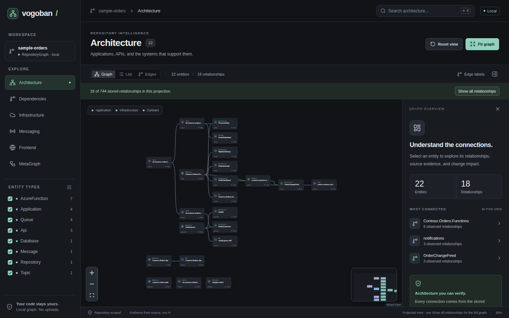
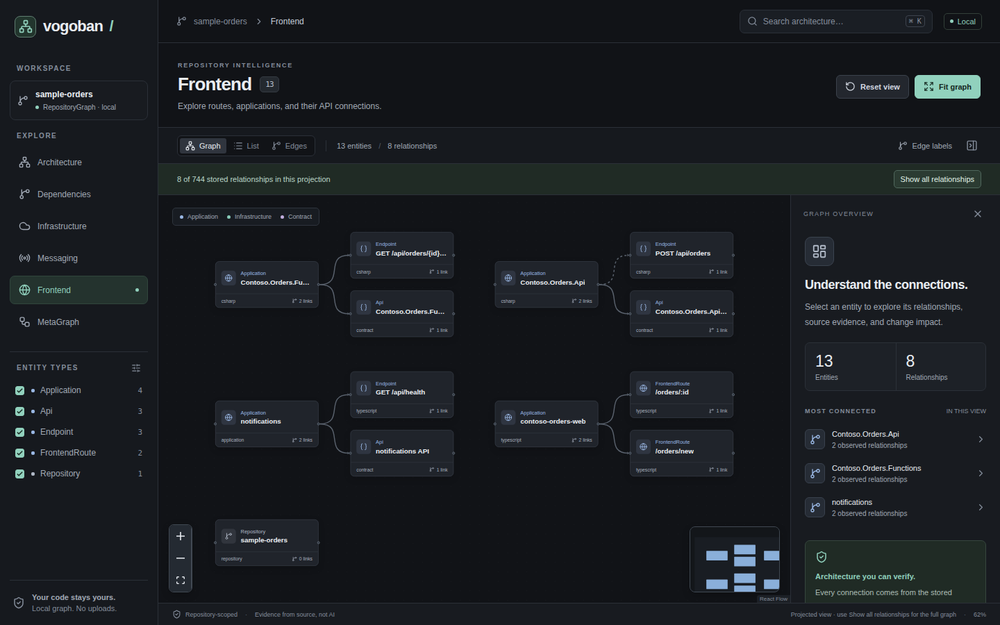
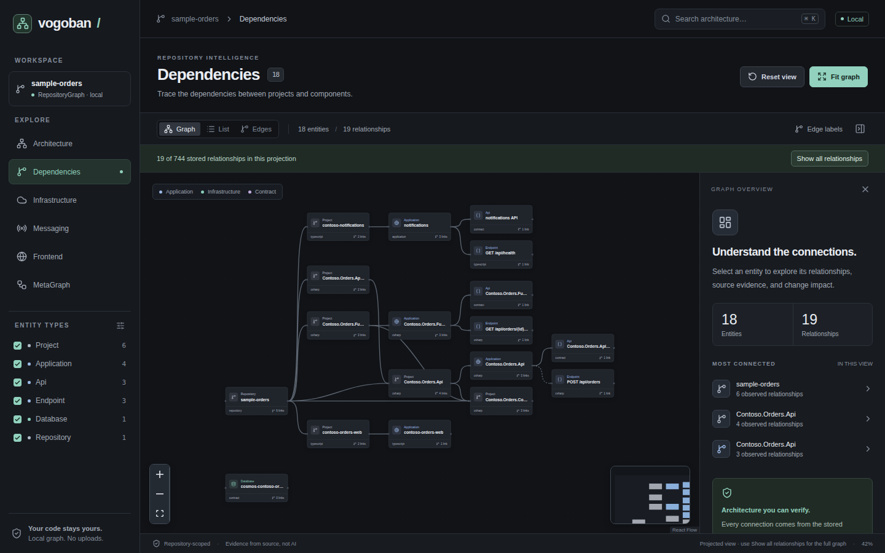

<div align="center">

# Vogoban

**Software Architecture Intelligence & Code Graph Engine**

A modern, provenance-aware graph engine for .NET, TypeScript/JavaScript frontends, and cloud infrastructure.

[](LICENSE)
[](https://bun.sh)
[](https://dotnet.microsoft.com/)
[](https://www.typescriptlang.org/)
[](docs/features/mcp.md)

<p align="center">
  <a href="#quickstart">Quickstart</a> •
  <a href="#key-capabilities">Key Capabilities</a> •
  <a href="#visual-workspace">Interactive UI</a> •
  <a href="#cli-tour">CLI Tour</a> •
  <a href="docs/README.md">Full Documentation</a>
</p>

---

</div>

Vogoban turns repositories into a deterministic, evidence-backed architecture graph: projects, assemblies, types, methods, HTTP endpoints, frontend routes, dependency injection registrations, messaging flows, and cloud declarations (Azure Functions, Cosmos DB, Bicep, ARM, Terraform, Docker, Helm, and Kubernetes).

Every connection carries **evidence**: the file and line it came from, which analyzer proved it, and how strong the proof is. **Nothing is invented**: unproven connections remain explicit unresolved references with reasons instead of guessed edges.

```text
React route /orders/new
  → NewOrderPage → createOrder()          (TypeScript compiler)
  → POST /api/orders → OrdersController   (route match, then Roslyn)
  → OrderSubmitted → Service Bus topic    (Roslyn + Azure SDK)
  → Function ProcessOrder → Cosmos DB     (Functions trigger, SDK)
  → infra/modules/data.bicep              (IaC declaration)
```

---

## 📸 Visual Workspace

Explore your architecture interactively with the built-in React Flow workspace:

```bash
vogoban graph .
```

<div align="center">
  
</div>

<p align="center">
  <em>Interactive graph inspection: filter by Architecture, Dependencies, Infrastructure, Messaging, or Frontend.</em>
</p>

<table align="center">
  <tr>
    <td align="center">
      <b>Frontend View</b><br/>
      
    </td>
    <td align="center">
      <b>Dependencies & Impact</b><br/>
      
    </td>
  </tr>
</table>

---

## ⚡ Quickstart

### 1. Requirements & Installation

- **Bun** ≥ 1.3
- **.NET SDK** 8+ (`dotnet` on `PATH`) for full Roslyn semantic analysis
- Linux x86_64, container, or WSL2

```bash
# Install globally from source package
bun install -g ./vogoban-0.18.0-src.tar.gz
export PATH="$HOME/.bun/bin:$PATH"
vogoban --version
```

### 2. Analyze a Repository

```bash
cd /path/to/repo
vogoban init .          # interactive preset wizard
vogoban analyze .       # builds local graph in ./.vogoban/graph.db
vogoban stats           # view entity, relationship, and evidence counts
vogoban graph .         # launch local React Flow UI
```

---

## 🚀 Key Capabilities

- **Zero Invention Discipline**: Compiler-backed facts (Roslyn & TypeScript compiler API) and explicit IaC/config declarations. Unresolved references surface with root-cause categories (`missing-package`, `analyzer-limitation`, etc.).
- **Frontend-to-Backend Tracing**: Statically traces React and Angular components, hooks, and HTTP client calls (`fetch`, `axios`) to ASP.NET Core endpoints and backend handlers.
- **Cloud & IaC Flow**: Resolves Azure Functions triggers/bindings, Azure SDK clients, and Infrastructure as Code (Bicep, ARM, Terraform, Aspire) into an end-to-end flow.
- **Change Impact & Blast Radius**: Predicts impacted components, categories (API, Code, Infrastructure, Service), and risk levels before committing changes.
- **Multi-Repo MetaGraph**: Connects independent repository graphs to track cross-repo messaging, API dependencies, and shared contracts.
- **AI & MCP Server**: Read-only Graph RAG tool suite for AI assistants via Model Context Protocol (MCP) over stdio or HTTP.

---

## 🛠️ CLI Tour

| Task | Command |
|---|---|
| **Search entities** | `vogoban find OrderService --kind Type` |
| **Inspect entity** | `vogoban show "MyApp.Services.OrderService"` |
| **Call graph** | `vogoban callers SubmitAsync --kind Method` |
| **Shortest path** | `vogoban path <from> <to>` |
| **Impact analysis** | `vogoban impact OrderSubmitted --kind Message` |
| **Endpoints** | `vogoban endpoints --method POST` |
| **Frontend chain** | `vogoban frontend-chain "/orders/new" --kind FrontendRoute` |
| **Azure flow** | `vogoban azure flow "/orders/new" --kind FrontendRoute` |
| **Incremental sync** | `vogoban graph sync` |
| **Export graph** | `vogoban export --format json --out graph.json` |

---

## 📚 Documentation

Detailed documentation and guides are available in [`docs/`](docs/README.md):

- [Getting Started & Installation](docs/getting-started.md)
- [Five-Minute Quickstart Tutorial](docs/quickstart.md)
- [Core Concepts & Evidence Levels](docs/concepts.md)
- [CLI Command Reference](docs/cli/overview.md)
- [Feature Guides](docs/README.md#features) (.NET, Frontend, Azure, Infrastructure, Contracts, Impact)
- [System Architecture](docs/architecture/overview.md)
- [Enterprise Platform](docs/advanced/enterprise.md)

---

## 📄 License

Vogoban is distributed under the terms of the [MIT License](LICENSE).
