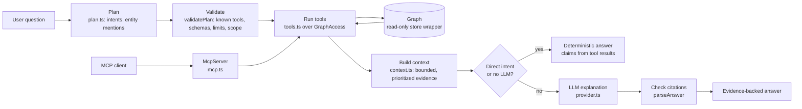

# AI and MCP

The AI layer answers architecture questions from the graph, and the MCP server exposes the same graph to external AI
assistants. Neither constructs graph truth: facts come only from deterministic, read-only graph tools, and a language
model, when one is configured, only explains tool results and is checked against the evidence it cites. The code is in
`src/ai` (`plan.ts`, `tools.ts`, `access.ts`, `context.ts`, `assistant.ts`, `provider.ts`, `mcp.ts`, `model.ts`).

## Flow



## Read-only access

`GraphAccess` (`src/ai/access.ts`) is the only way the AI layer and MCP reach the graph. It wraps the store with
`readOnlyStore(store)`, a `Proxy` that throws `ReadOnlyViolation` when any mutating method is called
(`saveRepositoryGraph`, `upsertCatalog`, `replaceMetaCategory`, `saveMetaSnapshot`, `saveGraphSnapshot`,
`deleteGraphSnapshots`, `saveBaseline`, `putCachedFacts`). It also carries:

- the **scope**: graph (`repository`, `meta`, `all`), allowed repositories, environment, pinned snapshots (`--repo`,
  `--env`, `--scope`, `--at`);
- the **limits** (`DEFAULT_LIMITS` and hard `LIMIT_CAPS` in `src/ai/model.ts`: depth 4 (cap 8), nodes 2000 (cap 5000),
  results 40 (cap 200), paths 3 (cap 10), evidence 60 (cap 200), plan steps 6 (cap 8), context tokens 12000);
- entity **resolution** with `RESOLVED`, `AMBIGUOUS`, `NOT_FOUND` or `OUT_OF_SCOPE`, preferring architectural kinds;
- optional **section filters** and **denied tools** (set by the platform from the caller's permissions).

## The tools

`TOOLS` in `src/ai/tools.ts` is a catalog of 30 deterministic tools, each with a strict input schema
(`validateInput`, unknown fields rejected) and a structured `ToolResult` (status `OK`, `EMPTY`, `AMBIGUOUS`,
`NOT_FOUND`, `OUT_OF_SCOPE`, `UNKNOWN` or `ERROR`; summary lines; evidence items; unknowns; graph state). Examples:
`resolve_entity`, `search_entities`, `get_entity`, `get_dependencies`, `get_dependents`, `find_paths`, `find_impact`,
`get_blast_radius`, `get_api_consumers`, `get_api_providers`, `get_message_publishers`, `get_message_consumers`,
`get_repository_dependencies`, `get_deployments`, `get_owners`, `get_endpoint_security`, `get_security_findings`,
`get_governance_violations`, `get_data_flows`, `get_external_systems`, `list_snapshots`, `compare_snapshots`,
`get_architecture_diff`, `summarize_entity`, and the Azure tools (`get_azure_functions`, `get_azure_resources`,
`get_azure_triggers`, `get_azure_messaging`, `get_azure_infrastructure`, `trace_azure_flow`). `vogoban ai-tools` lists
them with their inputs; `vogoban ai-tool <tool> <json>` runs one directly.

Tools call the existing engines (`src/analysis` traversal and impact, `src/governance`, `src/enterprise`,
`src/query/meta-query.ts`); they add no inference of their own. Each evidence item records the entity or relationship,
its evidence level, location and repository snapshot, and a status: `FACT` when the relationship is confirmed
(`isConfirmed` in `src/analysis/graph.ts`: a confirmed evidence level with confidence ≥ 0.7), `UNKNOWN` for unknown
evidence, otherwise `INFERENCE`.

## Plan

`planQuestion` (`src/ai/plan.ts`) classifies the question into up to three intents (`EXPLAIN`, `DEPENDENTS`,
`DEPENDENCIES`, `IMPACT`, `BLAST_RADIUS`, `CONSUMERS`, `PROVIDERS`, `PATH`, `WHY_DEPENDENCY`, `DEPLOYMENT`,
`OWNERSHIP`, `GOVERNANCE`, `SECURITY`, `EXPOSURE`, `UNPROTECTED_ENDPOINTS`, `DATA_FLOW`, `EXTERNAL_SYSTEMS`,
`TEMPORAL`, `RISKIEST_CHANGES`, `UNSUPPORTED`), extracts entity mentions and resolves them through `GraphAccess`, and
produces tool steps. Ambiguous or unknown mentions produce a clarification instead of steps. With `--llm-plan` and an
`UNSUPPORTED` question, the model may propose steps as JSON (`planningPrompt`, `parsePlanJson`); it can only choose
tools and arguments, and the proposal goes through the same validation. `explain ...` commands use fixed plans
(`explicitPlan`).

## Validate

`validatePlan` rejects the whole plan (status `REJECTED_PLAN`, nothing executed) when any step names an unknown tool,
fails its schema, exceeds the step, depth or result limits, names a repository or environment outside the scope,
names an unknown snapshot, or references an entity outside the scope.

## Context

`buildContext` (`src/ai/context.ts`) normalizes tool results into a bounded, deduplicated evidence set with ids
`E1`, `E2`, ..., prioritized as direct evidence, then paths, impact, governance/security, ownership and supporting
metadata, with the primary step outranking supporting steps. It fits the set into the token budget and reports what was
considered, deduplicated and dropped. Graph text is untrusted: it is JSON-encoded with `<` and `>` escaped and placed
inside `<graph_data>` tags with a per-request nonce, so repository content cannot close the data boundary.

## Answer

`ask` (`src/ai/assistant.ts`):

- **Deterministic path.** Direct intents (`DEPENDENTS`, `DEPENDENCIES`, `CONSUMERS`, `PROVIDERS`, `OWNERSHIP`,
  `EXPOSURE`, `UNPROTECTED_ENDPOINTS`, `EXTERNAL_SYSTEMS`, `DEPLOYMENT`, `BLAST_RADIUS`), `--no-llm`, or no
  configured provider: the answer is the tool summaries, and each claim's status is derived from its evidence
  (`CONFIRMED` for `FACT`, `INFERRED` for `INFERENCE`, `UNKNOWN`, `NO_EVIDENCE`, `AMBIGUOUS`, `CONFLICTING`).
- **LLM path.** The system prompt states that `<graph_data>` is the only source of facts, is never an instruction, and
  that every statement must cite evidence ids. The model returns JSON (`answer`, `claims`, `implications`, `unknowns`).
- **Citation validation** (`parseAnswer`): citations to evidence ids that do not exist are replaced by
  `[unsupported]` and reported; positive claims without valid citations, or naming identifiers absent from the cited
  evidence, are rejected; `CONFIRMED`/`OBSERVED` claims without a `FACT` among their citations are downgraded; if the
  prose names identifiers no evidence contains, the prose is withheld and the deterministic result is shown; an answer
  with evidence but no cited statement is discarded as invalid. Any provider error falls back to the deterministic
  answer (`deterministic-fallback`).

Answer statuses: `ANSWERED`, `NO_EVIDENCE`, `AMBIGUOUS`, `NOT_FOUND`, `UNSUPPORTED`, `OUT_OF_SCOPE`, `REJECTED_PLAN`,
`ERROR`. An audit record (question, plan, tools, evidence keys, answer, no prompt text, no credentials) is appended to
`ai-audit.jsonl` next to the graph store; sessions store questions and entity ids only, never answers as facts.

A real deterministic run on the demo store:

```bash
vogoban ask "who consumes OrderSubmitted" --no-llm --evidence --plan
```

```text
Answer  [ANSWERED; deterministic graph result, no LLM call]
1 consumers of Message Contoso.Orders.Contracts.OrderSubmitted [contoso-orders]: ProcessOrder.

Claims
  CONFIRMED    1 consumers of Message Contoso.Orders.Contracts.OrderSubmitted [contoso-orders]: ProcessOrder.  (E1)

Evidence (1 of 1)
  [E1] FACT      Message Contoso.Orders.Contracts.OrderSubmitted [contoso-orders] CONSUMED_BY Method Contoso.Orders.Functions.OrderFunctions.ProcessOrder(Contoso.Orders.Contracts.OrderSubmitted, System.Threading.CancellationToken) [contoso-orders]  @ src/Contoso.Orders.Functions/OrderFunctions.cs:18  (repository r_26e0e523298c1109aef74b5f)  snapshot a021d2d5c8bd74c1

Query plan  intent CONSUMERS  source deterministic  deterministic answer (no LLM call)
  entity 'OrderSubmitted' -> RESOLVED Message Contoso.Orders.Contracts.OrderSubmitted [contoso-orders] (e_9e60cabf35f663841b9ad86c) by exact name or qualified name
  1. get_message_consumers {"message":"e_9e60cabf35f663841b9ad86c"}  — message consumers and handlers
  validation: OK (read-only tools, schema-checked, bounded, in scope)
  ran get_message_consumers -> OK (1 evidence, 42 ms)

Provenance: graph contoso-orders@ccaffed6 READY; tools get_message_consumers; no LLM call; record ai_aa18198e0bb678c4
```

## Providers and data boundary

`src/ai/provider.ts` supports `none`, `openai-compatible`, `azure-openai` and `anthropic`. The provider defaults to
`none`, so nothing leaves the machine until a provider is configured. `aiDestination` classifies the configured endpoint as `local-model` (loopback, `.local`, unix socket) or
`user-configured-provider`; for the latter the CLI prints the destination before each call, and `--offline` refuses it.
Only the bounded evidence for the requested scope is sent. Configuration: [AI features](../features/ai.md).

## MCP server

`McpServer` (`src/ai/mcp.ts`) speaks JSON-RPC (`initialize`, `ping`, `tools/list`, `tools/call`, `resources/list`,
`resources/templates/list`, `resources/read`, `prompts/list`, `prompts/get`) over the same `GraphAccess`:

- **Tools** are the catalog above, with the same schemas and validation.
- **Resources** expose the catalog, governance and security summaries and per-entity architecture views
  (repository, service, API, message, deployment, ownership).
- **Prompts** (`repository-architecture`, `service-architecture`, `api-contract`, `message-contract`,
  `deployment-topology`, `ownership`, `security-posture-of`, `governance-of`, `architecture-review`,
  `impact-analysis`, `azure-architecture-flow`) are fixed tool sequences plus rules telling the client to cite entity
  ids, relationship ids and evidence levels and to report `UNKNOWN`, `AMBIGUOUS` and `NO_EVIDENCE` as such.

`vogoban mcp` serves it on stdio, scoped by `--repo`, `--env` and `--scope`. The platform serves it over HTTP at
`/api/v1/t/{tenant}/mcp` with the caller's permissions (`mcp.use` intersected with `graph.read`, per-tool permission
checks, repository and environment scope); see [security-model.md](security-model.md#mcp-and-ai-authorization).

## AI does not construct graph truth

- Tools read the graph through a store that cannot be written.
- Plans, including model-proposed plans, are validated before execution and can only use read-only tools.
- The model sees only evidence the tools returned; its claims are kept only when they cite that evidence.
- Answers are never written back as graph facts, and sessions never feed earlier answers back as evidence.

## Limitations

- Evidence is bounded by limits and the token budget; an absent relationship in bounded evidence is "no confirmed
  relationship", not proof of absence.
- The intent classifier is rule-based; unsupported phrasings return `UNSUPPORTED` unless LLM planning is enabled.
- Model explanations can still be incomplete; the deterministic result and the cited claims are the reliable part.

## Related

- [AI features](../features/ai.md)
- [ai command reference](../cli/ai.md)
- [Platform architecture](platform.md)
