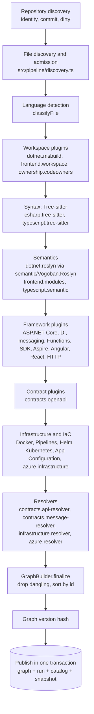

# Analysis pipeline

`vogoban analyze <path>` runs one deterministic pipeline: discover and admit files, parse syntax, compute semantics,
apply framework, contract, infrastructure and Azure rules, resolve cross-analyzer links, and publish the result in a
single transaction. `graph sync`, `analyze-repo`, `analyze-all` and the platform worker all run this same pipeline.
The entry point is `analyzeRepository` in `src/pipeline/analyze.ts`.

## Stages

## Repository discovery

`loadConfig` reads `vogoban.json` from the repository root (`src/pipeline/config.ts`); `discoverRepository`
(`src/pipeline/discovery.ts`) runs Git to find the root (`rev-parse --show-toplevel`), remote, branch, `HEAD` commit
and dirty state, and derives the repository identity ([identity.md](identity.md#repository-identity)). A catalog entry
is upserted with status `ANALYZING`; it becomes `READY` on success or `FAILED` (with `lastError`) on failure. When a
`.git` directory exists but Git cannot answer, `GitStateError` stops the analysis before anything is written.

## Discovery and file admission

`discoverFiles`:

1. Lists files with `git ls-files -co --exclude-standard -z` (tracked plus untracked, honouring `.gitignore`), or walks
   the directory when Git is not available. Paths under `.git`, `bin`, `obj`, `node_modules`, `.vs`, `.idea`,
   `.vogoban`, `packages` and `TestResults` are dropped.
2. Skips gitlinks (submodules) and nested Git repositories with a `file-skipped` diagnostic: their contents belong to
   another repository's graph.
3. `lstat`s every path; **symbolic links are never followed** (a `file-skipped` diagnostic is recorded when the link
   would otherwise have been analyzed).
4. Classifies the file (next section). Unclassified files (`other`) are not admitted.
5. Excludes frontend build output, vendored libraries and bundles (`dist`, `build`, `out`, `.next`, `wwwroot/lib`,
   `*.min.js`, ...), one `file-skipped` diagnostic per directory, unless `vogoban.json` `frontend.include` names them;
   `frontend.exclude` removes more.
6. Refuses files larger than `VOGOBAN_MAX_SOURCE_FILE_BYTES` (default 8 MiB) with
   `FILE_SKIPPED_RESOURCE_LIMIT`.
7. Reads the bytes once, hashes them with SHA-256, and marks generated files (`*.g.cs`, `*.designer.cs`,
   `<auto-generated>`, NSwag/openapi-generator/`@generated` headers).

Each admitted file becomes a `File` entity with `CONTAINS` (evidence `EXACT`) from the repository, and a row in the
`files` table with hash, size, category and language.

## Language detection

`classifyFile` maps a path to a `FileCategory` (`source`, `project`, `solution`, `config`, `infrastructure`,
`pipeline`, `contract`, `other`) and a language:

| Pattern | Category | Language |
|---|---|---|
| `*.cs` | source | `csharp` |
| `*.razor`, `*.cshtml` | source | `razor` |
| `*.csproj`, `*.fsproj`, `*.vbproj`, `*.props`, `*.targets` | project | `msbuild` |
| `*.ts`, `*.tsx`, `*.mts`, `*.cts` / `*.js`, `*.jsx`, `*.mjs`, `*.cjs` | source | `typescript` / `javascript` |
| `package.json` | project | `npm` |
| `tsconfig*.json`, `jsconfig*.json` | config | `tsconfig` |
| `*.sln`, `*.slnx`, `*.slnf` | solution | – |
| `appsettings*.json`, `web.config`, `launchSettings.json`, `.env*` | config | `json`, `dotenv` |
| `azure-pipelines*.yml`, `.github/workflows/*`, `*/pipelines/*` | pipeline | `yaml` |
| `openapi*`, `swagger*`, `asyncapi*` (`.json`/`.yaml`) | contract | `json`/`yaml` |
| `Dockerfile*`, `*.dockerfile`, `compose*.yaml` | infrastructure | `docker` |
| `Chart.yaml`, `values*.yaml`, files under `charts/`, `helm/`, `k8s/`, `kubernetes/`, `manifests/`, `deploy/` | infrastructure | `yaml` |
| `*.bicep`, `*.tf` / `*.bicepparam` / `*.tfvars` | infrastructure | `bicep`, `tf` / `bicepparam` / `tfvars` |
| `host.json`, `function.json`, `local.settings*.json` | config | `azure-functions` |
| `azure.yaml` | config | `azd` |

Content sniffing then promotes otherwise unclassified JSON/YAML files: ARM templates (by `$schema`), OpenAPI documents
(`openapi:`/`swagger:` marker), Kubernetes manifests (`apiVersion` + `kind`) and pipelines (`stages:`/`jobs:`/`steps:`).
An `.html` file next to a same-named `.ts` file is an Angular template; data files next to `.bicep` files are
`bicep-content` (for `loadJsonContent`/`loadTextContent`). `vogoban.json` can name OpenAPI documents, pipelines and Helm
value files explicitly.

## Plugin execution order

`defaultPlugins()` (`src/plugins/registry.ts`) returns 38 plugins. `analyzeDiscovered` sorts them with a **stable sort
by category** in `PLUGIN_CATEGORIES` order (`src/plugins/types.ts`): `workspace`, `language`, `semantic`,
`framework`, `contract`, `infrastructure`, `resolver`. Within a category the registry order is kept. The effective order
(recorded in every run's `plugin_versions`) is:

| # | Category | Plugins |
|---|---|---|
| 1 | workspace | `dotnet.msbuild`, `frontend.workspace`, `ownership.codeowners` |
| 2 | language | `csharp.tree-sitter`, `typescript.tree-sitter` |
| 3 | semantic | `dotnet.roslyn`, `frontend.modules`, `typescript.semantic` |
| 4 | framework | `dotnet.applications`, `dotnet.dependency-injection`, `dotnet.aspnetcore`, `dotnet.configuration`, `azure.functions`, `azure.sdk`, `azure.aspire`, `azure.typescript`, `dotnet.http-clients`, `frontend.http`, `frontend.angular`, `frontend.react`, `dotnet.messaging.mediatr`, `dotnet.messaging.masstransit`, `dotnet.messaging.nservicebus`, `dotnet.messaging.azure-service-bus`, `dotnet.messaging.rabbitmq`, `dotnet.messaging.kafka`, `dotnet.messaging.configured` |
| 5 | contract | `contracts.openapi` |
| 6 | infrastructure | `infrastructure.docker`, `infrastructure.azure-pipelines`, `infrastructure.helm`, `infrastructure.kubernetes`, `infrastructure.app-configuration`, `azure.infrastructure` |
| 7 | resolver | `contracts.api-resolver`, `contracts.message-resolver`, `infrastructure.resolver`, `azure.resolver` |

Plugins communicate through the shared `GraphBuilder` and through typed artifacts in the `ArtifactStore`
(`artifactKey<T>(name)`), for example `DOTNET_PROJECTS`, `CSHARP_SYNTAX` and `DOTNET_SEMANTIC` in
`src/dotnet/artifacts.ts`, `HTTP_CALLS` in `src/contracts/http-calls.ts`. A plugin that throws is caught: the error
becomes a `plugin-failed` diagnostic in the matching category, and the remaining plugins still run. See
[analyzers.md](analyzers.md) for inputs and outputs per plugin.

## Syntax (Tree-sitter)

Language plugins (`LanguagePlugin` in `src/plugins/types.ts`) are run by `runLanguagePlugin`: for every admitted file
with a matching extension the plugin's `parse(path, source)` returns facts and syntax errors. The first five syntax
errors per file become `syntax-error` diagnostics; a thrown parse becomes `parse-failed`. Facts for all files are stored
under the plugin's `syntaxArtifact` for later plugins.

- `csharp.tree-sitter` (`src/dotnet/csharp-syntax.ts`, `tree-sitter-c-sharp`) extracts declarations, usings and
  attributes. When semantic analysis is unavailable, `src/dotnet/syntax-graph.ts` turns these into declarations.
- `typescript.tree-sitter` (`src/frontend/syntax.ts`, `tree-sitter-typescript`/`tree-sitter-javascript` through
  `web-tree-sitter`) extracts declarations, exports, imports, re-exports, `require`, dynamic `import()` and module
  references. It always runs, so syntax facts survive `--no-semantic`.

## Semantics

### .NET: Roslyn

`dotnet.msbuild` (`src/dotnet/projects.ts`, `src/dotnet/msbuild.ts`) first parses solutions and project files
**statically** (properties, items, `PackageReference`, `ProjectReference`, central package versions, implicit
usings, `project.assets.json`) into `DotnetProject` artifacts. `dotnet.roslyn` (`src/dotnet/roslyn.ts`) then:

1. Locates the .NET SDK (`VOGOBAN_DOTNET`, `dotnet` on `PATH`, `~/.dotnet/dotnet`). Without one, or with
   `--no-semantic`, it records `semantic-unavailable` and the syntax graph is used.
2. Builds `semantic/Vogoban.Roslyn` once (`dotnet build -c Release`) when the stamped source hash differs; this needs
   network access once for NuGet.
3. Computes a cache key per project (see [Caching](#caching)) and serves hits from the fact cache.
4. Sends the cache misses, plus their project references, to the analyzer process.

The process protocol (`semantic/Vogoban.Roslyn/Program.cs`, `Protocol.cs`):

| Channel | Format |
|---|---|
| stdin | One JSON `AnalysisRequest`: `repositoryRoot`, `maxSourceFileBytes`, `projects[]` (id, name, project path, assembly name, directory, source files, project references, target frameworks with reference paths, framework references, global usings, define constants, nullable, output type, generated sources) |
| stdout | JSONL: one `ProjectResult` per project (symbols, relations, invocations, assignments, attributes, unresolved facts, compiler diagnostics, assembly uses, framework context, skipped sources, success flag) |
| stderr | JSONL log events (`{"event": ...}`), forwarded to the Vogoban logger |

Projects are compiled in dependency order (a depth-first visit of `projectReferences`), one `CSharpCompilation` per
target framework, with per-framework results merged (`FrameworkMerge.cs`). When MSBuild evaluation is enabled,
`MsBuildEvaluation.cs` evaluates the project with `Microsoft.Build.Locator` to obtain the real `Compile` items,
package references and properties; `VOGOBAN_MSBUILD_EVALUATION=0` (set by `--untrusted`, CI commit-range sync and
static-only workers) disables it and the statically parsed project is used. Every file the analyzer is about to read is
checked by `RepositoryFiles.Validate` (inside the root by path segment, no symlink component, regular file, below the
size limit); a rejected file is reported as `source-rejected` and never opened.

`src/dotnet/semantic-graph.ts` turns results into entities (`Type`, `Method`, `Property`, `Field`, `Event`,
`Parameter`, `Namespace`, `Assembly`, external symbols) and `COMPILER_RESOLVED` relationships. Secret-shaped literal
values are removed from the facts (`redactSecretValues`) before they are cached or emitted.

### TypeScript / JavaScript: the TypeScript compiler API

`frontend.modules` (`src/frontend/modules.ts`, `src/frontend/resolve.ts`) resolves module specifiers with Vogoban's own
resolver, restricted to discovered repository files (relative paths, index files, extension substitution,
`paths`/`baseUrl`, workspace packages). `typescript.semantic` (`src/frontend/semantic.ts`, `src/frontend/program.ts`)
builds one TypeScript program per npm package with TypeScript 6.0.3 (`typescript-compiler` dependency) over a virtual
file system that serves only discovered files; tsconfig compiler plugins, `typeRoots` and `types` are ignored and
`node_modules` is never read. JavaScript is compiled in `allowJs` mode. Results are recorded as graph operations and
cached per package. Details: [frontend-engine.md](frontend-engine.md).

## Framework plugins

Framework plugins read syntax and semantic artifacts and apply framework rules: application detection, DI
registrations, ASP.NET Core controllers and minimal APIs, middleware, authorization, configuration keys, HTTP clients,
messaging libraries, Azure Functions, Azure SDK clients, Aspire AppHosts, Node v4 Functions, frontend HTTP calls,
Angular and React. They emit domain entities (`Application`, `Endpoint`, `ServiceRegistration`, `Message`,
`AzureFunction`, `FrontendRoute`, ...) and facts for the resolvers (for example `HttpCallFact` in `HTTP_CALLS`).

## Contracts, infrastructure and Azure IaC

`contracts.openapi` parses OpenAPI 2/3 documents into `ContractDocument`, `Api`, `ApiOperation` and `ApiSchema`.
The infrastructure plugins parse Dockerfiles and Compose files, Azure Pipelines YAML, Helm charts (with a static template
engine, `src/infrastructure/helm-template.ts`), Kubernetes manifests and App Configuration. `azure.infrastructure`
parses Bicep, `.bicepparam`, ARM and Terraform files (`src/azure/iac`) and evaluates them symbolically
(`src/azure/iac/evaluate.ts`) into declared `AzureResource` entities. Nothing is rendered, deployed or executed.
Details: [azure-engine.md](azure-engine.md).

## Fact extraction, identity resolution and relationship construction

Every plugin turns facts into `EntityDraft`s and `RelationshipDraft`s with a semantic key
([identity.md](identity.md)) and a provenance record. The resolver category runs last because it links facts from
different analyzers:

| Resolver | Links |
|---|---|
| `contracts.api-resolver` | HTTP calls (.NET `HttpClient`, Refit, frontend `fetch`/axios/`HttpClient`) → `ApiOperation` (`CALLS_ENDPOINT`), external hosts (`CALLS_EXTERNAL_API`); code-first `Api`/`ApiOperation` from endpoints; OpenAPI operations ↔ implementing endpoints |
| `contracts.message-resolver` | Message contracts, publishers, consumers and transports across messaging plugins; schema conflicts |
| `infrastructure.resolver` | Applications ↔ Dockerfiles, images, pipelines, Helm releases, Kubernetes workloads, services, ingresses, configuration |
| `azure.resolver` | Function bindings and SDK calls → logical data-plane resources → declared IaC/Aspire resources (`DECLARED_BY`), triggers, hosting, configuration supply, APIM → `ApiOperation` |

When a resolver cannot find exactly one target it records an unresolved reference.

## Evidence

Each draft carries an evidence level chosen by the extractor or resolver. `GraphBuilder` keeps the strongest level
when several facts produce the same relationship. See [evidence-provenance.md](evidence-provenance.md).

## Graph publication

After the last plugin:

1. `graph.finalize()` removes relationships with a missing endpoint (diagnostic `dangling-relationship`) and unresolved
   references with a missing source, then sorts every collection by id.
2. The run record is built (counts, total duration, `ms:<plugin>` timings, plugin versions).
3. The graph version is computed over the sorted batch ([repository-graph.md](repository-graph.md#graph-version-and-snapshots)).
4. Inside `store.transaction(...)`: `saveRepositoryGraph` reconciles the batch into the store, the catalog entry is set
   to `READY` with commit, run, graph version and analyzer version, the build-evaluation mode is saved
   (`evaluation:<repoId>` baseline, used by the incremental planner), and a graph snapshot is captured.

If anything in step 4 fails, SQLite rolls back the whole transaction: the previous graph, catalog entry and snapshot
stay together, and the catalog is marked `FAILED` with the error. A plugin failure is not a storage failure: the graph
is published with a `plugin-failed` diagnostic.

## Caching

The `fact_cache` table holds one row per `scope` (primary key) with a `cache_key` and a JSON `payload`. A lookup hits
only when both scope and key match, so a changed input changes the key and the stale payload is never returned; the
next `put` for that scope replaces it.

| Producer | Scope | Key |
|---|---|---|
| Language plugins (`runLanguagePlugin`) | `syntax\|<plugin id>\|<repoId>\|<path>` | `<plugin version>\|<file sha256>` |
| `dotnet.roslyn` | `semantic\|<repoId>\|<project entity id>` | SHA-256 of plugin version, analyzer source hash, MSBuild evaluation mode, source size limit, the project description, Aspire generated metadata, every source file's path and hash, skipped files under the project directory, target frameworks and reference paths, and the keys of all referenced projects (transitively) |
| Frontend semantic/framework/HTTP plugins | `frontend\|<plugin id>\|<repoId>\|<package.json path>` | `<version>\|<project key>`; the project key covers analyzer source hash, `package.json`, tsconfig chain, applications, Angular configuration and the hash of every file in the program's import closure and templates |
| `azure.typescript` | `azure-typescript\|<repoId>\|<package path>` | hash of Azure analyzer version and the frontend project key |
| `azure.infrastructure` | `azure-iac\|<file extension>` | hash of IaC parser version, Azure plugin version and file hash |
| MetaGraph build | `meta-input\|<resolver>@<version>\|<repoId>` | the repository's graph version |

Two global guards: every Azure and frontend plugin version embeds a hash of its analyzer sources, so a code change in
an analyzer changes its version (and forces a full rebuild in `graph sync`); and the store records a
`fact_cache_generation` (`FACT_CACHE_GENERATION` in `src/infrastructure/common.ts`). When the generation changes
(for example after a redaction rule change) the whole cache is purged on first open; a read-only store that cannot be
purged never serves cached facts.

Known limitation (0.18.0): the `azure.infrastructure` scope is per file *extension*, not per file, so a repository with
several `.bicep` files keeps only the last parsed `.bicep` file in the cache (the demo store has a single
`azure-iac|bicep` row for five Bicep files). Results stay correct because the key includes the file hash; only the
reuse is lost, and IaC files are re-parsed on each run.

## Limitations

- MSBuild evaluation (the default for local `analyze`) runs repository build logic during evaluation. Use
  `--untrusted` for repositories you do not trust (see [security-model.md](security-model.md)).
- Without restored NuGet packages, external types are unbound and produce unresolved references
  (`missing-package`).
- Python, Java and PowerShell code are not analyzed (Functions in those languages are found only through
  `function.json`).

## Related

- [Analyzers](analyzers.md)
- [Incremental engine](incremental-engine.md)
- [RepositoryGraph](repository-graph.md)
- [analyze command](../cli/analyze.md)
