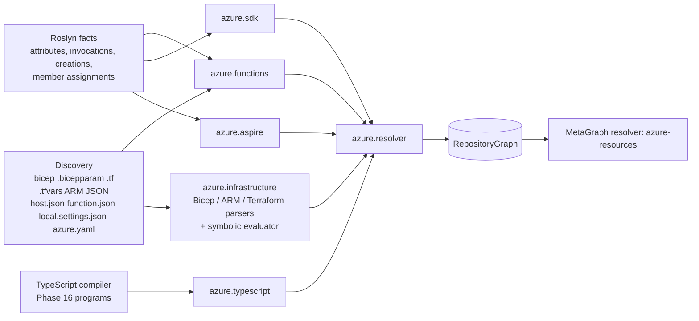

# Azure engine

The Azure engine is the set of analyzers that turn Azure Functions, Azure SDK usage, .NET Aspire AppHosts and
infrastructure as code (Bicep, ARM, Terraform, `azure.yaml`) into RepositoryGraph facts, and link code to the
resources it uses. It is static repository analysis: it does not inspect or modify live Azure subscriptions. This page
carries the internals: plugins, model, the symbolic IaC evaluator, resolver rules, identity, caching, security and the
measured verification results. Usage is in [Azure features](../features/azure.md) and the
[azure command reference](../cli/azure.md).

Nothing is deployed, nobody is authenticated to Azure, and no Azure CLI, Azure PowerShell, Bicep CLI, Terraform,
azd, Aspire AppHost, Functions host, npm script or repository code is executed. Analysis needs no network.

Azure is one more analyzer domain feeding the existing RepositoryGraph. Azure facts use the same entity and
relationship identity, provenance, evidence levels, unresolved references, diagnostics, reconciliation, incremental
planner, fact cache, snapshots, MetaGraph, impact, governance, security, ownership, query engine, AI tools and MCP
server as everything else. There is no Azure graph, store, traversal engine or incremental engine.

## Plugins



| Plugin | Category | Input | Output |
|---|---|---|---|
| `azure.functions` | framework | Roslyn symbols/attributes, `host.json`, `local.settings*.json`, `function.json` | `AzureFunction`, HTTP `Endpoint`s, timer triggers, Durable relationships, settings |
| `azure.sdk` | framework | Roslyn invocations, object creations, field assignments, DI registrations | Azure SDK usage facts, credentials (`AUTHENTICATES_WITH`), EF Core SQL connections |
| `azure.aspire` | framework | Aspire AppHost invocations | Aspire `AzureResource`s, `CONNECTS_TO`, `DEPLOYED_TO`, role assignments |
| `azure.typescript` | framework | Phase 16 TypeScript programs of packages that depend on `@azure/*` | Node v4 Functions (`app.serviceBusTopic(...)`), JS/TS SDK usage |
| `azure.infrastructure` | infrastructure | Bicep, `.bicepparam`, ARM templates/parameter files, Terraform/`.tfvars`, `azure.yaml` | `AzureResource`s, hierarchy, dependencies, app settings, hosting, identity, roles, networking, observability, APIM, Event Grid |
| `azure.resolver` | resolver | all of the above | logical data-plane resources, `TRIGGERS`/bindings/SDK edges, `DECLARED_BY` code → IaC/Aspire, hosting, config supply, APIM → API operations |
| `metagraph.azure-resources` | MetaGraph | every repository's Azure facts | `SHARES_RESOURCE`, cross-repository `DECLARED_BY`, repository dependencies |

Source files: `src/azure/functions.ts`, `function-attributes.ts` (Functions), `src/azure/sdk.ts` (SDK), `src/azure/aspire.ts`
(Aspire), `src/azure/typescript.ts` (Node/TypeScript), `src/azure/infrastructure.ts` with `src/azure/iac/{bicep,arm,terraform,terraform-azurerm,evaluate,model}.ts`
(IaC), `src/azure/resolver.ts` (linking), `src/azure/catalog.ts` (AVM module catalog and identity keys),
`src/azure/values.ts` (static value states), `src/azure/common.ts`, `src/azure/source-hash.ts`, and
`src/metagraph/azure.ts` (cross-repository). Read-side views are in `src/query/azure-query.ts`, which derives nothing new:
every row is a stored relationship.

## Model

Two entity kinds were added; everything else reuses existing kinds.

- **`AzureFunction`**: one per function (`[Function]`, `[FunctionName]`, Durable `[DurableTask]` classes, `function.json`,
  Node v4 `app.*`). Identity: repository + owning project + function name. A rename is a new identity. Node v4
  registrations are recognised in ESM (`import { app } from "@azure/functions"`, namespace imports) and CommonJS
  (`const { app } = require("@azure/functions")`, `const functions = require("@azure/functions"); functions.app.http(...)`,
  `import f = require(...)`), with the `handler` shorthand and `extraOutputs` held in a const; mixed `.mjs`/`.cjs`
  packages and the legacy `function.json` → `scriptFile` model work alongside (D-08). Only string-literal `require()` is
  followed; nothing is executed and `node_modules` is never read.
- **`AzureResource`**: a declared Azure resource (Bicep, ARM, Terraform, Aspire), a system-assigned identity, an Event
  Grid subscription, or a Functions runtime trigger source with no provisioned resource (`timer-schedule`). Metadata
  carries `armType`, normalized `azureKind`, `service`, `name`, `nameState`, `declaredIn`, `declaredState`
  (`DECLARED` / `REFERENCED` for `existing`/`data`), files, AVM module and security-relevant properties.
- Data-plane resources that code reads, writes, publishes to or is triggered by are **logical resources** in existing
  kinds: Service Bus queue/topic (`Queue`, shared identity with the messaging plugins: `transport|repo|azure-service-bus|queue-or-topic|name`),
  subscription (`Queue`), Event Hub and Event Grid topic (`Topic`), storage queue (`Queue`), blob container and table
  (`Storage`), Cosmos database/container and SQL database (`Database`). Their `resolution` is
  `exact`, `statically-derived`, `partially-resolved` or `unresolved`.
- HTTP-triggered functions also produce `Endpoint`s, so the existing API resolver creates `ApiOperation`s and Phase 16
  frontend calls resolve to Functions exactly like to ASP.NET Core endpoints. App settings are `Configuration` /
  `SecretReference` entities; connection settings are `ConfigurationReference`s shared with the .NET configuration plugin.
- Functions projects are `Application`s (`applicationKind: azure-functions`) detected from `FunctionsApplication.CreateBuilder`,
  `ConfigureFunctionsWorkerDefaults`/`ConfigureFunctionsWebApplication`, `FunctionsStartup` and function methods, which are
  also application entry points.

Relationships (group `azure` in `src/graph/model.ts`, each with an impact rule in `src/analysis/semantics.ts`), drawn in
message/data-flow direction:

| Relationship | From → to |
|---|---|
| `TRIGGERS` | HTTP `Endpoint`, timer, queue/subscription/Event Hub/blob container/storage queue, Event Grid subscription → `AzureFunction` |
| `CHANGE_FEED` | Cosmos container → Function (trigger) or caller (SDK change-feed processor) |
| `SUBSCRIBES_TO` | topic → subscription; Event Grid topic → event subscription |
| `PUBLISHES_TO`, `PUBLISHES_EVENT`, `SENDS_MESSAGE` | publisher method/function → queue/topic/Event Hub/Event Grid topic |
| `CONSUMES_FROM`, `RECEIVES_MESSAGE`, `CONSUMED_BY` | consumer ↔ broker (SDK receivers, processors; Event Hub consumers) |
| `READS_FROM`, `WRITES_TO` (existing) | method/function → data resource (bindings and SDK operations) |
| `INVOKES_ACTIVITY`, `STARTS_ORCHESTRATION`, `CALLS_SUB_ORCHESTRATION`, `USES_DURABLE_ENTITY` | Durable Functions |
| `AUTHENTICATES_WITH` | method → Microsoft Entra ID (credential type in metadata) |
| `USES_IDENTITY`, `HAS_ROLE_ON`, `READS_SECRET_FROM` | identity, role assignments, Key Vault |
| `CREATES`, `REFERENCES_RESOURCE`, `USES_MODULE`, `DEPENDS_ON_RESOURCE`, `CONTAINS_RESOURCE` (existing) | IaC file → resource, module use, dependencies, hierarchy |
| `DECLARED_BY` | logical resource → declaring IaC / Aspire resource |
| `HOSTED_ON`, `DEPLOYED_TO` | application/function → App Service/Function App/Container App/plan/environment |
| `OBSERVED_BY`, `LOGS_TO` | application resource → Application Insights → Log Analytics |
| `IN_SUBNET`, `PRIVATE_ENDPOINT_FOR`, `ROUTES_TRAFFIC_TO` | networking; Front Door/App Gateway/APIM → backend; APIM operation → `ApiOperation` |
| `SHARES_RESOURCE` (MetaGraph) | the same Azure resource used by code in two repositories |

`ORCHESTRATES` from the original wish list is not emitted: orchestrations are represented by the Durable edges above.

## Azure Functions

- **Models**: .NET isolated worker, .NET in-process (WebJobs attributes; binding direction from `out`, `IAsyncCollector`,
  `ICollector`, `FileAccess.Write`), legacy `function.json` (any language, function name = directory), and the Node.js v4
  programming model (`app.http`, `app.timer`, `app.serviceBusQueue/Topic`, `app.eventHub`, `app.storageQueue/Blob`,
  `app.cosmosDB`, `app.eventGrid`, `output.*` extra outputs). Python v2 decorators are not analyzed.
- **Triggers**: HTTP (route with `host.json` `routePrefix`, methods, authorization level), Timer (schedule or `%Setting%`,
  `RunOnStartup`), Service Bus (queue, or topic + subscription, connection, sessions), Event Hubs (hub, consumer group,
  connection), Event Grid (resolved through declared event subscriptions), Blob (container, path pattern, connection,
  Event Grid source), Queue, Cosmos DB (database, container, lease container, connection), SQL, SignalR, Kafka, RabbitMQ,
  Warmup, Durable orchestration/activity/entity.
- **Bindings**: inputs and outputs on parameters, on the method / `[return:]`, and on properties of a returned
  multi-output type (`[QueueOutput]`, `[HttpResult]`, ...). Outputs to brokers are `PUBLISHES_TO` / `PUBLISHES_EVENT`,
  to data stores `WRITES_TO`; inputs are `READS_FROM`. Retry attributes (`FixedDelayRetry`, `ExponentialBackoffRetry`)
  are metadata.
- **Durable**: `CallActivity(WithRetry)Async`, `CallSubOrchestrator(WithRetry)Async`, `ScheduleNewOrchestrationInstanceAsync`
  / `StartNewAsync`, `CallEntityAsync`/`SignalEntityAsync`, isolated and in-process APIs, names from string constants or
  `nameof`, targets resolved within the same function app. Orchestration code is never run or simulated.
- **Binding expressions**: `%Setting%` is resolved from the app settings declared on the hosting resource in IaC, then
  from `local.settings.json`; `{name}` runtime binding data keeps the value partial. Unresolvable settings stay
  unresolved references.
- **Configuration**: `host.json` (version, extension bundle, `routePrefix`, Durable hub name), `local.settings*.json`
  values (secret-like and connection-string values are never stored), connection settings (`<name>`,
  `<name>__fullyQualifiedNamespace`, `__serviceUri`, `__blobServiceUri`, `__queueServiceUri`, `__tableServiceUri`,
  `__accountName`, `__accountEndpoint`, `__credential`, `__clientId`).
- Unbound attributes (packages not restored) are read from syntax with constant folding (`unbound: true`), so functions
  are found without `dotnet restore`; SDK analysis still needs restored packages, as for all NuGet types.

## Azure SDK

.NET: `ServiceBusClient/Sender/Receiver/Processor`, `EventHubProducerClient`, `EventHubBufferedProducerClient`,
`EventHubConsumerClient`, `EventProcessorClient`, `PartitionReceiver`, `EventGridPublisherClient`, `BlobServiceClient`,
`BlobContainerClient`, `BlobClient` (and block/append/page), `QueueServiceClient`, `QueueClient`, `TableServiceClient`,
`TableClient`, `CosmosClient`, `Database`, `Container`, `SecretClient`, `KeyClient`, `CertificateClient`,
`ConfigurationClient`, `SqlConnection`, EF Core `UseSqlServer`/`UseAzureSql`, Azure Identity credentials (`DefaultAzureCredential`,
`ManagedIdentityCredential`, `WorkloadIdentityCredential`, `ClientSecretCredential`, `ClientCertificateCredential`, ...),
key/SAS credentials, Microsoft.Identity.Web, `AddAzureKeyVault` / `AddAzureAppConfiguration` configuration providers, `ArmClient`
(authentication only; management operations are not modeled).

The address of a client (namespace/account, entity path, connection, credential) is derived only from code:
constructor arguments, factory calls (`CreateSender("q")`, `GetBlobContainerClient("c")`, `GetContainer("db","c")`, ...),
local and field initializers, constructor assignments, Microsoft.Extensions.Azure client builder registrations,
Aspire client integrations (`AddAzureServiceBusClient("messaging")`, keyed variants and `[FromKeyedServices]`), and DI
factory registrations (`AddSingleton(sp => ...)`). A DI-injected client resolves only when exactly one registration (or
construction site, evidence `INFERRED`) of its type exists in the application; otherwise it is an unresolved reference
naming the ambiguity. Arguments become values: string constants, `IConfiguration["k"]`/`GetValue`/`GetConnectionString`,
`Environment.GetEnvironmentVariable`, templates, `new Uri(...)`. JavaScript/TypeScript: the same services through
`@azure/service-bus`, `@azure/event-hubs`, `@azure/eventgrid`, `@azure/storage-blob`, `@azure/storage-queue`, `@azure/data-tables`,
`@azure/cosmos`, `@azure/keyvault-secrets`, `@azure/app-configuration`, with `process.env.X` settings, `const` initializers
and `this.x` assignments; types from `node_modules` are not loaded, so only statically traceable clients are reported.

## Infrastructure as code

- **Bicep** (`.bicep`, `.bicepparam`): params with decorators (`@secure()` defaults are never read), vars, resources
  (nested children, `parent:`, `existing`, conditions, loops), modules (local, registry, template specs), outputs,
  `loadJsonContent`/`loadTextContent` of discovered repository files.
- **ARM** (deploymentTemplate / deploymentParameters JSON): parameters (`securestring` defaults dropped), variables,
  resources including nested `resources` and inline `Microsoft.Resources/deployments` templates, outputs, the template
  expression language (`parameters()`, `variables()`, `concat`, `format`, `resourceId`, `reference`, `listKeys`, ...).
  Bicep-generated ARM JSON next to its `.bicep` source is skipped.
- **Terraform** (`.tf`, `.tfvars`, `.tfvars.json`): `azurerm_*` and `azapi_resource`, data sources (as referenced
  resources), variables, locals, outputs, local modules, `count`/`for_each`, `depends_on`. Parent resources come from the
  documented `*_id` / `*_name` attributes for azurerm 3.x and 4.x. Provisioners are dropped; providers are never installed.
- **Symbolic evaluation** (`src/azure/iac/evaluate.ts`): each deployment root (a template not used as a module) is
  instantiated; module parameters are bound to their call-site expressions, variables, outputs and parameter files
  (`.bicepparam`, `main.parameters.json` including azd `${VAR=default}` defaults, `.tfvars`) are applied, resource
  references become typed references to resource instances, `union`/`concat`/`format`/`toLower`/`empty`/conditionals are
  evaluated when their inputs are known. Deployment-time functions (`uniqueString`, `resourceGroup()`, `utcNow()`,
  random/naming providers) stay opaque with a canonical text. A resource's identity is its ARM type plus its canonical
  full name, so the same literal resource declared in Bicep and Terraform is one entity; partially known names are
  `partially-resolved` and never matched by name.
- **Azure Verified Modules**: `br/public:avm/res/<service>/<type>` calls are read from their parameters without fetching
  the registry (`src/azure/catalog.ts` lists the supported modules and their child conventions, e.g. `queues[]`,
  `topics[].subscriptions[]`, `blobServices.containers[]`, `sqlDatabases[].containers[]`, `roleAssignments[]`).
- **Extracted relationships**: hosting (`serverFarmId`, `managedEnvironmentId`), app settings and connection strings (Bicep
  `siteConfig.appSettings`, `sites/config appsettings`, AVM `appSettingsKeyValuePairs`/`configs`, Terraform `app_settings`,
  Container App `env`), Key Vault references, managed identities (system and user assigned), role assignments (built-in role
  ids mapped to names; Owner/Contributor/User Access Administrator flagged), Cosmos SQL role assignments, Key Vault access
  policies, private endpoints, subnets, NSGs, Application Insights → Log Analytics, diagnostic settings, Event Grid system
  topic sources and subscriptions (Azure Function and webhook destinations, event type filters), APIM APIs, operations,
  backends and policies, Front Door origins, Application Gateway backends.
- **`azure.yaml`** (azd): service name → project directory and host kind. A service is linked (`HOSTED_ON`) to the resource
  whose `azd-service-name` tag evaluates to the service name.

## The symbolic IaC evaluator

`src/azure/iac/evaluate.ts` turns parsed Bicep, ARM and Terraform facts (the language-neutral `IacFileFacts` of
`src/azure/iac/model.ts`) into deployed-resource instances without executing anything. Values are symbolic (`Sym`):

| `Sym` kind | Meaning |
|---|---|
| `lit` | A literal string, number, boolean or null |
| `res` | A typed reference to a deployed resource instance (and a property path) |
| `param` | An unbound parameter (with its unit and whether it is `@secure()`) |
| `cat` | A concatenation of parts (string interpolation, `concat`, `format`) |
| `obj`, `arr` | Objects and arrays |
| `opaque` | A deployment-time value (`uniqueString`, `resourceGroup()`, `utcNow()`, random/naming providers) kept as canonical text, with the resources it references |

Each deployment root (a template not used as a module) is instantiated; module parameters are bound to call-site
expressions, parameter files are applied, and every `DeployedResource` records its ARM type, symbolic name, parent,
`existing`/`conditional`/`loop` flags and declaration sites (`language`, `file`, `symbol`, `line`, module `instance`
path such as `infra/main.bicep>serviceBus`, AVM module id). Two values are the same only when their canonical forms are
identical. `nameState(sym)` classifies a name as `exact`, `partially-resolved` or `unresolved`. Evaluation depth is
bounded (deeper expressions become opaque with `depth-limit`), parsers refuse files above 4 MiB
(`IAC_LIMITS.maxBytes`) and expressions nested deeper than 64 levels become `unknown` (`IAC_LIMITS.maxDepth`).

## .NET Aspire

AppHost projects (`Aspire.AppHost.Sdk` or `Aspire.Hosting.AppHost`) are compiled with the `Projects.*` metadata types the
Aspire SDK would generate from their project references, so `AddProject<Projects.X>()` binds. Recognized resources include
Azure Storage (blobs, queues, tables, containers), Service Bus (queues, topics, subscriptions), Event Hubs (hubs, consumer
groups), Cosmos DB (databases, containers), Azure SQL, Key Vault, App Configuration, Application Insights, Log Analytics,
SignalR, Redis, PostgreSQL, Container Apps and App Service environments, Container Registry, user-assigned identities,
Search and OpenAI. `WithReference` gives each compute project a connection name → resource map (used for connection
resolution), `WithRoleAssignments` becomes `HAS_ROLE_ON`, `WithExternalHttpEndpoints` marks external exposure, and with
a compute environment every project is `DEPLOYED_TO` it. Aspire resource names are logical (the provisioned name is
generated at publish time), so Aspire resources reconcile with Bicep/Terraform declarations through the code-side
logical resource (both `DECLARED_BY` targets), never by name similarity; they are not used for cross-repository matching.

## Infrastructure ↔ application linking

For a Function binding or an SDK call the resolver determines, in order:

1. the **hosting resource** of the project (azd tag, Aspire environment);
2. the **account/namespace** from the connection: Aspire `WithReference` connection names, then the hosting resource's
   app settings (`X`, `X__fullyQualifiedNamespace`, `ConnectionStrings:X`, ...) whose values are symbolic references to
   resources, then literal endpoints and connection-string hosts from `appsettings*.json` / `local.settings.json`
   (`sb://ns.servicebus.windows.net` → namespace `ns`);
3. the **leaf name**: literal, or the value of the `%Setting%` / configuration key (statically derived), or the symbolic IaC
   expression of that setting, which matches a declared resource whose name is the *same expression* (symbolic identity);
4. the declared resource of the right ARM type under that account with that name.

**Identity is parent-qualified (Phase 18, D-03).** A child resource's logical name and key are
`<namespace-or-account>/<leaf path>` (`sb-contoso/orders`, `sb-contoso/orders/billing`, `evhns-contoso/telemetry/$Default`,
`stcontoso/uploads`, `cosmos-contoso/ordersdb/orders`, `kv-contoso/db-password`) when the parent is statically known: the
declared account of the matched resource, the single account referenced by the connection setting, the single literal
host in configuration, or the Aspire parent (metadata `account`, `accountSource` = `iac` | `literal` | `aspire`). When
the parent is not statically determined the entity keeps the bare leaf path with `resolution: partially-resolved` and is
**never** matched to a declared resource by leaf name: one declared candidate is reported as `unresolved-azure-account`
(with the candidate), several as `ambiguous-azure-resource`. The 0.17 rule "a literal name declared exactly once in the
repository links with evidence `INFERRED`" no longer exists. Empty, null or whitespace-only names (`queueName: ""`, a
Bicep `name: ''`, an unnamed Terraform resource) are never identities: declarations get `nameState: unresolved` and a
key suffixed with their declaration site so distinct unnamed declarations never merge, code-side bindings produce no
entity and no edge (`dynamic-resource-name`), and nothing links across repositories on an empty name (D-09).

Fuzzy or partial name similarity is never used. Example from `Azure-Samples/functions-quickstart-dotnet-azd-service-bus`:
`[ServiceBusTrigger("%ServiceBusQueueName%", Connection = "ServiceBusConnection")]` → the Function App's
`ServiceBusConnection__fullyQualifiedNamespace` setting references the AVM Service Bus namespace module output, and the
`ServiceBusQueueName` setting is the same expression as the AVM queue name → `DECLARED_BY` the declared queue
`sb-{token}/sbq-{token}` (evidence `STRUCTURALLY_RESOLVED`).

APIM operations link (`ROUTES_TRAFFIC_TO`) to code-first `ApiOperation`s when the API's `serviceUrl` references the
resource hosting the API project and the method and normalized route match.

## Cross-repository (MetaGraph)

The `azure-resources` resolver (version 3) groups code-side logical resources by Azure kind and **account-qualified**
exact name across repositories (`service-bus-entity|sb-contoso/orders`). A code-side fact participates only when its
resolution is exact or statically derived, its `account` is known from IaC or a literal host (Aspire logical parents do
not qualify across repositories) and every name segment is non-empty; a declaration participates only with
`nameState: exact`, a parent path and no blank segment, and is compared as `<root account>/<trailing leaf segments>`.
When one repository publishes to and another consumes from the same resource, the MetaGraph gets `SHARES_RESOURCE`
(publisher side → consumer side) and `CONSUMES_REPOSITORY_CONTRACT`; when another repository declares the resource in
Bicep/ARM/Terraform, `DECLARED_BY` and `DEPENDS_ON_REPOSITORY`. Two namespaces that both contain `orders` are two
contracts and never cross-link; a consumer whose namespace is unknown links to neither. Names that are settings,
templates, partially resolved or empty never participate; an identity declared more than once in different forms is
reported as `ambiguous-azure-declaration`. Message contracts flowing over Service Bus triggers additionally use the existing message
resolver.

## Queries, CLI and MCP

All existing commands understand Azure entities (`analyze`, `graph sync/status/changes/history`, `impact`, `paths`,
`governance`, `security`, `security-findings`, `export`, `metagraph`). The `azure` views (`summary`, `functions`,
`triggers`, `resources`, `messaging`, `infrastructure`, `flow`) are thin queries over the same graph; see the
[azure command reference](../cli/azure.md). `azure flow` follows stored relationships only, including MetaGraph
relationships. The AI/MCP tool catalog adds `get_azure_functions`, `get_azure_resources`, `get_azure_triggers`,
`get_azure_messaging`, `get_azure_infrastructure` and `trace_azure_flow` (registered before the tool index is built, so
they are callable from the AI planner, MCP stdio, MCP over HTTP, the REST `/query/{tool}` endpoint and `ai-tool`, under
the same tenant/repository/environment scoping as every other tool; F-01), plus the `azure-architecture-flow` prompt.

## Security

Static declarations, not proof of runtime state. Findings (`security-findings`, governance selectors):

| Category | Condition |
|---|---|
| `AZURE_FUNCTION_ANONYMOUS_HTTP` | HTTP function with `AuthorizationLevel.Anonymous` |
| `PUBLIC_ENDPOINT_*` (existing) | Functions and APIs hosted on an App Service/Function App without `publicNetworkAccess: Disabled`, external Container App ingress, or Aspire external endpoints are `PUBLIC` |
| `AZURE_STORAGE_PUBLIC_BLOB_ACCESS` | `allowBlobPublicAccess: true` or container public access |
| `AZURE_DATA_SERVICE_PUBLIC_NETWORK` | storage/Cosmos/SQL/Key Vault/Service Bus/Event Hubs with public network access enabled or network default action `Allow` |
| `AZURE_SHARED_KEY_ACCESS_ENABLED` | shared-key / local authentication explicitly enabled |
| `AZURE_WEAK_TLS`, `AZURE_HTTP_ALLOWED` | TLS < 1.2, `httpsOnly: false` |
| `AZURE_SQL_FIREWALL_OPEN_TO_INTERNET`, `AZURE_SQL_FIREWALL_ALLOWS_AZURE_SERVICES` | 0.0.0.0–255.255.255.255, 0.0.0.0–0.0.0.0 |
| `AZURE_CONTAINER_APP_EXTERNAL_INGRESS` | external ingress |
| `AZURE_HIGH_RISK_ROLE_ASSIGNMENT` | Owner, Contributor or User Access Administrator granted to an identity |
| `AZURE_SECRET_BASED_CREDENTIAL` | `ClientSecretCredential`, username/password, key or SAS credentials |
| `AZURE_KEY_BASED_CONNECTION_SETTING` | app setting built from `listKeys()` / connection strings / secure values |

**Secrets.** Secret values are never stored, cached, exported or logged; redaction happens before any value reaches the
fact cache, a graph entity, a diagnostic or an export (D-05). One value-level filter (`redactSecretText` in
`src/infrastructure/common.ts`, mirrored by `Redaction.Text` in the Roslyn analyzer) is applied to every string an
analyzer extracts: connection strings keep their non-secret pairs (`Endpoint`, `AccountName`, `SharedAccessKeyName`) and
lose `SharedAccessKey`, `SharedAccessSignature`, `AccountKey`, `Password`, `Secret`, `Token`, ... (`=[redacted]`); URLs and
bare query strings lose user information and `sig`, `signature`, `token`, `access_token`, `code`, `key`, `secret`, `sas`,
... parameters; JWTs, PEM blocks, cloud API keys, Azure client secrets, SAS tokens and opaque key material are replaced
entirely. Arguments bound to credential parameters (`clientSecret`, `sharedAccessKey`, `signature`, `password`, `token`,
`authKeyOrResourceToken`, and `key`/`credential` on Azure SDK or credential constructors such as `AzureNamedKeyCredential`,
`AzureKeyCredential`, `AzureSasCredential`, `ClientSecretCredential`, `CosmosClient`) are redacted whatever their shape,
so short or letters-only key material does not slip through. IaC facts are redacted as before (`@secure()`/`securestring`
/`sensitive` defaults, Key Vault secret and APIM named-value bodies, secret-named settings, `listKeys()`-derived settings).
JS/TS literals in the Azure TypeScript analyzer pass through the same filter; a literal connection string is recorded as
a connection without its value (and therefore without its host, so its account stays unresolved unless configuration
names it). The fact cache carries a generation stamp: every graph store purges its cache on first open after an upgrade
that changed the redaction rules, so entries persisted by 0.17 and earlier never survive into this release. Known edge
(D-10, accepted): a value made only of letters, 32–63 characters long, with no credential-like name or parameter, is
kept as an identifier.

**Untrusted repositories.** Only repository files are read. Discovery skips symbolic links, and the Roslyn analyzer applies
the same boundary to every file it is about to read, including MSBuild-evaluated `Compile` items, the project file and the
restore output (`RepositoryFiles` in `semantic/Vogoban.Roslyn`): the normalized path must lie inside the repository root
by path segment, no component below the root may be a symbolic link or reparse point, and the file must be a regular file
below the source size limit; a rejected file is never opened and is reported as a `source-rejected` diagnostic (D-06).
This holds in every trust mode (default, `--trust-repository`, CI commit-range sync, `--untrusted`, platform workers).
MSBuild property functions can still read host files during evaluation; that is why untrusted analysis disables
evaluation and platform workers run it only inside the namespace jail. Source files above `VOGOBAN_MAX_SOURCE_FILE_BYTES`
(default 8 MiB) are skipped with `FILE_SKIPPED_RESOURCE_LIMIT` by discovery and by the Roslyn analyzer alike, and the rest
of the repository is analyzed (D-11). `loadJsonContent`
/`loadTextContent` and module paths outside the repository are refused, Terraform remote modules and Bicep registry
modules are never fetched, `azure.yaml` hooks and Terraform provisioners are never run, IaC files larger than 4 MB or
nested deeper than 64 levels are bounded per file.

## Incremental analysis and caching

Azure is a planner domain (`azure`). Changes to `.cs`/project files in a repository with Azure facts, IaC files,
`host.json`, `function.json`, `local.settings*.json`, `azure.yaml`, ARM templates and Bicep data files select it; a changed
IaC module widens the plan to every file that (transitively) uses it. Parsed IaC is cached per file by IaC parser
source hash + Azure analyzer source hash + file hash; TypeScript Azure facts by the Phase 16 project key; Roslyn facts by
the existing project key (now including generated Aspire metadata). Every Azure plugin version includes the hash of the
Azure analyzer sources, so a changed analyzer forces a full rebuild. Evaluation and resolution re-run over cached facts,
so the result is a function of the current files only.

Actual cache scopes in 0.18.0 (`fact_cache`, one row per scope): parsed IaC uses scope `azure-iac|<file extension>`
with key `hash(IAC_PARSER_VERSION, azure.infrastructure version, file hash)`; TypeScript Azure facts use
`azure-typescript|<repoId>|<package path>` with key `hash(azure.typescript version, frontend project key)`. Because the IaC
scope is per extension rather than per file, only the most recently parsed file of each IaC extension stays cached
(a correctness-neutral limitation: the key includes the file hash, so a stale parse is never replayed, but most IaC
files are re-parsed on each run). The demo store holds one `azure-iac|bicep` row for five Bicep files.

## Verification

Linux x86_64 (Ubuntu 24.04), Bun 1.3.14, .NET SDK 10.0.401. Repositories were `dotnet restore`d by the test harness (the
documented prerequisite for full NuGet semantics); nothing in them was built or executed.

**Real repositories** (pinned at the commits cloned on 2026-10-10; cold = fresh store and empty cache, Roslyn included):

| Repository | Stack | Functions (triggers) | Trigger sources | Declared resources (exact names) | Code→IaC links | Hosting | Cold | Peak RSS | Warm | Azure plugins (cold) |
|---|---|---|---|---|---|---|---|---|---|---|
| Azure-Samples/functions-quickstart-dotnet-azd | isolated, Bicep+AVM, azd | 2 (http) | 2 | 25 (3) | 0 | 4 | 2.4 s | 212 MB | 0.6 s | 55 ms |
| …-azd-service-bus | isolated SB, Bicep+AVM, VNet, MI | 1 (serviceBus) | 1 | 26 (5) | 1 | 3 | 2.2 s | 147 MB | 0.6 s | 105 ms |
| …-azd-eventhub | Event Hubs trigger + output | 2 (eventHub, timer) | 2 | 36 (6) | 1 | 4 | 2.7 s | 172 MB | 0.7 s | 100 ms |
| …-azd-eventgrid-blob | Blob trigger via Event Grid, AVM system topic | 1 (blob) | 1 | 28 (4) | 2 | 3 | 2.2 s | 155 MB | 0.6 s | 73 ms |
| …-azd-cosmosdb | Cosmos DB change feed | 1 (cosmosDB) | 1 | 35 (5) | 1 | 3 | 2.1 s | 158 MB | 0.6 s | 65 ms |
| …-azd-sql | SQL trigger + output | 2 (http, sql) | 2 | 33 (5) | 1 | 4 | 2.1 s | 156 MB | 0.5 s | 66 ms |
| …-azd-tf | isolated, **Terraform** (azurerm 4, azurecaf) | 2 (http) | 2 | 9 (1) | 0 | 4 | 2.1 s | 145 MB | 0.5 s | 51 ms |
| durable-functions-quickstart-dotnet-azd | Durable fan-out/fan-in, DTS | 3 (http, orchestration, activity) | 1 | 29 (3) | 0 | 5 | 2.3 s | 159 MB | 0.6 s | 65 ms |
| Azure/azure-functions-dotnet-worker (samples) | every isolated binding | 84 (12 trigger types) | 72 | 0 | 0 | 0 | 4.5 s | 299 MB | 1.1 s | 58 ms |
| serverless-microservices-reference-architecture | in-process, Durable, Event Grid, **ARM** + Bicep, APIM | 57 (5 trigger types) | 33 | 83 (60) | 0 | 7 | 5.3 s | 334 MB | 1.5 s | 111 ms |
| todo-csharp-sql | React + .NET API + Azure SQL, Bicep | 0 | – | 9 (1) | 1 | 4 | 2.9 s | 255 MB | 0.7 s | 32 ms |
| dotnet/aspire-samples | **Aspire** + Functions + Azure Storage | 1 (blob) | 1 | 4 Aspire | 0 | 2 | 17.1 s | 522 MB | 2.6 s | 34 ms |

"Trigger sources" counts functions with a stored `TRIGGERS`/`CHANGE_FEED` source; Durable orchestrations and activities
have none by design. "Code→IaC links" are `DECLARED_BY` edges. Azure plugin time is the sum of the six Azure plugins in a
cold run; the rest of each run is discovery, Roslyn and the Phase 16 analyzers. These are measurements of these
repositories on one machine, not a capacity statement.

`functions-e2e-sb-vnet` (Python v2) yields its 22 Bicep resources but no functions (Python decorators are not analyzed).
Unresolved Azure references in these repositories are genuine: `Lazy<Task<Container>>` client factories and helper
methods that receive clients as parameters, a keyed client chosen by a runtime condition, Event Grid triggers whose
subscription is created by a deployment script, and runtime-computed container names.

**Enterprise fixtures** (`test/azure/fixtures`, used only where real repositories lack the capability: one repository with
React + .NET API + isolated and Node v4 Functions + Bicep + Aspire + azd + APIM, a Functions repository, and a Terraform
platform repository) prove the full chain:

```
FrontendRoute /orders/new -ROUTES_TO_COMPONENT-> NewOrderPage -CALLS-> createOrder -CALLS_ENDPOINT/INFERRED-> ApiOperation POST /api/orders
 -IMPLEMENTED_BY-> Endpoint -IMPLEMENTED_BY-> OrdersController.Create -CALLS-> IOrderService.SubmitAsync <-IMPLEMENTS- OrderService.SubmitAsync
 -PUBLISHES_TO-> Service Bus topic orders -SUBSCRIBES_TO-> subscription orders/billing -TRIGGERS-> AzureFunction ProcessOrder
 -IMPLEMENTED_BY-> OrderFunctions.ProcessOrder -CALLS-> OrderProcessor.ProcessAsync -CALLS-> IOrderRepository.SaveAsync <-IMPLEMENTS- CosmosOrderRepository.SaveAsync
 -WRITES_TO-> Cosmos container ordersdb/orders -DECLARED_BY-> Bicep Microsoft.DocumentDB/.../containers cosmos-contoso-orders/ordersdb/orders
AzureFunction ProcessOrder -HOSTED_ON-> Microsoft.Web/sites func-contoso-orders (azd service "functions") <-CREATES- infra/modules/apps.bicep
```

Across repositories (MetaGraph): the same route → … → topic `sb-contoso-orders/orders` (contoso-orders)
`-SHARES_RESOURCE/meta->` topic `sb-contoso-orders/orders` (contoso-fulfillment, whose `local.settings.json` names the
namespace through `OrdersBus__fullyQualifiedNamespace`) → subscription `sb-contoso-orders/orders/fulfillment` → Function
`FulfillOrder` → `PUBLISHES_TO` topic `sb-contoso-platform/shipments` `-DECLARED_BY/meta->` Terraform
`sb-contoso-platform/shipments` (contoso-platform-infra) → subscription `notifications`; the Cosmos container
`cosmos-contoso-fulfillment/fulfillmentdb/shipments` written by `ShipmentStore` (a field initializer, D-02) is
`DECLARED_BY` the Terraform module's `account/database/container` chain (D-01). Every cross-repository edge rests on a
namespace or account named in configuration or infrastructure; in 0.17 the same links came from bare-name matching.
In reverse, `azure flow <Bicep topic> --upstream` reaches its publishers, the API operation, the frontend client,
component and route, and the three Functions (in two repositories and two languages) it triggers; `impact` on the
`ProcessOrder` Function reports the API operation, frontend client, component and `/orders/new` route as POTENTIAL, and
`impact` on `infra/modules/messaging.bicep` reaches the declared resources, their code-side resources, publishers and
triggered Functions.

**Incremental = full rebuild** (`test/azure/harness/azure_incr.py`): each scenario analyzes a clean real repository,
applies an uncommitted change, runs `graph sync` (working tree), and compares every entity, relationship, unresolved
reference, diagnostic, conflict, file and the graph version with a clean full analysis in a fresh store. 17/17 scenarios
ran incrementally and were equivalent: Function add, modify, delete, rename; trigger modification; Bicep queue
modification; Event Hub; Event Grid (system topic + blob trigger); Cosmos trigger; Bicep resource; Terraform resource;
Aspire resource; shared Bicep module (widened); `local.settings.json`; `azure.yaml`; `host.json`; Durable activity.
IaC- and configuration-only changes ran in 0.9–1.1 s against 2.0–2.5 s for a full rebuild. C# changes in these
single-project repositories took 2.3–2.9 s, slightly slower than a cold full rebuild (2.1–2.6 s), because the changed
project is recompiled either way and sync adds change detection and reconciliation; in the multi-project aspire-samples
repository an AppHost change took 5.6 s against 17.7 s.

**Security and offline** (`test/azure/harness/azure_security.sh`, 16/16): a hostile repository (symlinked `abbreviations.json`
and module to a host secret, `loadTextContent` traversal, module paths escaping the repository, Terraform `local-exec`,
azd hooks, npm lifecycle scripts, ARM deployment script, 50,000-level nesting and a 3 MB literal, secret canaries in
Bicep, ARM, Terraform and `local.settings.json`) analyzed inside a network namespace with no interfaces under strace: no
process execution beyond the analyzer, no inet connects, no read of the host secret or `/etc/passwd`, no canary in the
store, export or logs. The enterprise fixture with full Roslyn semantics analyzed under `unshare -rn` made 0 inet
connects. Phase 16 regression: re-analyzing `todo-csharp-sql` and `aspire-samples` with 0.16.0 and 0.17.0 removed no
entity or relationship and changed no Phase 16 frontend fact; additions are Azure facts, newly discovered Azure files,
the Aspire `Projects.*` metadata types and the facts they allow Roslyn to bind.

## Limitations

- Runtime values are not known: names computed by code, `uniqueString`, random/naming providers and unset azd environment
  values stay partial or unresolved. Bicep parameter defaults, parameter files and azd `${VAR=default}` defaults are used
  as the deployed values; a deployment can override them.
- Exposure and security facts are declarations: App Service access restrictions, Front Door/WAF rules, NSG rule
  evaluation, Entra ID app registrations and RBAC inheritance are not modeled.
- Clients passed through method parameters, collections, `Lazy<T>`, reflection or service locators beyond
  `GetRequiredService<T>()` are not traced; DI with several registrations of a client type is reported as ambiguous.
  Clients held in fields and properties are traced through their initializers (`private CosmosClient client = new ...`,
  `public Container Orders { get; } = ...`, `static readonly`, constructor assignments, several clients per class) when
  the initializer is a deterministic SDK construction or factory chain (D-02).
- A code-side resource whose namespace/account is not statically known stays partially resolved and is never linked to
  a declared resource or to another repository, even when exactly one declaration carries the same leaf name (D-03).
- A frontend in one repository calling an API hosted in Azure by another repository is linked only through the existing
  OpenAPI/route MetaGraph contract matching; Azure hosting is not used to bridge the two (D-04).
- JS/TS SDK types are not loaded from `node_modules`; Python, Java and PowerShell Functions are found only through
  `function.json`.
- ARM nested inline templates share the outer template's parameter namespace; linked templates and Bicep registry modules
  other than the listed AVM resource modules are opaque. Terraform `count`/`for_each` instances are one resource with
  `loop: true`.
- Aspire resources are matched to IaC only through code that uses both; generated Aspire Bicep is analyzed like any Bicep.
- Event Grid subscriptions created outside IaC (scripts, portal) cannot be linked to their functions.

## Related

- [Azure features](../features/azure.md)
- [Azure end to end](../features/azure-end-to-end.md)
- [azure command reference](../cli/azure.md)
- [Identity: Azure resource identity](identity.md#azure-resource-identity)
- [Evidence and provenance: worked example](evidence-provenance.md#worked-example-bicep-declaration--service-bus-resource--function-trigger)
