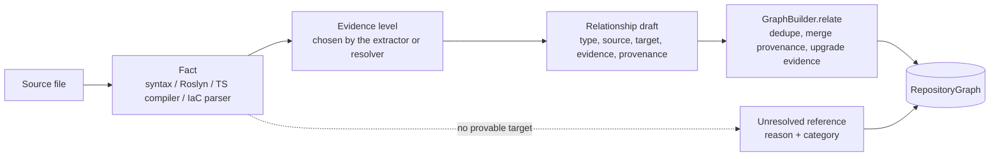

# Evidence and provenance

Every relationship in Vogoban says how strongly it is known (its evidence level) and where it came from (its
provenance). This page describes the path from an extracted fact to a stored relationship, when each evidence level is
assigned, what a provenance record contains, and walks through a real chain from a Bicep declaration to an Azure
Function trigger.

## Fact → evidence → relationship → graph



1. **Fact.** An analyzer extracts a fact from a file: a Roslyn-bound invocation, a `[ServiceBusTrigger]` attribute, a
   Bicep `resource` block, an `import` statement. Facts are cached (see [analysis-pipeline.md](analysis-pipeline.md#caching)).
2. **Evidence.** The extractor (or, for cross-analyzer links, the resolver plugin) decides how the fact proves the
   relationship and picks one level from `EVIDENCE_LEVELS` (`src/graph/model.ts`).
3. **Relationship.** The analyzer calls `GraphBuilder.relate()` (`src/graph/builder.ts`) with a `RelationshipDraft`:
   type, source and target entity ids, evidence, optional confidence and metadata, and a `Provenance` record built by
   `ctx.provenance(...)`.
4. **Merge.** If the same `(type, source, target)` already exists, the builder appends the provenance (deduplicated by
   plugin, extractor, mechanism and location, at most 50 records), increments `metadata.occurrences`, and keeps the
   *strongest* evidence, taking that draft's metadata and the higher confidence.
5. **Graph.** `finalize()` removes relationships whose endpoints were never produced (`dangling-relationship`
   diagnostic) and the batch is published in one transaction.

If no target can be proven, step 3 becomes `GraphBuilder.unresolved()` and the result is an unresolved reference, not
a weaker relationship.

## Evidence levels and when each is assigned

| Level | Assigned when | Examples in 0.18.0 |
|---|---|---|
| `EXACT` | The relationship is the repository structure itself | Repository `CONTAINS` file (`vogoban.core`), `PROJECT_CONTAINS`, project-file `DECLARES` project, `PACKAGE_DEPENDS_ON` from a project file (`dotnet.msbuild`), MetaGraph `PROVIDES_API` for an implemented API |
| `COMPILER_RESOLVED` | Roslyn or the TypeScript compiler bound both ends | `CALLS`, `USES_TYPE`, `IMPLEMENTS`, `INHERITS` from `dotnet.roslyn` and `typescript.semantic`; Angular `INJECTS`; Function trigger and binding edges whose attribute arguments are compile-time constants; Azure SDK `PUBLISHES_TO` from a bound `SendMessageAsync` call |
| `DECLARED` | An explicit declaration states it | IaC `CREATES` and `CONTAINS_RESOURCE` (`azure.infrastructure`), Angular lifecycle `CALLS`, Next.js file-system routes, configuration references, MetaGraph `USES_EXTERNAL_SYSTEM` from a configured URL |
| `STRUCTURALLY_RESOLVED` | A resolver matched two independently extracted facts on structure | `DECLARED_BY` code-side resource → IaC resource when namespace and leaf name match (`azure.resolver`); MetaGraph `CALLS_ENDPOINT` on host + method + route; MetaGraph message groups on namespace + name + version |
| `INFERRED` | Exactly one candidate exists, but nothing binds it | Frontend or `HttpClient` `CALLS_ENDPOINT` to the single `ApiOperation` matching method and normalized route (`contracts.api-resolver`); a DI-injected Azure client resolved through its single construction site |
| `HEURISTIC` | Pattern-based | Defined in the model; no 0.18.0 analyzer emits it |
| `UNKNOWN` | Not classifiable | Defined in the model; no 0.18.0 analyzer emits it |

Confidence is a separate number (0..1, default 1). The read side treats `EXACT`, `COMPILER_RESOLVED`, `DECLARED` and
`STRUCTURALLY_RESOLVED` with confidence ≥ 0.7 as confirmed (`isConfirmed` in `src/analysis/graph.ts`); `impact`
reports paths through other edges as potential, and the AI layer labels their evidence `INFERENCE` instead of `FACT`.

## Provenance records

`Provenance` (`src/graph/model.ts`) is built by `ctx.provenance()` in `src/pipeline/analyze.ts`:

| Field | Filled from |
|---|---|
| `repositoryId`, `commit` | The analyzed repository and its `HEAD` commit |
| `plugin` | The plugin id (`azure.infrastructure`, `dotnet.roslyn`, `vogoban.core`, ...) |
| `extractor` | The rule that fired (`RESOURCE_DECLARATION`, `FUNCTION_ATTRIBUTE`, `SERVICEBUSTRIGGER_BINDING`, `declaration`, `file-discovery`, ...) |
| `mechanism` | The technique (`bicep-static`, `roslyn-semantic-model`, `roslyn-semantic-model+functions-rules`, `azure-resource-resolution`, `filesystem`, `git`) |
| `resolver` | The resolver plugin for resolver-made facts, else `null` |
| `location` | File, line, column (and end) of the evidence |
| `analysisVersion` | `<ANALYZER_VERSION>/<plugin version>`, e.g. `0.1.0/1+323b31cc3e63` (Azure plugins append the hash of the Azure analyzer sources; `dotnet.roslyn` appends the hash of `semantic/Vogoban.Roslyn`) |

The store adds temporal columns to every entity and relationship row: `first_seen_commit`, `first_seen_run`
(set on insert and never updated) and `last_seen_commit`, `last_seen_run` (updated by every analysis that still
produces the row). `vogoban provenance <id>` prints both, for entities, relationships and unresolved references.

MetaGraph records use the same structure with `plugin` and `resolver` = `metagraph.<resolver id>`,
`mechanism` = `cross-repository-resolution`, `repositoryId` and `commit` = `null`, and the source and target commits
and graph versions in the relationship metadata (see [metagraph.md](metagraph.md#provenance-of-meta-relationships)).

## Worked example: Bicep declaration → Service Bus resource → Function trigger

The demo repository `contoso-orders` declares a Service Bus namespace with a topic and a subscription in
`infra/modules/messaging.bicep`:

```bicep
resource sb 'Microsoft.ServiceBus/namespaces@2022-10-01-preview' = {
  name: namespaceName
  …
  resource orders 'topics' = {
    name: 'orders'

    resource billing 'subscriptions' = {
      name: 'billing'
      …
    }
  }
}
```

`infra/main.bicep` passes `namespaceName: 'sb-${prefix}'`, and `infra/modules/apps.bicep` gives the Function App the
connection setting:

```bicep
resource functionApp 'Microsoft.Web/sites@2023-12-01' = {
  name: 'func-${prefix}'
  tags: union(tags, { 'azd-service-name': 'functions' })
  …
        { name: 'ServiceBus__fullyQualifiedNamespace', value: '${serviceBusNamespace}.servicebus.windows.net' }
```

The isolated Function in `src/Contoso.Orders.Functions/OrderFunctions.cs` listens on that subscription:

```csharp
[Function("ProcessOrder")]
[ExponentialBackoffRetry(5, "00:00:04", "00:15:00")]
public Task ProcessOrder([ServiceBusTrigger("orders", "billing", Connection = "ServiceBus")] OrderSubmitted order, CancellationToken cancellationToken)
    => processor.ProcessAsync(order, cancellationToken);
```

### Step 1: the declaration (`DECLARED`)

`azure.infrastructure` parses the Bicep files, the symbolic evaluator resolves `namespaceName` to
`sb-contoso-orders`, and the plugin creates the declared resource and a `CREATES` edge from the file:

```bash
vogoban provenance e_45edc3b0ff9a1bdb54732483
```

```text
entity e_45edc3b0ff9a1bdb54732483
  first seen ccaffed660b7f947a60737e24447c6ace2a90559 (run run_e34a0483c00f51f09da9bf04), last seen ccaffed660b7f947a60737e24447c6ace2a90559 (run run_e34a0483c00f51f09da9bf04)
  - azure.infrastructure/RESOURCE_DECLARATION via bicep-static @ infra/modules/messaging.bicep:15:1  repo=e_9a2cfe3a9823cb05539c79e5 commit=ccaffed660b7 v0.1.0/1+323b31cc3e63
```

```bash
vogoban provenance r_5a8ac8394720de6cd3134819
```

```text
relationship r_5a8ac8394720de6cd3134819
  first seen ccaffed660b7f947a60737e24447c6ace2a90559 (run run_e34a0483c00f51f09da9bf04), last seen ccaffed660b7f947a60737e24447c6ace2a90559 (run run_e34a0483c00f51f09da9bf04)
  - azure.infrastructure/RESOURCE_DECLARATION via bicep-static @ infra/modules/messaging.bicep:15:1  repo=e_9a2cfe3a9823cb05539c79e5 commit=ccaffed660b7 v0.1.0/1+323b31cc3e63
```

The entity is `AzureResource Microsoft.ServiceBus/namespaces/topics:sb-contoso-orders/orders` with
`nameState: exact`. The `CREATES` edge (file → topic) and `CONTAINS_RESOURCE` (namespace → topic) are `DECLARED`.

### Step 2: the trigger (`COMPILER_RESOLVED`)

`azure.functions` reads the `[Function]` and `[ServiceBusTrigger]` attributes from the Roslyn facts and creates the
`AzureFunction` entity:

```bash
vogoban provenance e_7f3bddb8e95711f7485818f7
```

```text
entity e_7f3bddb8e95711f7485818f7
  first seen ccaffed660b7f947a60737e24447c6ace2a90559 (run run_e34a0483c00f51f09da9bf04), last seen ccaffed660b7f947a60737e24447c6ace2a90559 (run run_e34a0483c00f51f09da9bf04)
  - azure.functions/FUNCTION_ATTRIBUTE via roslyn-semantic-model+functions-rules @ src/Contoso.Orders.Functions/OrderFunctions.cs:16:6  repo=e_9a2cfe3a9823cb05539c79e5 commit=ccaffed660b7 v0.1.0/1+323b31cc3e63
```

`azure.resolver` then resolves the binding. The connection `ServiceBus` is looked up on the hosting resource (the
Function App tagged `azd-service-name: functions`, matched to the `functions` service in `azure.yaml`); its
`ServiceBus__fullyQualifiedNamespace` setting is a symbolic reference to the declared namespace, so the account is
`sb-contoso-orders` (`accountSource: iac`). The topic and subscription names are attribute constants, so the trigger
source is the logical subscription `sb-contoso-orders/orders/billing` and the trigger edge is `COMPILER_RESOLVED`:

```bash
vogoban provenance r_26aab6bc85f2cc30ebbf5d88
```

```text
relationship r_26aab6bc85f2cc30ebbf5d88
  first seen ccaffed660b7f947a60737e24447c6ace2a90559 (run run_e34a0483c00f51f09da9bf04), last seen ccaffed660b7f947a60737e24447c6ace2a90559 (run run_e34a0483c00f51f09da9bf04)
  - azure.resolver/SERVICEBUSTRIGGER_BINDING via azure-resource-resolution resolver=azure.resolver @ src/Contoso.Orders.Functions/OrderFunctions.cs:18:31  repo=e_9a2cfe3a9823cb05539c79e5 commit=ccaffed660b7 v0.1.0/1+323b31cc3e63
```

### Step 3: code meets declaration (`STRUCTURALLY_RESOLVED`)

The code-side subscription and topic are linked to the declared Bicep resources because ARM type, account and leaf
name all match. Neither fact binds the other, so the link is `STRUCTURALLY_RESOLVED`:

```bash
vogoban provenance r_4f8cc4c22b6c85d826594cb8
```

```text
relationship r_4f8cc4c22b6c85d826594cb8
  first seen ccaffed660b7f947a60737e24447c6ace2a90559 (run run_e34a0483c00f51f09da9bf04), last seen ccaffed660b7f947a60737e24447c6ace2a90559 (run run_e34a0483c00f51f09da9bf04)
  - azure.resolver/FUNCTION_BINDING via azure-resource-resolution resolver=azure.resolver @ src/Contoso.Orders.Functions/OrderFunctions.cs:18:31  repo=e_9a2cfe3a9823cb05539c79e5 commit=ccaffed660b7 v0.1.0/1+323b31cc3e63
```

The topic's `DECLARED_BY` edge was produced by three independent facts in two languages (the .NET trigger, the Node v4
Function in `notifications/` and the Azure SDK publisher in the API), so it carries three provenance records and
`x3` occurrences:

```bash
vogoban provenance r_5a58e0be01dd249996e7528a
```

```text
relationship r_5a58e0be01dd249996e7528a
  first seen ccaffed660b7f947a60737e24447c6ace2a90559 (run run_e34a0483c00f51f09da9bf04), last seen ccaffed660b7f947a60737e24447c6ace2a90559 (run run_e34a0483c00f51f09da9bf04)
  - azure.resolver/FUNCTION_BINDING via azure-resource-resolution resolver=azure.resolver @ src/Contoso.Orders.Functions/OrderFunctions.cs:18:31  repo=e_9a2cfe3a9823cb05539c79e5 commit=ccaffed660b7 v0.1.0/1+323b31cc3e63
  - azure.resolver/FUNCTION_BINDING via azure-resource-resolution resolver=azure.resolver @ notifications/src/functions/notify.ts:17:1  repo=e_9a2cfe3a9823cb05539c79e5 commit=ccaffed660b7 v0.1.0/1+323b31cc3e63
  - azure.resolver/AZURE_SDK_USAGE via azure-resource-resolution resolver=azure.resolver @ src/Contoso.Orders.Api/Services/OrderService.cs:28:15  repo=e_9a2cfe3a9823cb05539c79e5 commit=ccaffed660b7 v0.1.0/1+323b31cc3e63
```

### The resulting chain

```bash
vogoban show e_2093d8f341d562f4fd179f1a
```

```text
Queue azure-service-bus:service-bus-subscription:sb-contoso-orders/orders/billing
  id         e_2093d8f341d562f4fd179f1a
  …
Outgoing (4)
  -[CARRIES]-> Message Contoso.Orders.Contracts.OrderSubmitted  (COMPILER_RESOLVED @ src/Contoso.Orders.Functions/OrderFunctions.cs:18)
  -[DECLARED_BY]-> AzureResource Microsoft.ServiceBus/namespaces/topics/subscriptions:sb-contoso-orders/orders/billing  (STRUCTURALLY_RESOLVED @ src/Contoso.Orders.Functions/OrderFunctions.cs:18)
  -[ROUTES_TO]-> Method Contoso.Orders.Functions.OrderFunctions.ProcessOrder(Contoso.Orders.Contracts.OrderSubmitted, System.Threading.CancellationToken)  (COMPILER_RESOLVED @ src/Contoso.Orders.Functions/OrderFunctions.cs:18)
  -[TRIGGERS]-> AzureFunction Contoso.Orders.Functions:ProcessOrder  (COMPILER_RESOLVED @ src/Contoso.Orders.Functions/OrderFunctions.cs:18)

Incoming (1)
  <-[SUBSCRIBES_TO]- Queue azure-service-bus:service-bus-entity:sb-contoso-orders/orders  (COMPILER_RESOLVED @ src/Contoso.Orders.Functions/OrderFunctions.cs:18)
```

Each hop has its own evidence and its own provenance. If the namespace setting were missing from the Function App,
the account would be unknown, the subscription would be `partially-resolved` and no `DECLARED_BY` edge would exist;
the resolver would report `unresolved-azure-account` instead of matching on the leaf name `billing`.

## Limitations

- Provenance is capped at 50 records per row; very common edges keep the first 50 distinct sources.
- Evidence describes the static derivation, not runtime truth. A `COMPILER_RESOLVED` trigger means the source
  declares it, not that the deployed Function App is configured the same way.
- `first_seen` is tied to the row id. A rename produces a new id with a new `first_seen` (see
  [identity.md](identity.md#renames-and-moves)).

## Related

- [RepositoryGraph](repository-graph.md#evidence-levels)
- [Identity](identity.md)
- [Azure engine](azure-engine.md)
- [Diagnostics commands](../cli/diagnostics.md)
