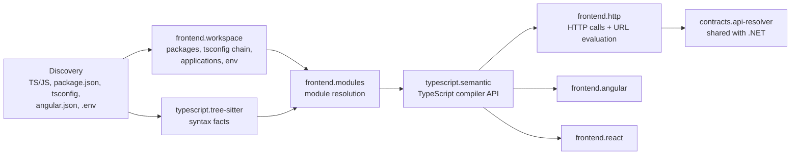

# Frontend engine

The frontend engine analyzes TypeScript and JavaScript, Angular and React alongside .NET. Frontend facts go into the same
RepositoryGraph as the C# facts, use the same identity, evidence and provenance model, and are queried, diffed, governed
and impact-analyzed by the same engines. Angular and React are framework plugins over a shared frontend layer; there is
no separate frontend graph, store, impact engine or MetaGraph. This page carries the internals; usage is in
[frontend features](../features/frontend.md), [Angular](../features/angular.md), [React](../features/react.md) and the
[frontend command reference](../cli/frontend.md).

The point of this work is to link the frontend to the backend: a component or route reaches the HTTP
call it makes, that call is resolved to an API operation, and the operation leads to the ASP.NET Core
endpoint and the .NET code behind it. Every link on that chain is a stored relationship with evidence.
Nothing is linked by name similarity.

## Pipeline

- **Discovery** classifies `.ts/.tsx/.mts/.cts` as TypeScript and `.js/.jsx/.mjs/.cjs` as JavaScript. It also picks up
  `package.json`, `tsconfig*.json`/`jsconfig*.json`, `angular.json`, workspace manifests (`pnpm-workspace.yaml`,
  `lerna.json`, `nx.json`), `.env*` files, and Angular component templates (an `.html` file next to a `.ts` file).
  Build output and vendored bundles are skipped and reported with one `file-skipped` diagnostic per directory.
  That covers `dist`, `build`, `out`, `coverage`, `.angular`, `.next` and similar directories, `wwwroot/lib`, and
  `*.min.js`, bundle and chunk files. `node_modules` is never read. `vogoban.json` can override this with
  `"frontend": { "include": [globs], "exclude": [globs] }`. Files with NSwag, openapi-generator, `@generated` or
  "do not edit" headers are marked `generated`.
- **Syntax (Tree-sitter)** always runs. It extracts declarations, exports, imports, re-exports, `require`, dynamic
  `import()` and module references. When semantic analysis is off (`--no-semantic`) or fails, these facts are
  still there, with a diagnostic.
- **Workspace** reads `package.json` (dependencies with dev/peer/optional scope, npm/yarn/pnpm workspaces),
  `tsconfig` (`extends` chains inside the repository, `paths`, `baseUrl`, project references) and `angular.json`.
  It detects frontend **Application** entities (`applicationType: frontend`, `framework: angular|react|nextjs`),
  each with its detection signals. A package name used by two `package.json` files is reported as a diagnostic.
- **Module resolution** is Vogoban's own resolver. It handles relative paths, index files, extension substitution,
  `paths`/`baseUrl`, and workspace packages by name. It works only inside the repository and never reads
  `node_modules`. Bare specifiers become external npm `Package` entities, and imports of packages that the owning
  `package.json` does not declare are reported. Specifiers it cannot resolve are kept as unresolved references.
- **Semantics (TypeScript compiler API, TypeScript 6.0.3)** builds one program per npm package. The program reads
  only discovered repository files through a virtual file system, and compiler plugins, `typeRoots` and `types`
  from the repository's tsconfig are ignored. The plugin emits `DECLARES`, `CALLS`, `CONSTRUCTS`, `USES_TYPE`,
  `REFERENCES`, `INHERITS`, `IMPLEMENTS` (type and member level), `EXTENDS` and `OVERRIDES` with
  `COMPILER_RESOLVED` evidence. JavaScript gets the same program in `allowJs` mode, so JS semantics are whatever
  the compiler can determine statically.

Source files: `src/frontend/workspace.ts` (packages, tsconfig chains, applications, `.env`), `syntax.ts`
(Tree-sitter), `modules.ts` and `resolve.ts` (module resolution), `program.ts` and `semantic.ts` (TypeScript
programs), `http.ts` (HTTP calls and URL evaluation), `angular.ts`, `react.ts`, `common.ts` (keys, per-project cache
and graph-operation replay). Read-side views: `src/query/frontend-query.ts`.

Per-project results are recorded as graph operations (`GraphOp` in `src/frontend/common.ts`: `entity`, `relate`,
`unresolved`, `diagnostic`, `annotate`) so a cache hit replays exactly the operations a fresh run would perform.

## Model additions

One entity kind and one relationship group were added. Everything else reuses existing kinds:
`Application`, `Project` (one per `package.json`), `File`, `Type`, `Method`, `Field`, `Property`, `Package`,
`ConfigurationReference`, `Configuration`, `SecretReference`, `Environment`, `Middleware`, `ServiceRegistration`.

- `FrontendRoute`: a client-side route (Angular router, React Router, Next.js file-system routes). Its impact
  category is SERVICE, it counts as a SERVICE component for ownership, and the AI layer treats it as architectural.
- Frontend relationships: `IMPORTS`, `TYPE_IMPORTS`, `DYNAMIC_IMPORTS`, `REQUIRES`, `REFERENCES_MODULE`,
  `RE_EXPORTS`, `EXPORTS`, `RENDERS`, `USES_COMPONENT`, `USES_HOOK`, `PROVIDES_CONTEXT`, `CONSUMES_CONTEXT`,
  `EXPOSES_ROUTE`, `ROUTES_TO_COMPONENT`, `GUARDED_BY`, `RESOLVED_BY`, `LOADS_MODULE`, `LOADS_COMPONENT`. Each one
  has an impact propagation rule in `src/analysis/semantics.ts`. `REFERENCES_MODULE` covers module references that
  are not imports: `/// <reference path>`, `new URL('./x', import.meta.url)` and `require.resolve('./x')`.
- Components, hooks, services, contexts, guards, interceptors, pipes, directives and Angular modules are ordinary
  `Type`/`Method`/`Field` entities with a `frontendRole` metadata value.
- **Identity** is `repository + file path + declaration path` (for example `TodoListsClient.get`). It never
  includes display names or line numbers, so it survives formatting changes and import reordering. Like C#
  symbols, a rename or a move produces a new identity.

## Angular

- Components (`@Component`, with selector and `templateUrl`/inline template), directives, pipes, `@NgModule`
  (`USES_COMPONENT` for declarations, bootstrap and imports), standalone components, and `@Injectable` services.
- Dependency injection: constructor parameters and `inject()` calls produce `INJECTS` with evidence `COMPILER_RESOLVED`.
  `providers` entries (`useClass`, `useExisting`, `useFactory`, `useValue`) produce `ServiceRegistration` +
  `REGISTERS`.
- Templates (inline or `templateUrl`, read only inside the repository): component selectors produce `RENDERS`.
- Routes from `RouterModule.forRoot/forChild`, `provideRouter` and `Routes` arrays, with nested `children`
  prefixes, produce `FrontendRoute` + `EXPOSES_ROUTE`, `ROUTES_TO_COMPONENT`, `LOADS_COMPONENT` / `LOADS_MODULE`
  (`loadComponent` / `loadChildren`; the lazy import may resolve to the module's default export, a named export
  (`.then((m) => m.OrdersComponent)`), an aliased or re-exported name, a `const` alias of an import, an `async`/`await`
  wrapper, or a route array for `loadChildren` — the target is resolved statically from the imported file's exports, and
  an import whose specifier is not a string literal, or whose export cannot be found, is recorded as an unresolved
  `LOADS_COMPONENT` / `LOADS_MODULE` reference with the reason, instead of a guessed edge, C-02), `GUARDED_BY` (`canActivate`, `canMatch`, …)
  and `RESOLVED_BY`.
- HTTP interceptors (`HTTP_INTERCEPTORS` providers and `withInterceptors([...])`) produce `Middleware` +
  `USES_MIDDLEWARE`. An interceptor that always rewrites the URL as `<prefix>${req.url}` has its prefix applied
  when the URLs of that application's calls are evaluated.
- Lifecycle hooks (`ngOnInit`, `ngOnChanges`, …) get `CALLS` edges from the component with evidence `DECLARED`
  (`angular-lifecycle`), so work started in `ngOnInit` is reachable from the component.
- A guard in the graph shows that a route declares it. It is **not** proof that the route is secure at runtime.

## React

- Function and class components (anything that returns JSX), custom hooks (`use*` functions that call hooks),
  and contexts (`createContext`).
- JSX produces `RENDERS`. Hook calls produce `USES_HOOK`. `<Ctx.Provider>` produces `PROVIDES_CONTEXT`.
  `useContext(Ctx)` produces `CONSUMES_CONTEXT`. Class lifecycle methods (`componentDidMount`, …) get `CALLS`
  from the component.
- React Router: JSX `<Route>` trees (v5/v6, nested paths), `createBrowserRouter` / `useRoutes` route objects,
  `lazy` routes, and `React.lazy(() => import(...))` / `lazy(() => import(...).then((m) => ({ default: m.Page })))`
  and routes whose element wraps the page inline (`<Protected><UsersPage/></Protected>` links both, C-04); the lazy target is resolved from the
  imported file's exports (default, named, re-exported, C-03) and never guessed from the file name. Routes whose path is not a static string become a
  `dynamic-route-path` diagnostic.
- Next.js: `app/` router pages and `pages/` router files produce `FrontendRoute` entities from the directory
  structure (evidence `DECLARED`, `nextjs-file-system-route`).
- When a route or a render target is a variable such as `const Page = withTelemetry(HomePage)`, `frontend-chain`
  follows that variable's references to the wrapped component.

## HTTP calls and frontend→backend linking

`frontend.http` finds `fetch`, axios (default import, `axios.create({ baseURL })` instances,
`axios.request/get/post/…`) and Angular `HttpClient` calls, NSwag/openapi-generator TypeScript clients included.
It evaluates the URL statically, without running anything. The evaluator follows:

- string literals, template literals, concatenation, `concat`/`join`, `const` locals, `const` object-literal
  paths, enum members, static/readonly fields, constructor-assigned fields (constructor parameters become holes
  that keep their default value), zero-argument functions that return one expression, `encodeURIComponent`
  holes, and NSwag-style `url.replace("{id}", …)` placeholders;
- `environment.ts`-style objects and `import.meta.env.X` / `process.env.X` references (recorded as
  `ConfigurationReference` + `REFERENCES_CONFIG`; the value is used only when a non-secret value is declared in the
  repository);
- conditional alternatives, up to 4 variants;
- axios base-URL joining and Angular interceptor prefixes.

A hole that covers a whole path segment becomes a route parameter (`/api/items/${id}` matches
`/api/items/{id}`). A partial-segment hole is never matched. The resulting `HttpCallFact` goes to the existing
`contracts.api-resolver`, the same resolver .NET `HttpClient` calls use:

- a relative or same-origin URL whose method and normalized route match exactly one `ApiOperation` produces
  `CALLS_ENDPOINT` (`INFERRED`, with method/route/base metadata);
- a URL on a dotted host produces `CALLS_EXTERNAL_API`;
- everything else becomes an unresolved reference with a category (`dynamic-url`, `no-matching-operation`, …) and
  the source location.

`ApiOperation`s come from ASP.NET Core endpoints (controllers and minimal APIs) and OpenAPI documents. So a chain
such as Angular component → `ngOnInit` → generated client method → `GET /api/TodoLists` → endpoint → controller
action → MediatR handler is made of stored relationships, each with its own evidence.

## Configuration and secrets

- `.env`, `.env.<mode>` and `.env.local` files produce `Configuration` entities per key, with environment
  scoping. Template files (`.env.example`, `.env.sample`, `.env.template`) are not environments.
- Keys with secret-like names (`*TOKEN*`, `*SECRET*`, `*PASSWORD*`, `*KEY*`, …) become `SecretReference` with
  `valueStored: false`. **Secret values are never stored.** Plain literal values are not stored either. Only
  service URLs are kept, after their credentials and query strings are removed.
- A public bundle-exposed variable (`VITE_*`, `REACT_APP_*`, `NEXT_PUBLIC_*`, `NG_APP_*`) with a secret-like name
  raises a `public-env-secret-name` warning, because it ships to the browser.
- URLs in HTTP calls are stored without user-info and query values.

## Security boundaries

Frontend analysis treats repository content as untrusted. The `frontend_security.sh` regression suite checks
each of these rules against a hostile repository:

- Nothing is executed. No `npm`/`pnpm`/`yarn`, no package scripts (`preinstall`/`postinstall`/`prepare`/`build`),
  no Angular CLI, no bundler, no browser, and no network calls during graph construction. Analysis passes inside a
  network namespace with no interfaces.
- Everything is read inside the repository root only. Symbolic links are not followed (`file-skipped`).
  `tsconfig` `extends` outside the repository is refused (`tsconfig-extends-missing`). Relative imports that leave
  the root stay unresolved. `templateUrl` traversal is not read.
- `node_modules` and build output are never parsed unless the user explicitly includes them.
- Compiler plugins, `typeRoots` and `types` from the repository's tsconfig are ignored.
- Pathological sources, such as 20,000-level nesting, fail per file with a diagnostic. The other files of the
  project keep their semantic facts.

## Incremental sync and caching

- Per-file syntax facts are cached by content hash. Per-project semantic/framework/HTTP facts are cached by a key
  that covers: the analyzer version plus a hash of the frontend analyzer sources, `package.json`, the tsconfig
  chain, detected applications, Angular project configuration, and the content hash of every file the project's
  program can read (its import closure, workspace packages included) plus its templates. Stale facts cannot be
  replayed after a code or analyzer change.
- The incremental planner re-analyzes the npm projects that own a changed file, plus the projects that import it
  (a reverse import closure over the stored module edges). Changes to `package.json`, `tsconfig`/`jsconfig`,
  `angular.json` or workspace manifests widen the plan to all npm projects. `frontend` is a planner domain.
- `vogoban graph sync` results are verified to match a clean full rebuild (see Verification).

Cache scopes in the store: syntax facts `syntax|typescript.tree-sitter|<repoId>|<path>` keyed `<version>|<file hash>`;
per-project facts `frontend|<plugin id>|<repoId>|<package.json path>` keyed `<version>|<project key>`.

## CLI

`frontend`, `components`, `frontend-routes` and `frontend-chain` are views over the stored graph (see the
[frontend command reference](../cli/frontend.md)). Every other command works on frontend entities without changes,
including `impact`, `paths`, `service-impact`, `dependencies`, `ownership`, `governance`, `diff`, `shared-packages`
(npm packages are keyed by ecosystem, and dev-only dependencies are classified as `build-dependency`) and the AI/MCP
tools.

## Verification

Everything below was measured with 0.16.0 (re-run unchanged on the 0.18.0 tree for the lazy-route and equivalence suites, see the Phase 18 release-gate report under `docs/release/`) on Linux x86_64 (Ubuntu 24.04, Bun 1.3.14, .NET SDK 10.0.401), against
real public repositories at pinned commits. Nothing in the repositories was installed, built or executed.

| Repository | Stack | TS/JS files | Frontend symbols | Routes | HTTP calls → API operations / external / unresolved | Cold analyze | Warm analyze |
|---|---|---|---|---|---|---|---|
| jasontaylordev/CleanArchitecture v7.0.2 | Angular + ASP.NET Core controllers + MediatR | 35 | 369 | 5 | 22 / 0 / 1 | 7.3 s, 338 MB | 1.2 s |
| jasontaylordev/CleanArchitecture v10.0.0 | React (JS) + Angular + minimal APIs | 38 | 532 | 7 | 20 / 0 / 2 | 6.5 s, 355 MB | 1.3 s |
| Azure-Samples/todo-csharp-sql @ e75277c | React (Vite, TS) + ASP.NET Core | 40 | 169 | 4 | 20 / 0 / 1 | 3.0 s, 253 MB | 0.7 s |
| gothinkster/angular-realworld-example-app @ dd99ed2c | Angular (TS-heavy, standalone, `inject()`) | 50 | 217 | 11 | 0 / 18 / 0 | 1.3 s, 286 MB | 0.5 s |
| alan2207/bulletproof-react @ 9506629e | React/Next.js monorepo (TS-heavy, 3 apps) | 447 | 1168 | 28 | 0 / 0 / 36 | 2.8 s, 395 MB | 0.9 s |
| dotnet/aspire-samples @ 5dfb80e | 11 React/Angular apps + .NET minimal APIs (+ Node/Python) | 132 | 344 | 0 | 16 / 1 / 14 | 17.4 s, 497 MB | 2.5 s |

Cold means a fresh store and an empty fact cache, including Roslyn. Warm means re-analysis of an unchanged tree.

**Frontend → backend chains proven in the graph** (`frontend-chain`, every hop a stored relationship):

- Angular + .NET (CleanArchitecture v7.0.2): `FrontendRoute /todo` -ROUTES_TO_COMPONENT-> `TodoComponent`
  -CALLS (angular-lifecycle)-> `ngOnInit` -CALLS (compiler)-> `TodoListsClient.get` (NSwag client) -CALLS_ENDPOINT->
  `ApiOperation GET /api/TodoLists` -IMPLEMENTED_BY-> `Endpoint GET /api/TodoLists` -IMPLEMENTED_BY->
  `TodoListsController.Get()` -PUBLISHES-> `GetTodosQuery` -HANDLED_BY-> `GetTodosQueryHandler`. From `/todo`, the
  chain reaches 20 API operations and 283 entities. `impact` on `TodoListsController.Get()` reports the client
  method, `ngOnInit`, `TodoComponent`, `AppModule` and the `/todo` route as impacted.
- React + .NET (aspire-samples `vite-csharp-postgres`): the `App` component -CALLS_ENDPOINT->
  `GET/POST /api/todos` and `PUT/DELETE /api/todos/{id}` -IMPLEMENTED_BY-> minimal-API endpoints -IMPLEMENTED_BY->
  `TodoEndpoints.MapTodos`. In `aspire-with-javascript`, the React, Vite and Angular front-ends all resolve
  `api/weatherforecast` to the minimal API under `MapGroup("/api")`.
- React + .NET (CleanArchitecture v10.0.0): `FetchData.populateWeatherData` -CALLS->
  `WeatherForecastsClient.getWeatherForecasts` -CALLS_ENDPOINT-> `ApiOperation GET /api/WeatherForecasts`. The
  backend registers endpoints through reflection, so the chain ends at the OpenAPI operation (see limitations).
- TS-heavy: in angular-realworld, all HTTP calls resolve to `https://api.realworld.show/api/...` through the
  interceptor URL-prefix rewrite. In bulletproof-react, the 36 calls stay unresolved because the repository has no
  backend contract: 32 have a resolved URL (`no-matching-operation`) and 4 are genuinely dynamic (an API wrapper
  that takes the URL as a parameter, and MSW's `fetch(request)`).

**Incremental sync = full rebuild.** Each scenario commits a real change to a clone and runs `vogoban graph sync`,
then compares the result with a clean full rebuild of the same tree in a fresh store. The comparison covers entity
ids/keys/kinds/names/locations/metadata/provenance, relationship ids/evidence/confidence/metadata/provenance,
unresolved references, diagnostics and the catalog graph-version hash. All 14 scenarios ran incrementally and
were equivalent (harness: `frontend_incr.py`).

| Scenario | Repository | Incremental | Full rebuild (fresh store) |
|---|---|---|---|
| Angular component change | CA v10 | 2.1 s | 5.9 s |
| Shared type change (DTO interface) | CA v10 | 1.9 s | 6.3 s |
| API client change (route of generated client method) | CA v10 | 2.0 s | 6.5 s |
| Package dependency added (widens to all npm projects) | CA v10 | 2.0 s | 6.3 s |
| tsconfig change (widens to all npm projects) | CA v10 | 2.0 s | 6.1 s |
| Angular route added | CA v10 | 1.9 s | 6.6 s |
| React component change | CA v10 | 2.0 s | 6.2 s |
| .NET-only change (frontend facts reused) | CA v10 | 5.2 s | 6.1 s |
| React component change | bulletproof-react | 1.9 s | 2.6 s |
| Shared type change | bulletproof-react | 2.1 s | 2.8 s |
| API client change (axios call) | bulletproof-react | 1.9 s | 2.7 s |
| Package dependency added | bulletproof-react | 1.8 s | 2.7 s |
| tsconfig change | bulletproof-react | 1.8 s | 2.7 s |
| React route change | bulletproof-react | 2.0 s | 2.7 s |

About 1.5 s of every incremental run is fixed cost: process start, change detection and reconciliation. So for
small frontends, an incremental run is barely faster than a full rebuild. The gain comes from not recompiling .NET
projects.

**Security and regression.** On the final code:

- The hostile-repository suite (`frontend_security.sh`) passed 18/18.
- Frontend analysis in a network namespace with no interfaces, traced with strace, made 0 inet connects.
- The Phase 15.1 suites pass unchanged: incremental-safety regression on eShop (23/23 cases equivalent to full
  rebuild), local-only/offline (all steps, 0 network attempts), and CLI security (symlink, path traversal, build
  evaluation secrets).
- The container image builds and analyzes an Angular repository read-only as a non-root user.

## Known limitations

- Types from external packages are not loaded, because `node_modules` is never read. A value that passes through
  an untyped external generic (for example React's `useMemo` returning an object with typed members) loses its
  type, so calls on it are not resolved. In `todo-csharp-sql` this stops the chain at `HomePage`, whose actions
  are bound with `bindActionCreators` inside `useMemo`.
- URLs built at runtime by wrapper functions that take the URL as a parameter (for example
  `apiClient(url, …)`) are reported as `dynamic-url` at the wrapper, not resolved per caller.
- Backend endpoints that are registered through reflection (`Activator.CreateInstance` endpoint groups, as in
  CleanArchitecture v10) are not statically resolvable on the .NET side. Frontend calls then resolve to the
  OpenAPI `ApiOperation` but stop there.
- Lazy loaders are resolved only from literal `import()` specifiers and a single selected export. Angular `m["X"]`,
  `.then((m) => wrap(m.X))`, loaders held in variables and `loadChildren` into an NgModule without
  `RouterModule.forChild(...)` stay unresolved; React `lazy(loader)` with the loader in a variable, non-react `lazy`,
  `loadable()` and other third-party wrappers, and `.then((m) => ({ default: m.A, other: m.B }))` stay unresolved
  (C-05, accepted: an unresolved reference with the reason, never a guessed component).
- Wrapper routes follow only JSX children written inline in the route element (`<Protected><Page/></Protected>`);
  a wrapper receiving the page through a prop (`<Protected component={Page}/>`) or an `<Outlet/>` layout route is
  not followed (C-04 scope).
- Higher-order components are followed only by `frontend-chain` (through the wrapping variable). No `RENDERS`
  edge is synthesized for them.
- Vue, Svelte, Angular signals-based routing helpers outside `@angular/router`, Redux/NgRx store semantics, and
  GraphQL clients are not analyzed.
- Static guards and interceptors are declarations. They are not evidence that authorization is enforced at runtime.

## Related

- [Frontend features](../features/frontend.md)
- [TypeScript and JavaScript](../features/typescript-javascript.md)
- [Identity: frontend identity](identity.md#frontend-identity)
- [Incremental engine](incremental-engine.md)
