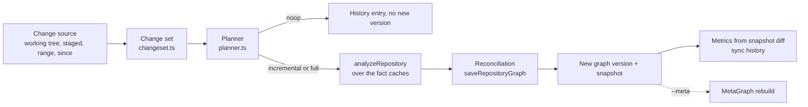

# Incremental engine

The incremental engine keeps a RepositoryGraph current by re-deriving what a change affects, reconciling the result
into the store and recording a new graph version. It is an orchestration layer around the normal analysis pipeline,
not a second graph engine: the same plugins, identity rules and store are used, and the result must be identical to a
clean full rebuild. The code is in `src/incremental` (`changeset.ts`, `git.ts`, `planner.ts`, `sync.ts`, `status.ts`,
`hooks.ts`).



User-facing commands and flags are in [the sync command reference](../cli/sync.md) and
[incremental analysis](../features/incremental-analysis.md). This page describes the internals.

## Change detection

### The change set

The engine consumes a normalized, Git-independent `ChangeSet` (`src/incremental/changeset.ts`):

| Field | Meaning |
|---|---|
| `repositoryId`, `repositoryIdentity` | The repository |
| `source` | `working-tree`, `staged`, `commit-range`, `since` or `manual` |
| `previousCommit`, `currentCommit` | The two states compared |
| `dirty` | The working tree had uncommitted changes |
| `changes[]` | `FileChange`: `path`, `previousPath` (renames), `status` (`added`, `modified`, `deleted`, `renamed`), `category` (from `classifyFile`) |

`buildChangeSet` deduplicates records (last write wins per status and path) and sorts them by path, so the same input
always gives the same change set. `summarizeChangeSet` counts statuses and categories and flags `structural`
(a `project`, `solution` or `config` file changed), `contracts` and `infrastructure`. `changeSetFingerprint` is a
16-hex SHA-256 over identity, commits, dirty flag and changes; it is stored in the sync history.

### The Git adapter

`src/incremental/git.ts` is the only incremental module that knows Git exists. `changeSetFromGit` builds the change
set from `git diff --name-status -z -M`:

| Mode | Git command |
|---|---|
| `working-tree` (default) | `git diff --name-status -z -M <analyzed commit>` plus untracked files (`git ls-files --others --exclude-standard`) |
| `since` | the same with `--since <commit>` as base |
| `staged` | `git diff --name-status -z -M --cached` |
| `commit-range` | `git diff --name-status -z -M <from> <to>` |

A Git command whose failure means the change set is unknowable throws `GitStateError` instead of returning an empty
list; the sync is refused with `git_state_unreadable` (exit 3) and nothing is analyzed. A missing base commit or a
non-Git directory is not an error: the planner falls back to a full rebuild (`missing_base_commit`,
`not_a_git_repository`). CI systems or other adapters can construct a `ChangeSet` themselves and pass it as
`options.changeSet` to the same engine.

`graph sync` always analyzes the **checked-out tree**. A commit range only describes what changed, so `--head`/`--to`
must resolve to the checked-out commit and the range requires a Git checkout; otherwise `SyncUsageError` (exit 2).
Commit references must match `^\w[\w./@{}^~+-]*$`.

## The planner

`planIncremental` (`src/incremental/planner.ts`) is deterministic: the same store state and change set always give the
same plan. It returns `mode` (`noop`, `incremental`, `full`), a human-readable `reason`, a machine `code` for full
rebuilds, the affected files, projects and domains, and whether scope was `widened`.

### Full-rebuild conditions

Checked in this order; the first that applies decides:

| Code | Condition |
|---|---|
| `missing_base_commit` / `not_a_git_repository` | The change set could not be built |
| `full_requested` | `--full` (a plan code, not a fallback) |
| `no_existing_graph` | No catalog entry, graph version or analyzed commit |
| `semantic_mode_changed` | `--no-semantic` differs from the mode the graph was built with (`catalog.semantic`) |
| `evaluation_mode_changed` | MSBuild evaluation (trust) mode differs from the stored `evaluation:<repoId>` baseline |
| `no_prior_run` | No analysis run recorded |
| `schema_version_changed` | `GRAPH_SCHEMA_VERSION` differs from the last run |
| `analyzer_version_changed` | `ANALYZER_VERSION` differs |
| `plugin_versions_changed` | Any plugin id or version differs (Azure, frontend and Roslyn versions include analyzer source hashes) |
| `configuration_changed` | The config fingerprint (SHA-256 of the parsed `vogoban.json`, errors excluded) differs from the last sync, or `vogoban.json` is in the change set |

A full rebuild that replaced a requested incremental sync on an existing graph is a **fallback**: `fallbackCode` and
`fallbackReason` are set, and `--strict-incremental` turns it into exit 5.

### No-op

The plan is `noop` (no analysis, no new graph version) when the checked-out commit equals the analyzed commit and
neither the tree nor the stored graph is dirty, or when the change set is empty for the same commit. A graph built from
a dirty working tree is always re-derived on the next sync (`graph was built from a dirty working tree`), even with an
empty change set, so reverting uncommitted changes never leaves stale facts.

### Dependency invalidation and planner domains

For an incremental plan the planner computes the reported scope:

- **Files**: every changed path and every previous path of a rename.
- **Projects**: the owning projects of changed files (`PROJECT_CONTAINS`, project-file `DECLARES`), plus the owners of
  every TS/JS module that transitively imports a changed module (`IMPORTS`, `TYPE_IMPORTS`, `DYNAMIC_IMPORTS`,
  `REQUIRES`, `REFERENCES_MODULE`, `RE_EXPORTS`), plus the reverse transitive closure over `PROJECT_REFERENCES`.
- **Widening**: shared build files (`Directory.*.props/targets`, any `.props`/`.targets`, `global.json`,
  `nuget.config`, `.editorconfig`, solution files) widen to all projects; `package.json`, `tsconfig`/`jsconfig`,
  `angular.json`, `pnpm-workspace.yaml`, `nx.json`, `lerna.json` widen to all npm projects; a changed IaC module widens
  to every IaC file that transitively uses it (`USES_MODULE`).
- **Domains** (`DOMAIN_BY_CATEGORY` plus special rules): `source`/`project` → `code`, `application`, `api`,
  `messaging`; `solution` → `code`, `application`; `contract` → `api`, `messaging`; `infrastructure`/`pipeline` →
  `infrastructure`, `deployment`; `config` → `configuration`, `security`; any TS/JS/HTML or frontend manifest →
  `frontend`; IaC, Functions configuration (`host.json`, `function.json`, `local.settings*.json`), `azure.yaml`, ARM and
  Bicep data files, or `.cs`/project changes in a repository that has Azure facts → `azure`; always `metagraph`.

The scope is reported in `graph sync --json` (`plan.affected`) and the human output. It never underestimates: when a
safe boundary cannot be established, scope is widened, and on any incompatibility the plan is a full rebuild.

## How reuse works

Both incremental and full plans run `analyzeRepository` (the full pipeline). What makes an incremental run cheap is
that every expensive step is served from the fact cache unless its inputs changed
([analysis-pipeline.md](analysis-pipeline.md#caching)):

- **Per-file syntax cache**: key `<plugin version>|<file hash>`. Unchanged files are never re-parsed.
- **Per-project Roslyn semantic cache**: key over analyzer and backend version, evaluation mode, project description,
  every source file's hash, target frameworks and reference paths, and, transitively, the keys of all referenced
  projects. A changed file changes its project's key and the key of every project that references it, so exactly those
  projects (the planner's reverse `PROJECT_REFERENCES` closure) are recompiled; cache misses are sent to
  `semantic/Vogoban.Roslyn` together with their references.
- **Per-npm-project frontend cache**: key over analyzer source hash, manifest, tsconfig chain and the hash of every
  file in the import closure.
- **Azure**: TypeScript Azure facts reuse the frontend project key; Roslyn facts reuse the project key; IaC evaluation
  and resolution re-run over the parsed facts, so the result depends only on current files.

Discovery, framework rules and resolvers always re-run over the cached facts, which is why the reported scope is a
plan, not a filter: correctness does not depend on the planner guessing the scope right, because anything whose input
changed has a new cache key.

## Reconciliation and graph publication

`saveRepositoryGraph` (`src/store/sqlite.ts`) reconciles inside one SQLite transaction:

1. Upsert every produced entity and relationship by id. Existing rows keep `first_seen_commit` and `first_seen_run`;
   `last_seen_*`, metadata, evidence and provenance are updated.
2. Delete the repository's entities and relationships whose `last_seen_run` is not the current run (no longer
   produced), and external entities that no relationship references any more.
3. Replace the repository's `files`, unresolved references, diagnostics and conflicts.

In the same transaction the catalog entry is published (`READY`, commit, run, graph version), the evaluation mode is
saved and a graph snapshot is captured. Sync then diffs the previous and new snapshots (`diffSnapshots`) to compute
the metrics: entities and relationships created, updated and deleted. The result has the guarantees of a full build:
no orphaned relationships, no duplicate or stale entities, history preserved for unchanged rows.

## Failure preservation

- Analysis and reconciliation persist in a single transaction, together with the catalog entry and snapshot. A failure
  (including a full disk) rolls back and leaves the previous graph, catalog entry and snapshot intact; the failure is
  recorded in the sync history (`FAILED`, exit 3) and the run can be retried.
- A plugin crash is not a failed sync: the graph is published with a `plugin-failed` diagnostic, the plugin is listed
  in `degradedPlugins`, and sync exits 4.
- Git failing (binary missing, corrupt index, unreadable objects, permission error) while a `.git` directory or
  `GIT_DIR` exists refuses the sync with `git_state_unreadable` (exit 3). It is never treated as "no changes", never
  falls back to a full rebuild and never registers a path-derived `local:` identity for a checkout the catalog knows
  under its Git identity.
- A MetaGraph failure after a successful repository sync (`--meta`) leaves the previous MetaGraph snapshot unchanged
  and exits 3. MetaGraph builds are a single transaction too.
- An unexpected environment error (for example a read-only store) exits 1 with the previous graph preserved.

## Locks and concurrency

`withSyncLock` (`src/incremental/sync.ts`) serializes syncs of one repository with an atomic `mkdir` of
`sync-<repositoryId>.lock` next to the graph store, containing an `owner` file with the PID:

- A lock whose owner process is dead is removed and re-acquired.
- A lock without an owner file older than 30 seconds (for example after the disk filled between `mkdir` and writing
  the owner) is recovered.
- Otherwise the sync waits up to 120 s and then fails with "another synchronization of this repository is in
  progress". Known limitation: a stale lock whose recorded PID belongs to an unrelated live process (for example PID 1
  after a crashed containerized CLI) is not recovered automatically; remove the lock directory after confirming no sync
  is running.

Different repositories and background hooks writing to one store wait for the SQLite write lock
(`busy_timeout = 60000`) instead of failing.

## Status and history

`syncStatus` (`src/incremental/status.ts`) reports `NEVER_ANALYZED`, `UP_TO_DATE`, `CHANGES_DETECTED`,
`FULL_REBUILD_REQUIRED` or `FAILED` (the last sync failed). `FULL_REBUILD_REQUIRED` is computed from schema version,
analyzer version and the config fingerprint only; plugin-version, semantic-mode and evaluation-mode changes are detected
by the planner when `graph sync` runs, not by `graph status`.

Each sync appends a `SyncHistoryEntry` (requested and actual mode, status, reason, fallback, commit, graph version,
config and change-set fingerprints, metrics) to the `sync-history:<repoId>` baseline, keeping the last 50.

A store kept inside the repository (the default `./.vogoban/graph.db`) shows up as untracked files in the working-tree
change set unless `.vogoban/` is ignored; the same applies to `bin/` and `obj/` after `dotnet restore`. Ignore them in
`.gitignore` or keep the store outside the repository (`--db`, `VOGOBAN_DB`).

## Hooks

`src/incremental/hooks.ts` installs optional Git hooks (`notify`, `background`, `sync`) that call the same `graph sync`
engine. They never modify Git config, never overwrite a foreign hook without `--force`, and bake an absolute `--db`
path into the hook body when one was given at install time.

## Full ≡ incremental

The invariant: after any sequence of changes, the incrementally updated graph is identical to a clean full analysis of
the same tree in a fresh store. Because the graph version is a hash over every entity id and metadata, every
relationship id, evidence and metadata, every unresolved id and every conflict id
([repository-graph.md](repository-graph.md#graph-version-and-snapshots)), equal graph versions mean equal content.

A run on a copy of the demo repository (`contoso-orders`, Bicep subscription renamed from `billing` to `invoicing` and
committed) shows the check:

```bash
vogoban graph sync --db ~/scratch/inc.db
```

```text
contoso-orders: INCREMENTAL — 1 file change(s): +0 ~1 -0 renamed 0
  commit ccaffed660b7 -> 9db868a1b479  [working-tree]
  graph version 024a56806cd9 -> e167041900c2
  changed files 1  ·  analyzed 33  ·  affected projects 0
  reconciled entities +1 ~2 -1  relationships +3 ~0 -4
  duration 357 ms (baseline full 2721 ms)
  domains: azure, deployment, infrastructure, metagraph
  diff: vogoban diff --from gs_81c17fa8afa75f852ed9aa31 --to gs_f8a1c60fe8bd5a3597e09e0b
```

A fresh full analysis of the same commit into another store (`vogoban analyze . --db ~/scratch/full.db`) produced
the same graph version:

```text
repository      status  identity                                                      commit        graph version  analyzed at               note
--------------  ------  ------------------------------------------------------------  ------------  -------------  ------------------------  ----
contoso-orders  READY   local:/home/user/.capy/work/scratch/arch/demo/contoso-orders  9db868a1b479  e167041900c2   2026-10-11T17:08:26.440Z
```

The release verification suites compare more than the graph version: entity ids, keys, kinds, names, locations,
metadata and provenance; relationship ids, evidence, confidence, metadata and provenance; unresolved references,
diagnostics, conflicts and files. Recorded results:

- .NET (Phase 15.1): incremental-safety regression on dotnet/eShop, 23/23 cases equivalent to a full rebuild
  (modify, add, delete, rename, project-reference, configuration and commit-range changes).
- Frontend (`frontend_incr.py`): 14/14 scenarios incremental and equivalent (tables in
  [frontend-engine.md](frontend-engine.md#verification)).
- Azure (`test/azure/harness/azure_incr.py`): 17/17 scenarios incremental and equivalent (details in
  [azure-engine.md](azure-engine.md#verification)).

## Performance

Every sync records changed files, files analyzed, affected projects, entity and relationship changes, duration and the
baseline full-analysis duration (`graph history`). These are measured, never synthesized. Measured on dotnet/eShop
(683 files, 28 projects, 7,298 entities, semantic analysis, one developer machine): full 18.3 s; 1 file 9.9 s; 10 files
10.7 s; a leaf project file 5.8 s; a 251-file range touching all projects 16.6 s (no meaningful saving). Incremental is
a clear win for narrow changes because only the changed projects and their dependents are recompiled, and approaches
full cost when a change reaches most projects. Speed-ups at much larger scale have not been measured.

## Trust and the platform worker

Incremental analysis uses exactly the same analysis path and boundary checks as a full analysis; changed files are not
more trusted. CI commit-range sync disables MSBuild evaluation unless `--trust-repository` is passed, and a change of
evaluation mode forces a full rebuild (`evaluation_mode_changed`), so keep CI stores separate from trusted local stores
or pass the same trust flag. The platform worker runs `analyze` against a persistent per-tenant store, so it benefits
from the same caches, but it does not run `graph sync` and records no sync mode or metrics.

## Related

- [sync command reference](../cli/sync.md)
- [Incremental analysis](../features/incremental-analysis.md)
- [CI integration](../advanced/ci.md)
- [Analysis pipeline: caching](analysis-pipeline.md#caching)
