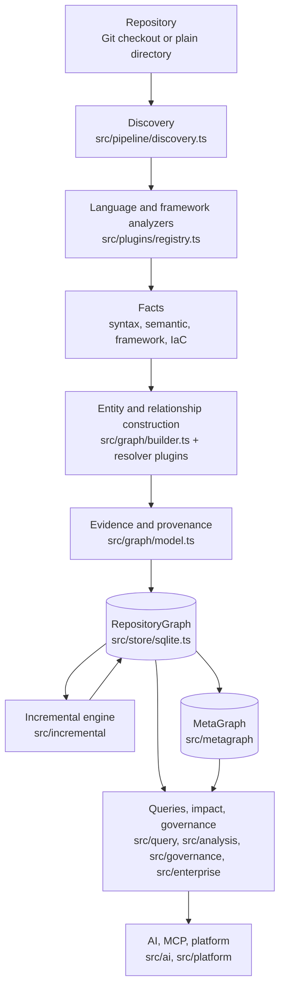

# Architecture overview

Vogoban turns a repository into a deterministic, evidence-backed graph. This page shows the layers from source files to
AI and platform access, and names the modules that implement each layer. Every other page in this section describes one
layer in detail.

**Who this is for:** engineers and contributors who need to know where a fact comes from, which module produced it, and
which guarantees hold at each step.

## The layers

The arrows are data flow. Two rules hold across the whole picture:

1. **The RepositoryGraph is the only source of truth for repository-local facts.** Everything to its right reads it.
   The MetaGraph adds cross-repository relationships but never edits or overrides a repository fact.
2. **Nothing is invented.** A relationship exists only when an analyzer can prove it from source; otherwise the
   analyzer records an unresolved reference with a reason. See [identity.md](identity.md).

## 1. Repository

A repository is a Git checkout (or a plain directory). Its identity is derived from the Git remote, a `vogoban.json`
pin, or the local path, in that order (`discoverRepository` in `src/pipeline/discovery.ts`). The repository identity is
part of every entity id, so two repositories never share entities. Details: [identity.md](identity.md#repository-identity).

## 2. Discovery

`discoverFiles` in `src/pipeline/discovery.ts` lists files with `git ls-files -co --exclude-standard` (or a directory
walk for a non-Git directory), skips ignored directories (`.git`, `bin`, `obj`, `node_modules`, `.vogoban`, ...),
symbolic links, submodules, nested repositories, frontend build output and files above the size limit, classifies each
admitted file into a `FileCategory` and language (`classifyFile`), and hashes its content with SHA-256. Configuration
comes from `vogoban.json` (`src/pipeline/config.ts`). Details: [analysis-pipeline.md](analysis-pipeline.md#discovery-and-file-admission).

## 3. Language and framework analyzers

Analyzers are plugins with a fixed contract (`src/plugins/types.ts`). `defaultPlugins()` in `src/plugins/registry.ts`
registers 38 of them; `analyzeDiscovered` in `src/pipeline/analyze.ts` runs them in category order: `workspace`,
`language`, `semantic`, `framework`, `contract`, `infrastructure`, `resolver`. The families are:

| Family | Modules |
|---|---|
| .NET projects, syntax, Roslyn semantics, ASP.NET Core, DI, configuration, messaging | `src/dotnet`, `semantic/Vogoban.Roslyn` |
| TypeScript/JavaScript, Angular, React, frontend HTTP | `src/frontend` |
| Azure Functions, Azure SDK, Aspire, IaC (Bicep, ARM, Terraform) | `src/azure`, `src/azure/iac` |
| OpenAPI, API and message resolution | `src/contracts` |
| Docker, Azure Pipelines, Helm, Kubernetes, App Configuration | `src/infrastructure` |
| CODEOWNERS | `src/ownership` |

Every analyzer writes into the same `GraphBuilder`; there is one graph, not one per language. Details:
[analyzers.md](analyzers.md).

## 4. Facts

Analyzers first extract facts: Tree-sitter syntax facts per file, Roslyn semantic facts per .NET project (a JSONL
protocol with `semantic/Vogoban.Roslyn`), TypeScript compiler facts per npm package, parsed IaC facts per file. Facts are
the cacheable unit: they live in the `fact_cache` table, keyed so that a stale fact can never be replayed. Details:
[analysis-pipeline.md](analysis-pipeline.md#caching).

## 5. Entity and relationship construction

Facts become entities and relationships through `GraphBuilder` (`src/graph/builder.ts`). Entity ids are
`e_` + the first 24 hex characters of SHA-256 over a semantic key (`src/graph/identity.ts`), so the same fact always gets
the same id. Resolver plugins (`contracts.api-resolver`, `contracts.message-resolver`, `infrastructure.resolver`,
`azure.resolver`) run last and link facts produced by different analyzers, for example an HTTP call to an API operation
or a Function binding to a Bicep resource. Details: [repository-graph.md](repository-graph.md).

## 6. Evidence and provenance

Every relationship carries one evidence level (`EVIDENCE_LEVELS` in `src/graph/model.ts`: `EXACT`,
`COMPILER_RESOLVED`, `DECLARED`, `STRUCTURALLY_RESOLVED`, `INFERRED`, `HEURISTIC`, `UNKNOWN`) and a list of
provenance records naming the plugin, extractor, mechanism, resolver, source location, commit and analyzer version.
Details: [evidence-provenance.md](evidence-provenance.md).

## 7. RepositoryGraph

`GraphBuilder.finalize()` drops dangling relationships (with a `dangling-relationship` diagnostic), sorts everything by
id, and `SqliteGraphStore.saveRepositoryGraph` publishes the batch, the run record, the catalog entry and a graph
snapshot in one SQLite transaction. The store sits behind the synchronous `GraphStore` interface
(`src/store/store.ts`). Details: [repository-graph.md](repository-graph.md#graphstore-and-the-sqlite-schema).

## 8. Incremental engine

`src/incremental` turns a change (working tree, staged, commit range) into a normalized change set, plans the
invalidation scope, re-runs the same analysis pipeline over the fact caches and reconciles the result into the store.
An incremental result must be identical to a clean full rebuild. Details: [incremental-engine.md](incremental-engine.md).

## 9. Queries, impact and governance

Read-side engines never write graph facts:

- `src/query` builds the CLI views (`graph-query.ts`, `application-query.ts`, `contract-query.ts`,
  `frontend-query.ts`, `azure-query.ts`, `infrastructure-query.ts`, `meta-query.ts`).
- `src/analysis` provides traversal (`traversal.ts`), impact rules per relationship type (`semantics.ts`,
  `impact.ts`), risk and blast radius (`risk.ts`), cycles and orphans (`structure.ts`) and snapshot diffs (`diff.ts`).
- `src/governance` evaluates policy-as-code rules over graph snapshots (`policy.ts`, `graph.ts`, `evaluate.ts`).
- `src/enterprise` adds ownership, classification, exposure and security findings from enterprise metadata
  (`config.ts`, `model.ts`, `analysis.ts`, `governance.ts`).
- `src/export` writes JSON, JSONL and CSV exports.

## 10. MetaGraph

`src/metagraph` builds cross-repository relationships from several independently analyzed RepositoryGraphs in the same
store. Six resolvers (packages, messages, deployments, APIs, external systems, Azure resources) read repository facts and
write only to the `meta_*` tables. Details: [metagraph.md](metagraph.md).

## 11. AI, MCP and platform

- `src/ai` answers questions through a plan, validate, run-tools, build-context, answer pipeline over a read-only store
  wrapper. Tools are deterministic graph queries; the optional language model only explains tool results, and its claims
  are checked against the cited evidence. Details: [ai-mcp.md](ai-mcp.md).
- `src/platform` wraps the same engines in a multi-tenant API, web app, MCP over HTTP and job workers, with PostgreSQL
  for platform state and one graph store per tenant. Details: [platform.md](platform.md).

## Cross-cutting concerns

| Concern | Where |
|---|---|
| Repository boundary, symlinks, size limits, secret redaction, trust modes | [security-model.md](security-model.md) |
| Identity rules for every entity family | [identity.md](identity.md) |
| Source tree and where tests, fixtures and policies live | [repository-structure.md](repository-structure.md) |

## Limitations

- The graph describes source and declared configuration. Static analysis never proves runtime behaviour: a declared
  guard, role assignment or route is a declaration, not proof that it is enforced.
- The `GraphStore` interface is synchronous and implemented only by SQLite (`src/store/sqlite.ts`).

## Related

- [Concepts](../concepts.md)
- [Analyzers](analyzers.md)
- [Repository structure](repository-structure.md)
