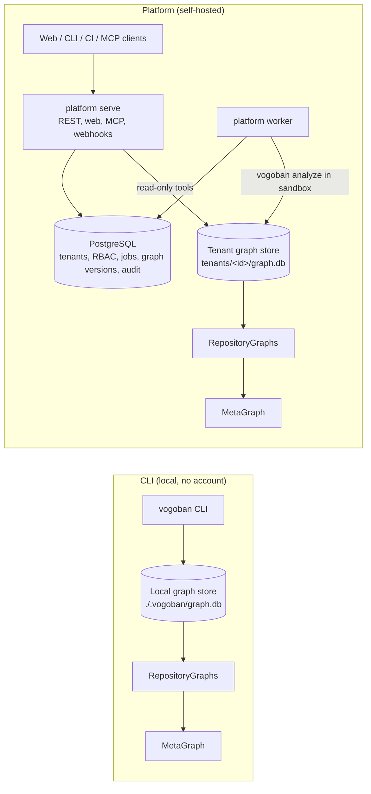

# Platform architecture

The platform is a thin multi-tenant product layer around the same engines the CLI uses. Graph construction,
traversal, impact, governance, security, ownership, AI and MCP logic stay in `src/graph`, `src/pipeline`,
`src/analysis`, `src/governance`, `src/enterprise`, `src/metagraph` and `src/ai`. `src/platform` adds tenancy,
identity, authorization, jobs, integrations, APIs, observability and the web application, and calls those engines
unchanged. This page explains the architecture and its rationale; installation and operation are in the
[enterprise guide](../advanced/enterprise.md) and the [runbook](../advanced/runbook.md).

## Local mode vs platform mode



- **The CLI** is complete on its own: it analyzes into a local SQLite store, builds the MetaGraph, answers queries and
  serves MCP on stdio. It needs no platform, account or network.
- **The platform** runs the same analysis in workers against one graph store per tenant, and serves those graphs to
  authorized users through an API, a web app and MCP over HTTP.

The platform's own mode setting (`VOGOBAN_MODE`, `src/platform/config.ts`) is `local` (default: SQLite for platform
state, `file://` repositories allowed, API tokens without an identity provider) or `enterprise` (PostgreSQL, OIDC and an
https public URL required; startup refuses configurations that violate this). This is separate from the CLI's
`--mode LOCAL|SELF_HOSTED|HOSTED`, which only labels the data boundary shown by `privacy`.

## Components

```mermaid
flowchart LR
  subgraph Clients
    Web[Web app]:::c
    CLI[CLI / CI]:::c
    MCPc[MCP clients]:::c
    Hooks[Git webhooks]:::c
  end
  subgraph API["platform serve (stateless, N replicas)"]
    Auth[OIDC / API tokens / sessions] --> RBAC[RBAC + tenant scope]
    RBAC --> Routes[REST /api/v1 + MCP /api/v1/t/:tenant/mcp]
    Routes --> Tools[Graph tools (src/ai/tools.ts)]
  end
  subgraph Workers["platform worker (N replicas)"]
    Queue[Job leasing] --> Jobs[analyze · MetaGraph · governance · security · PR checks · exports · retention]
  end
  Clients --> API
  Routes -->|enqueue| PG[(PostgreSQL: tenants, users, RBAC, jobs, graph versions, documents, audit, AI usage)]
  Queue --> PG
  Tools --> TG[(Per-tenant graph store /data/tenants/:id/graph.db)]
  Jobs -->|single writer per tenant| TG
  Jobs --> Git[(Git providers)]
  Tools --> LLM[(LLM provider, optional)]
```

| Component | Command | State | Modules |
|---|---|---|---|
| API, web app, MCP over HTTP, webhooks, health and metrics | `vogoban platform serve` | Stateless; reads tenant graphs | `server.ts`, `http.ts`, `api.ts`, `auth.ts`, `rbac.ts`, `web/` |
| Worker | `vogoban platform worker` | Runs jobs; the only writer of tenant graphs | `worker.ts`, `jobs.ts`, `sandbox.ts`, `sandbox.sh`, `providers.ts` |
| Platform database | PostgreSQL (enterprise) or SQLite (local) | Tenants, identity, RBAC, jobs, graph versions, documents, audit, AI usage | `db.ts`, `store.ts`, `audit.ts` |
| Graph data | `$VOGOBAN_DATA_DIR/tenants/<tenant-id>/graph.db` | One `GraphStore` per tenant | `graph.ts` |
| Admin CLI | `vogoban platform migrate`, `config`, `tenant`, `token`, `audit` | – | `cli.ts` |
| Observability | – | Prometheus metrics, OpenTelemetry traces | `telemetry.ts`, `reports.ts` |

## Why PostgreSQL for the platform but SQLite for graphs

The graph engine's `GraphStore` interface is synchronous and is implemented by SQLite. Moving graph data into
PostgreSQL would mean rewriting every engine to be asynchronous, so the platform uses PostgreSQL for platform state and
the job queue, and keeps one embedded graph store per tenant. The consequences:

- Graph reads scale with API replicas that share the data volume.
- Graph writes are serialized per tenant by a lease (`locks` table), so tenants analyze in parallel.
- Workers and API replicas must share `/data`. Use a single-node RWX volume, or shard tenants across volumes and run a
  worker set per shard.
- One store per tenant is also the physical tenant isolation boundary: a query against one tenant's store cannot
  return another tenant's rows.

## Jobs and workers

Job types: `ANALYZE_REPOSITORY`, `METAGRAPH_BUILD`, `GOVERNANCE_EVALUATION`, `SECURITY_ANALYSIS`,
`PULL_REQUEST_ANALYSIS`, `EXPORT`, `RETENTION`. Jobs are rows in the platform database; workers lease them atomically,
renew the lease every few seconds and record progress. A crashed worker's lease expires and the job is re-queued (or
fails with `WORKER_LOST` on its last attempt).

An `ANALYZE_REPOSITORY` job:

1. Fetches the commit with a shallow, single-commit clone into `tenants/<id>/checkouts/<repository>`; credentials are
   passed as an HTTP header, never stored in the remote URL (`providers.ts`).
2. Optionally runs `dotnet restore` (`VOGOBAN_WORKER_DOTNET_RESTORE`) with a tenant-scoped NuGet root and `HOME`.
3. Runs `vogoban analyze <checkout> --db <tenant graph.db> --log-json` as a child process, wrapped by
   `sandboxPlan()` (`namespace-jail`, `static-only` or `trusted-unconfined`; see
   [security-model.md](security-model.md#worker-isolation)).
4. Records a graph version and queues follow-ups: a MetaGraph rebuild (deduplicated per tenant) and, when enabled,
   governance and security evaluations.

Properties:

- **Idempotency.** An identical active job (same tenant and dedupe key) is returned instead of duplicated. An analysis
  whose `(tenant, repository, commit, analyzer version, analysis-config fingerprint)` matches the current graph version
  completes as `deduplicated`; `force: true` overrides this. The fingerprint (`analysisFingerprint` in
  `src/platform/graph.ts`) covers analyzer version, schema version, plugin versions, semantic mode and restore mode.
- **Failures** are classified as `transient`, `repository_unavailable`, `authentication`, `configuration`, `permanent`
  or `cancelled`; only the first two are retried, with exponential backoff, up to `maxAttempts`.
- **Cancellation** is honoured within about 3 seconds. The analyzer child process is killed, and the graph write is a
  single transaction, so the current graph is never partially replaced. On SIGTERM a worker stops claiming jobs and
  re-queues the running ones.
- **Pull-request analysis** analyzes the head commit into a scratch graph, diffs it against the repository's current
  graph version and evaluates rules on both.

The worker runs `analyze`, not `graph sync`, so it benefits from the fact caches in the persistent tenant store but
records no sync mode or metrics.

## Graph versions and reproducibility

Every analysis records a graph version row: repository, catalog id, commit, branch, graph version hash, snapshot id,
analyzer version, graph schema version, analysis-config fingerprint, the active policy and enterprise-metadata
document versions, job id and correlation id. Older versions become `HISTORICAL` and stay queryable through their
snapshots. Because graph data is derived, re-analyzing a recorded commit with the same analyzer version and fingerprint
reproduces it. The engine refuses graph stores written with a different schema version.

## Tenancy, authentication and authorization

- **Tenancy.** Every route under `/api/v1/t/{tenant}` needs active membership (users) or a token issued for that tenant;
  non-members get 404. Tenant ids are validated before any filesystem use.
- **Authentication.** OIDC authorization code + PKCE for the web app (hashed server-side sessions, HttpOnly SameSite=Lax
  cookies, same-origin writes); `Authorization: Bearer` with an OIDC JWT or a platform API token (`vgb_…`, SHA-256
  stored, tenant-bound, expiring, revocable) for API and MCP clients.
- **RBAC.** 16 permissions, built-in roles `org_admin`, `architecture_admin`, `security_admin`, `repository_analyst`,
  `viewer`, and custom roles; bindings at tenant, team or repository scope, optionally per environment
  (`src/platform/rbac.ts`).
- **Resource scope.** `PlatformGraphs.access()` (`src/platform/graph.ts`) builds a `GraphAccess` over a read-only view
  of the tenant store, restricted to the repositories and environments the caller may read, with per-tool permission
  checks (`deniedTools`) and section filters for composite results. REST graph routes, `/query/{tool}`, AI and MCP all
  go through it.

Details: [security-model.md](security-model.md).

## Configuration and secrets

Configuration comes from `VOGOBAN_*` environment variables plus an optional YAML file (`VOGOBAN_PLATFORM_CONFIG`,
example in `deploy/platform.example.yaml`); `vogoban platform config` prints the effective configuration with secrets
masked. Secrets are only ever references (`env:NAME` or `file:/run/secrets/name`) for the OIDC client secret,
repository credentials, webhook secrets, AI provider keys and the metrics token; raw values are rejected by the API and
never written to the database or graph. The full variable list is in the [enterprise guide](../advanced/enterprise.md).

## API

The OpenAPI 3.1 document is served at `GET /api/v1/openapi.json`, generated from the same route table and schemas the
server validates with (`src/platform/api.ts`): authentication, required permission and feature per route,
pagination (`limit` plus an opaque `cursor`), error codes. The API is versioned by path (`/api/v1`). Requests are
validated against strict schemas with size limits and bounded page sizes, depths and node counts; errors are structured
(`{ error: { code, message, correlationId, details } }`) without stack traces.

## Degradation

| Failure | Effect |
|---|---|
| Database | API readiness fails; workers stop claiming jobs; expired leases re-queue in-flight jobs after restore |
| Worker | API stays available; jobs stay queued or are re-queued when their lease expires |
| Repository provider | Jobs fail as transient and retry; existing graphs stay readable |
| AI provider | Answers fall back to deterministic results; graph tools and MCP are unaffected |
| Identity provider | New logins fail; existing sessions and API tokens keep working |

## Limitations

- Workers and API replicas must share the data volume that holds tenant graph stores.
- The namespace jail needs unprivileged user, mount and PID namespaces and a mountable `/proc`; under default Docker the
  worker runs `static-only`. Kubernetes was not validated.
- The platform worker does not run incremental sync.

## Related

- [Enterprise guide](../advanced/enterprise.md)
- [Runbook](../advanced/runbook.md)
- [platform command reference](../cli/platform.md)
- [Security model](security-model.md)
- [AI and MCP](ai-mcp.md)
