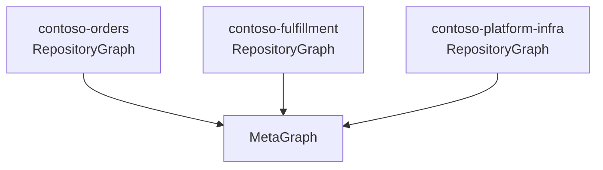
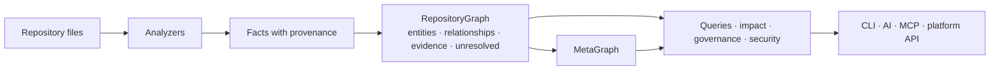

# Concepts

The handful of ideas you need to read Vogoban's output. Each section says what the concept is, shows where you meet it on the command line, and links to the detailed page.

## RepositoryGraph

A **RepositoryGraph** is one repository's architecture graph: every entity and relationship Vogoban derived from that repository's files at one commit.

- It is built by `vogoban analyze <path>` and kept current by `vogoban graph sync`.
- It is **authoritative for repository-local facts**. Nothing outside the repository can add to or change what the repository's own code, configuration and infrastructure files say.
- Each successful analysis or sync produces a new **graph version** (a content hash) and a **snapshot**, so you can compare versions with `vogoban diff`.

Several RepositoryGraphs can live in one store side by side. External symbols (for example `System.Threading.Tasks.Task` or a NuGet type) are shared nodes without a repository, so two repositories that use the same framework type point at the same entity.

Details: [RepositoryGraph architecture](architecture/repository-graph.md).

## MetaGraph

The **MetaGraph** connects independently analyzed RepositoryGraphs. It records relationships that cross repository boundaries: repository B consumes a message that repository A publishes, a frontend repository calls an API another repository implements, a Terraform repository declares the Service Bus topic both use.



The MetaGraph never becomes a second source of truth. It only links facts that already exist in the repository graphs, keeps its own relationships in separate tables with evidence from both sides, and records which graph version of each repository it was built from. Cross-repository links that cannot be matched deterministically stay unresolved.

```bash
vogoban register ../contoso-fulfillment
vogoban analyze-all
vogoban metagraph build
vogoban connections
```

Details: [MetaGraph guide](features/metagraph.md), [MetaGraph architecture](architecture/metagraph.md).

## Entity

An **entity** is a known architectural or code object. Every entity has a kind, a name, usually a qualified name and a source location, and a deterministic id derived from what it is (not from where it happens to be printed). Common kinds:

| Kind | Example from the sample |
|---|---|
| `Project`, `Assembly`, `Namespace`, `File` | `src/Contoso.Orders.Api/Contoso.Orders.Api.csproj` |
| `Type`, `Method`, `Property`, `Field`, `Parameter` | `Contoso.Orders.Api.Services.OrderService` |
| `Application` | `Contoso.Orders.Api` (an ASP.NET Core app), `contoso-orders-web` (a React app) |
| `Endpoint`, `ApiOperation`, `Api` | `POST /api/orders` |
| `ServiceRegistration`, `Middleware`, `HostedService` | `IOrderService` → `OrderService` (scoped) |
| `Message`, `Topic`, `Queue` | `OrderSubmitted`; Service Bus topic `sb-contoso-orders/orders` |
| `AzureFunction` | `Contoso.Orders.Functions:ProcessOrder` |
| `AzureResource` | `Microsoft.DocumentDB/databaseAccounts/sqlDatabases/containers` declared in Bicep |
| `Database`, `Storage` | Cosmos container `cosmos-contoso-orders/ordersdb/orders` as code sees it |
| `FrontendRoute` | `/orders/new` |
| `Pipeline`, `ContainerImage`, `Deployment`, `KubernetesService`, `HelmChart` | declared infrastructure |

The full list is `ENTITY_KINDS` in `src/graph/model.ts`; `vogoban stats` shows how many of each your graph has. Use the kind with `--kind` to narrow searches: `vogoban find orders --kind Queue`.

## Relationship

A **relationship** is a directed, typed connection between two entities, established deterministically from the source. Examples: `CALLS`, `IMPLEMENTS`, `INJECTS`, `IMPLEMENTED_BY`, `CALLS_ENDPOINT`, `PUBLISHES`, `PUBLISHES_TO`, `SUBSCRIBES_TO`, `TRIGGERS`, `WRITES_TO`, `DECLARED_BY`, `HOSTED_ON`, `ROUTES_TO_COMPONENT`.

On the command line a relationship is printed as `-[TYPE/EVIDENCE]->`:

```text
-[WRITES_TO/COMPILER_RESOLVED]-> Database azure:cosmos-container:cosmos-contoso-orders/ordersdb/orders
```

The vocabulary is fixed (`RELATIONSHIP_TYPES` in `src/graph/model.ts`). Impact analysis has a propagation rule per relationship type (`src/analysis/semantics.ts`) that says whether a change travels along it, in which direction, and whether the reached entity is only a potential impact.

## Evidence

Every relationship carries an **evidence level** saying how it was established. From strongest to weakest:

| Level | Meaning in practice |
|---|---|
| `EXACT` | Structural fact with no interpretation: a project contains a file, a project references a package, an API operation is implemented by the endpoint it was generated from. |
| `COMPILER_RESOLVED` | Resolved by a compiler: Roslyn for C#, the TypeScript compiler API for TS/JS. A call edge points at the method the compiler bound to. |
| `DECLARED` | Stated explicitly in a declaration file: Bicep, Terraform, a Dockerfile, a pipeline, `function.json`, `vogoban.json`. Declared state, not observed runtime state. |
| `STRUCTURALLY_RESOLVED` | Matched through explicit structure: the same resource name in code and in IaC, a request body type bound from an endpoint parameter. |
| `INFERRED` | A documented, weaker rule, such as a frontend HTTP call matched to an API operation by method and route template. Shown with `?` in path output. |
| `HEURISTIC`, `UNKNOWN` | Defined in the model for completeness; treat them as the weakest level. |

Commands that traverse the graph print the evidence of every hop, and impact analysis classifies entities reached only through weaker links as `POTENTIAL`.

Details: [Evidence and provenance](architecture/evidence-provenance.md).

## Provenance

**Provenance** is where a fact came from: the analyzer plugin and extractor, the mechanism, the file and line, the repository, the commit and the analyzer version. Entities and relationships also record the commit and run in which they were first and last seen.

```bash
vogoban provenance <entity-or-relationship-id>
```

`show` prints the source location of every relationship inline, for example `(COMPILER_RESOLVED @ src/Contoso.Orders.Api/Program.cs:9)`.

## Unresolved

An **unresolved reference** is a connection Vogoban saw but could not establish deterministically. It keeps the source entity, the location, the target as written, the reason and a category, but it does **not** become a relationship.

```bash
vogoban unresolved
```

```text
type      target                            source                                                                            reason                                                location
--------  --------------------------------  --------------------------------------------------------------------------------  ----------------------------------------------------  --------------------------------------------------
SENDS_TO  SendMessageAsync (sender entity)  Contoso.Orders.Api.Services.OrderService.SubmitAsync(string, System.Collections.  sender is not created by a visible CreateSender call  src/Contoso.Orders.Api/Services/OrderService.cs:28
```

Typical causes: a URL built at runtime, a NuGet package that was not restored (`missing-package`), a Service Bus queue name that comes from a variable, a resource name that IaC computes from parameters Vogoban cannot evaluate.

**Vogoban prefers unresolved information over guessed architecture.** A missing edge with a reason is honest and fixable; an invented edge is a wrong answer that looks right. Name similarity alone never creates a relationship.

## Diagnostics and conflicts

- **Diagnostics** record analysis problems by category: discovery, parser, semantic (Roslyn), framework and resolver failures, skipped files, a missing .NET SDK (`semantic-unavailable`). `vogoban stats` shows counts per category; `vogoban export` contains every diagnostic.
- **Conflicts** record facts that disagree, such as two endpoints with the same route or the same message contract defined with different fields. Both facts are kept; nothing is overwritten. List them with `vogoban conflicts`.

See [Diagnostics, unresolved and provenance](cli/diagnostics.md).

## Graph store

The graph lives in a local SQLite file, by default `./.vogoban/graph.db` relative to the directory you run `vogoban` in. `--db <path>` or `VOGOBAN_DB` choose another file. The enterprise platform keeps one such store per tenant and uses PostgreSQL for platform state ([Enterprise platform](advanced/enterprise.md)).

## How the pieces fit



Next: [CLI overview](cli/overview.md) or [Architecture overview](architecture/overview.md).
