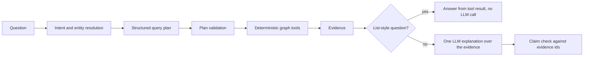

# AI assistant

`vogoban ask` and `vogoban explain` answer architecture questions in plain language ("What depends on ProcessOrder?", "Who owns it?", "What breaks if I change POST /api/orders?") by running Vogoban's deterministic graph tools and citing the graph evidence behind every claim. AI consumes Vogoban's intelligence; it is not the source of truth. Many questions are answered without any language model at all.

## What AI can and cannot do

| AI can | AI cannot |
|---|---|
| query the graph through read-only tools: entities, dependencies and dependents, impact and blast radius, paths, API providers and consumers, message publishers and consumers, repository topology, deployments, ownership, endpoint security, security findings, governance violations, data flows, external systems, snapshots and architecture diffs, Azure Functions, resources, triggers, messaging, infrastructure and flows | create, change or delete entities, relationships, owners or rules (the store it receives throws on every write) |
| explain results in natural language, citing evidence ids | make a claim that no evidence supports: unsupported claims are rejected, confirmations backed only by inferred evidence are downgraded, citations to non-existent evidence are removed |
| ask you to clarify an ambiguous name | guess which entity you meant, or invent one that does not exist |
| stay inside the repositories, environment and snapshot you allow | read entities outside that scope: they are refused or withheld |

## How a question is answered



1. **Resolve.** Names are resolved against the graph. Ambiguous names return candidates; unknown names are reported.
2. **Plan.** Intent rules produce a plan of read-only tool calls. `vogoban ai-plan "<question>"` shows it without running it.
3. **Validate.** Every plan is checked: known read-only tool, strict input schema, depth and result limits, repository and environment scope, snapshot existence.
4. **Execute.** The tools run the same engines as the CLI (impact, ownership, governance, ...). Every result carries evidence items with entity ids, relationship ids, evidence level, path, repository, environment, snapshot, provenance and location, each classified `FACT`, `INFERENCE` or `UNKNOWN`.
5. **Answer.** List-style questions (owners, consumers, dependents, exposure, deployments, ...) are answered directly from the tool result. Explanations (`explain`, impact, governance, paths, temporal questions) send one request to the configured model with a bounded, deduplicated evidence set inside a delimited data block; repository text is treated as data, not instructions. The answer's claims are then checked against the evidence ids.

## Examples without any model

These run on the `contoso-orders` sample from [Azure end to end](azure-end-to-end.md). `--no-llm` guarantees that no external call is made.

```bash
vogoban ask "Who consumes OrderSubmitted?" --no-llm
```

```text
Answer  [ANSWERED; deterministic graph result, no LLM call]
1 consumers of Message Contoso.Orders.Contracts.OrderSubmitted [contoso-orders]: ProcessOrder.

Claims
  CONFIRMED    1 consumers of Message Contoso.Orders.Contracts.OrderSubmitted [contoso-orders]: ProcessOrder.  (E1)

Evidence (1 of 1; --evidence for all)
  [E1] FACT      Message Contoso.Orders.Contracts.OrderSubmitted [contoso-orders] CONSUMED_BY Method Contoso.Orders.Functions.OrderFunctions.ProcessOrder(Contoso.Orders.Contracts.OrderSubmitted, System.Threading.CancellationToken) [contoso-orders]  @ src/Contoso.Orders.Functions/OrderFunctions.cs:18  (repository r_9b6468f2a3a4f61f4e98a1a6)  snapshot 05a0fc6d647cb7ce

Provenance: graph contoso-orders@27e13936 READY; tools get_message_consumers; no LLM call; record ai_9d384030d1909e0c
```

Every claim cites evidence (`E1`), the evidence names the relationship, its location and the snapshot, and the provenance line names the graph version, the tools used and the audit record.

```bash
vogoban ask "What depends on ProcessOrder?" --no-llm --evidence
```

```text
Answer  [ANSWERED; deterministic graph result, no LLM call]
8 dependents of AzureFunction Contoso.Orders.Functions:ProcessOrder [contoso-orders] within depth 3: levels POTENTIAL=8; categories INFRASTRUCTURE=1 MESSAGE=4 CODE=2 SERVICE=1; repositories contoso-orders(8).
  POTENTIAL: AzureResource func-contoso-orders; Queue sb-contoso-orders/orders/billing; Method ProcessOrder; Queue sb-contoso-orders/orders; Message OrderSubmitted; Method SubmitAsync; Queue sb-contoso-orders/orders/notifications; Application Contoso.Orders.Functions

Claims
  CONFIRMED    8 dependents of AzureFunction Contoso.Orders.Functions:ProcessOrder [contoso-orders] within depth 3: …  (E1, E2, E3, E4, E5, E6, E7, E8)

Unknowns / limitations
  - unknown: 1 unresolved references at the traversal boundary; anything reached only through them is unknown

Evidence (8 of 8)
  [E1] FACT      [POTENTIAL INFRASTRUCTURE] AzureFunction Contoso.Orders.Functions:ProcessOrder [contoso-orders] -[HOSTED_ON]-> AzureResource Microsoft.Web/sites:func-contoso-orders  @ src/Contoso.Orders.Functions/OrderFunctions.cs:18  (repository r_995a06fc0088bfb2cc36ab63)  snapshot 05a0fc6d647cb7ce
  [E2] FACT      [POTENTIAL MESSAGE] AzureFunction Contoso.Orders.Functions:ProcessOrder [contoso-orders] <-[TRIGGERS]- Queue azure-service-bus:service-bus-subscription:sb-contoso-orders/orders/billing  @ src/Contoso.Orders.Functions/OrderFunctions.cs:18  (repository r_d9dff3a80070632e945db844)  snapshot 05a0fc6d647cb7ce
…
```

Follow-up questions in a session resolve "it" to the previous entity, by id:

```bash
vogoban ask "Who owns ProcessOrder?" --no-llm --session review
vogoban ask "What triggers it?" --no-llm --session review
```

```text
Answer  [ANSWERED; deterministic graph result, no LLM call]
AzureFunction Contoso.Orders.Functions:ProcessOrder [contoso-orders] is owned by team-orders.
…
Answer  [ANSWERED; deterministic graph result, no LLM call]
Outgoing relationships (3): Microsoft.Web/sites:func-contoso-orders; Contoso.Orders.Functions.OrderFunctions.ProcessOrder(Contoso.Orders.Contracts.OrderSubmitted, System.Threading.CancellationToken); configuration:ServiceBus
Incoming relationships (2): Contoso.Orders.Functions (azure-functions); azure-service-bus:service-bus-subscription:sb-contoso-orders/orders/billing
…
```

### What happens when the graph does not know

In a MetaGraph store where `OrderSubmitted` exists in two repositories and as a shared contract:

```bash
vogoban ask "Who consumes OrderSubmitted?" --no-llm
```

```text
Answer  [AMBIGUOUS; deterministic graph result, no LLM call]
'OrderSubmitted' matches 3 entities: SharedContract Contoso.Orders.Contracts.OrderSubmitted [-] (me_0662ccdaa3b609a83b563191); Message Contoso.Orders.Contracts.OrderSubmitted [contoso-fulfillment] (e_34d890280aed67708b89148f); Message Contoso.Orders.Contracts.OrderSubmitted [contoso-orders] (e_851ed7b515b2374bb29080dd)
Which one do you mean? Re-ask with the id, the repository (--repo) or a more specific name.
```

```bash
vogoban ask "What breaks if I change FooBarService?" --no-llm
```

```text
Answer  [NOT_FOUND; deterministic graph result, no LLM call]
No entity named 'FooBarService' exists in the graph.

Unknowns / limitations
  - unknown: the graph contains no entity named 'FooBarService'
```

Both exit with code 3. Vogoban does not guess and does not fill gaps from general knowledge.

### Plans and direct tool calls

```bash
vogoban ai-plan "What breaks if I change ProcessOrder?"
```

```text
Query plan  intent IMPACT  source deterministic  LLM explanation over retrieved evidence
  entity 'ProcessOrder' -> RESOLVED AzureFunction Contoso.Orders.Functions:ProcessOrder [contoso-orders] (e_cd48baa2612fcdd2b170f636) by exact name or qualified name
  1. find_impact {"entity":"e_cd48baa2612fcdd2b170f636"}  — Phase 7 change impact and blast radius
  validation: OK (read-only tools, schema-checked, bounded, in scope)
```

`vogoban ai-tools` lists every tool with its input schema, and `vogoban ai-tool <tool> '<json>'` runs one directly:

```bash
vogoban ai-tool get_message_consumers '{"message":"OrderSubmitted","kind":"SharedContract"}'
```

```text
get_message_consumers -> OK
4 consumers of SharedContract Contoso.Orders.Contracts.OrderSubmitted: OrderSubmitted, OrderSubmitted, FulfillOrder, ProcessOrder, FulfillOrder, ProcessOrder.
Evidence (6):
  INFERENCE Repository local:…/contoso-orders [contoso-orders] CONSUMES_MESSAGE SharedContract Contoso.Orders.Contracts.OrderSubmitted
  INFERENCE Repository local:…/contoso-fulfillment [contoso-fulfillment] CONSUMES_MESSAGE SharedContract Contoso.Orders.Contracts.OrderSubmitted
  INFERENCE SharedContract Contoso.Orders.Contracts.OrderSubmitted CONSUMED_BY Method Contoso.Fulfillment.Functions.FulfillmentFunctions.FulfillOrder(…) [contoso-fulfillment]
  INFERENCE SharedContract Contoso.Orders.Contracts.OrderSubmitted CONSUMED_BY Method Contoso.Orders.Functions.OrderFunctions.ProcessOrder(…) [contoso-orders]
  FACT      Message Contoso.Orders.Contracts.OrderSubmitted [contoso-fulfillment] CONSUMED_BY Method Contoso.Fulfillment.Functions.FulfillmentFunctions.FulfillOrder(…) [contoso-fulfillment]  @ src/Contoso.Fulfillment.Functions/FulfillmentFunctions.cs:10
  FACT      Message Contoso.Orders.Contracts.OrderSubmitted [contoso-orders] CONSUMED_BY Method Contoso.Orders.Functions.OrderFunctions.ProcessOrder(…) [contoso-orders]  @ src/Contoso.Orders.Functions/OrderFunctions.cs:18
```

The summary line repeats some names (it lists the consumers found through each relationship); the evidence list is the authoritative result. Cross-repository MetaGraph links are `INFERENCE`; facts read from one repository's code are `FACT`.

## Scope

Every tool honours the scope you give:

| Option | Effect |
|---|---|
| `--repo R[,R]` | only these repositories; out-of-scope entities are refused and out-of-scope results withheld |
| `--env E` | only this environment's facts |
| `--scope repository|meta|all` | include MetaGraph relationships or not |
| `--at S` | a stored snapshot instead of the current graph |
| `--depth`, `--limit`, `--max-nodes`, `--max-evidence` | bound retrieval; truncation is reported |

On the [platform](../cli/platform.md), AI and MCP additionally run with the caller's permissions: only repositories where the caller holds `ai.use` (or `mcp.use`) and `graph.read`, plus per-tool permissions such as `security.read` and `governance.read`, are visible, and authorization is applied before any evidence reaches the model.

## Providers

Without a provider, everything except LLM explanations works. To add explanations, create `vogoban-ai.yaml` (or pass `--ai-config <file>`, or set `$VOGOBAN_AI`):

```yaml
provider: openai-compatible
model: llama3.1
endpoint: http://localhost:11434/v1
apiKeyEnv: LOCAL_LLM_KEY
temperature: 0
maxOutputTokens: 1200
contextTokens: 12000
aliases:
  orders-topic: e_c27699a970fb60fc67831e43
```

```bash
vogoban ai-config --ai-config vogoban-ai.yaml
```

```text
provider openai-compatible  destination LOCAL MODEL on this machine (http://localhost:11434/v1)  model llama3.1  endpoint http://localhost:11434/v1
credential from $LOCAL_LLM_KEY (NOT set)
temperature 0  max output tokens 1200  context tokens 12000  timeout 60000 ms  retries 2  planner deterministic  audit true  aliases 1
config file …/vogoban-ai.yaml
```

| Key | Values |
|---|---|
| `provider` | `none`, `openai-compatible` (OpenAI or a local server), `azure-openai`, `anthropic` |
| `model`, `endpoint`, `apiVersion` | model name, endpoint URL, Azure OpenAI API version |
| `apiKeyEnv` | **name** of the environment variable that holds the key; raw keys are rejected (`raw credentials are not accepted`, exit 2) and never printed |
| `temperature`, `maxOutputTokens`, `contextTokens`, `timeoutMs`, `retries` | request limits |
| `planner` | `deterministic` (default) or `llm`; `--llm-plan` lets the model propose a plan for questions the rules cannot map, still validated before execution |
| `audit` | write audit records (default `true`) |
| `aliases` | name → entity id shortcuts |

`$VOGOBAN_AI_PROVIDER`, `_MODEL`, `_ENDPOINT` and `_API_KEY_ENV` override the file. `vogoban ai-config` classifies the destination as **LOCAL MODEL** (loopback; no data leaves the machine) or **USER-CONFIGURED PROVIDER** (graph evidence within the requested scope is sent there). Before each external call the CLI prints the destination to stderr. Vogoban ships no default AI endpoint and contacts no AI vendor on its own. Provider failures, timeouts or malformed output fall back to the deterministic result.

## Offline

`--offline` or `VOGOBAN_OFFLINE=1` refuses every non-loopback AI endpoint. The answer falls back to the deterministic graph result and says why:

```bash
vogoban explain entity ProcessOrder --kind AzureFunction --offline
```

```text
Answer  [ANSWERED; deterministic fallback]
Outgoing relationships (3): Microsoft.Web/sites:func-contoso-orders; …
…
  - LLM explanation failed (offline mode (VOGOBAN_OFFLINE=1): refusing to contact non-local AI endpoint llm.example.com); deterministic graph result returned
```

(Here `VOGOBAN_AI_ENDPOINT=https://llm.example.com/v1` was set.) Local models on loopback, the graph, the MetaGraph and MCP keep working offline.

## Audit

Each answer appends a record to `ai-audit.jsonl` next to the graph store: question, scope, graph versions, plan, tools, evidence references, model and answer. Prompt context and credentials are not recorded. Sessions (`--session`) store questions and the entity ids they resolved to, never answers.

```bash
vogoban ai-audit
```

```text
record               at                        status    mode                    intent       tools                  question
-------------------  ------------------------  --------  ----------------------  -----------  ---------------------  -----------------------------
ai_9d384030d1909e0c  2026-10-11T17:08:18.557Z  ANSWERED  deterministic           CONSUMERS    get_message_consumers  Who consumes OrderSubmitted?
ai_f166a5c6c5fc8187  2026-10-11T17:08:18.768Z  ANSWERED  deterministic           DEPENDENTS   get_dependents         What depends on ProcessOrder?
…
```

`vogoban ai-audit <record-id>` shows one record in full.

## Limitations

- Answers are only as complete as the graph. What Vogoban did not extract (see each feature page's limitations) is unknown to the AI too; unresolved references at the boundary are reported as unknowns.
- The deterministic planner recognises common question shapes. Unusual phrasing may return `UNSUPPORTED`; rephrase, name the entity explicitly, or use `ai-tool`.
- Questions naming MetaGraph ids (`me_…`) are not resolved by `ask`; use `ai-tool` with `"kind":"SharedContract"`.
- A model explanation is a summary of evidence, checked claim by claim, but wording can still be imprecise. The evidence list is authoritative.

## Related

- [MCP](mcp.md): the same tools for AI clients
- [AI command reference](../cli/ai.md)
- [AI and MCP architecture](../architecture/ai-mcp.md)
- [Privacy](../advanced/privacy.md)
