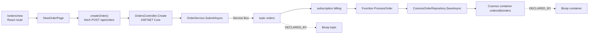

# Azure end to end: from a React route to Cosmos DB and Bicep

This tutorial follows one request through a complete Azure application: a React page calls an ASP.NET Core API, the API publishes to a Service Bus topic, an Azure Function consumes the message and writes to Cosmos DB, and Bicep declares every resource. You analyze the sample, trace the chain hop by hop, ask what a change would affect, and then connect two more repositories through the MetaGraph.

Everything here is static repository analysis. No Azure subscription is needed or contacted, and nothing is deployed or executed.



## What you need

- Vogoban 0.18.0 installed (see [Installation](../installation.md)) and Git.
- The .NET SDK 8 or later on `PATH` for full semantic resolution of the C# projects. Without it, Functions are still found from their attributes, but SDK calls such as `CreateSender("orders")` are not resolved.
- The sample repositories. They ship with the Vogoban source distribution in `test/azure/fixtures/`: `contoso-orders`, `contoso-fulfillment` and `contoso-platform-infra`. After `bun install -g ./vogoban-0.18.0-src.tar.gz` the same folder is at `~/.bun/install/global/node_modules/vogoban/test/azure/fixtures/`.

## 1. Prepare the sample

Copy the three repositories to a working folder, make each one a Git repository, and restore the .NET projects. `dotnet restore` downloads NuGet packages so that Roslyn can resolve Azure SDK types; nothing is built or run.

```bash
FIXTURES=~/.bun/install/global/node_modules/vogoban/test/azure/fixtures   # or <source tree>/test/azure/fixtures
mkdir -p ~/azure-demo && cd ~/azure-demo
cp -r "$FIXTURES"/contoso-orders "$FIXTURES"/contoso-fulfillment "$FIXTURES"/contoso-platform-infra .

for r in contoso-orders contoso-fulfillment contoso-platform-infra; do
  (cd "$r" && printf 'bin/\nobj/\n.vogoban/\n' > .gitignore && git init -q && git add -A && git commit -qm initial)
done

(cd contoso-orders && for p in $(find . -name '*.csproj'); do dotnet restore "$p"; done)
(cd contoso-fulfillment && dotnet restore src/Contoso.Fulfillment.Functions)
```

The `.gitignore` keeps restore output and the Vogoban store out of Git, so `vogoban graph status` reports only your real changes later.

## 2. The code, layer by layer

**Route and component** (`web/src/routes.tsx`, `web/src/pages/NewOrderPage.tsx`):

```tsx
export const router = createBrowserRouter([
  { path: "/orders/new", element: <NewOrderPage /> },
  { path: "/orders/:id", element: <OrderStatusPage /> },
]);

export function NewOrderPage() {
  const submit = async () => {
    const created = await createOrder({ customerId: "c-1", lines: [{ sku, quantity: 1 }] });
    window.location.assign(`/orders/${created.id}`);
  };
  // …
}
```

**Frontend API client** (`web/src/api/orders.ts`):

```ts
export async function createOrder(order: CreateOrder): Promise<{ id: string }> {
  const response = await fetch("/api/orders", { method: "POST", headers: { "Content-Type": "application/json" }, body: JSON.stringify(order) });
  return response.json();
}
```

**ASP.NET Core API** (`src/Contoso.Orders.Api/Controllers/OrdersController.cs`, `Services/OrderService.cs`, `Program.cs`):

```csharp
[ApiController]
[Route("api/orders")]
[Authorize]
public sealed class OrdersController(IOrderService orders) : ControllerBase
{
    [HttpPost]
    public async Task<ActionResult<string>> Create(CreateOrderRequest request, CancellationToken cancellationToken)
    {
        var id = await orders.SubmitAsync(request.CustomerId, request.Lines, cancellationToken);
        return Accepted(new { id });
    }
}

public sealed class OrderService : IOrderService
{
    public OrderService(ServiceBusClient client, EventGridPublisherClient audit)
    {
        _sender = client.CreateSender("orders");
        _audit = audit;
    }

    public async Task<string> SubmitAsync(string customerId, IReadOnlyList<OrderLine> lines, CancellationToken cancellationToken)
    {
        var submitted = new OrderSubmitted(id, customerId, lines);
        await _sender.SendMessageAsync(new ServiceBusMessage(BinaryData.FromObjectAsJson(submitted)), cancellationToken);
        // …
    }
}

// Program.cs
builder.AddAzureServiceBusClient("messaging");
builder.Services.AddScoped<IOrderService, OrderService>();
```

**Azure Function** (`src/Contoso.Orders.Functions/OrderFunctions.cs`) and its data access (`Data/CosmosOrderRepository.cs`):

```csharp
[Function("ProcessOrder")]
[ExponentialBackoffRetry(5, "00:00:04", "00:15:00")]
public Task ProcessOrder([ServiceBusTrigger("orders", "billing", Connection = "ServiceBus")] OrderSubmitted order, CancellationToken cancellationToken)
    => processor.ProcessAsync(order, cancellationToken);

public CosmosOrderRepository(CosmosClient client)
{
    _orders = client.GetContainer("ordersdb", "orders");
}

public Task SaveAsync(OrderDocument order, CancellationToken cancellationToken)
    => _orders.UpsertItemAsync(order, new PartitionKey(order.id), cancellationToken: cancellationToken);
```

**Bicep** (`infra/modules/messaging.bicep`, `infra/modules/data.bicep`, `infra/modules/apps.bicep`):

```bicep
resource sb 'Microsoft.ServiceBus/namespaces@2022-10-01-preview' = {
  name: namespaceName                       // 'sb-contoso-orders' from main.bicep
  resource orders 'topics' = {
    name: 'orders'
    resource billing 'subscriptions' = {
      name: 'billing'
    }
  }
}

resource orders 'Microsoft.DocumentDB/databaseAccounts/sqlDatabases/containers@2024-05-15' = {
  parent: db                                 // cosmos-contoso-orders/ordersdb
  name: 'orders'
}

resource functionApp 'Microsoft.Web/sites@2023-12-01' = {
  name: 'func-${prefix}'
  tags: union(tags, { 'azd-service-name': 'functions' })
  properties: {
    siteConfig: {
      appSettings: [
        { name: 'ServiceBus__fullyQualifiedNamespace', value: '${serviceBusNamespace}.servicebus.windows.net' }
        { name: 'Cosmos__accountEndpoint', value: cosmosEndpoint }
      ]
    }
  }
}
```

`azure.yaml` maps the `functions` service to `./src/Contoso.Orders.Functions`, and the `api` service to an App Service whose `ConnectionStrings__messaging` setting names the same namespace.

## 3. Analyze

Run the analysis from inside the repository. The graph is written to `./.vogoban/graph.db` relative to the current directory.

```bash
cd ~/azure-demo/contoso-orders
vogoban analyze .
```

```text
INFO  discovery.files repo=contoso-orders files=33 skipped=0
…
INFO  applications.detected repo=contoso-orders plugin=dotnet.applications applications=2 kinds=["Contoso.Orders.Api:aspnetcore","Contoso.Orders.Functions:azure-functions"]
…
INFO  azure.functions repo=contoso-orders plugin=azure.functions functions=5 hosts=2 localSettings=2
INFO  azure.sdk repo=contoso-orders plugin=azure.sdk usages=5 unresolved=0 registrations=3 dbContexts=0
INFO  azure.aspire repo=contoso-orders plugin=azure.aspire appHosts=1 resources=6 compute=1 references=1 environments=0
INFO  frontend.http-calls repo=contoso-orders plugin=frontend.http calls=2 resolvedUrls=2
INFO  azure.infrastructure repo=contoso-orders plugin=azure.infrastructure files=5 roots=1 resources=26 settings=14 azdServices=3
INFO  azure.resolver repo=contoso-orders plugin=azure.resolver hosted=3 functions=7 sdkUsages=6
…
Analyzed contoso-orders @ 99d506d574cd in 3328 ms
```

The `azure.functions` line counts the five .NET Functions; the resolver line counts all seven, including the two Node.js Functions in `notifications/` found by the TypeScript Azure analyzer. `azure.infrastructure` evaluated the five Bicep files from one deployment root (`infra/main.bicep`). Your commit hash, timings and the entity ids below will differ from this page: ids are derived from the repository identity, which for a repository without a Git remote is its local path.

## 4. Look at the Azure parts

```bash
vogoban azure functions
```

```text
function                                  trigger     trigger source                                                                    bindings / durable                                                                auth       hosted on            location
----------------------------------------  ----------  --------------------------------------------------------------------------------  --------------------------------------------------------------------------------  ---------  -------------------  -------------------------------------------------
contoso-notifications:Health              http        Endpoint contoso-notifications:GET /api/health (COMPILER_RESOLVED)                -                                                                                 function   -                    notifications/src/functions/notify.ts:18
contoso-notifications:NotifyCustomer      serviceBus  Queue azure-service-bus:service-bus-subscription:sb-contoso-orders/orders/notifi  -                                                                                 -          -                    notifications/src/functions/notify.ts:17
Contoso.Orders.Functions:GetOrderStatus   http        Endpoint Contoso.Orders.Functions:GET /api/orders/{id}/status (COMPILER_RESOLVED  READS_FROM Database azure:cosmos-container:cosmos-contoso-orders/ordersdb/orders  anonymous  func-contoso-orders  src/Contoso.Orders.Functions/OrderFunctions.cs:22
Contoso.Orders.Functions:NightlyCleanup   timer       AzureResource NightlyCleanup:timer (COMPILER_RESOLVED)                            -                                                                                 -          func-contoso-orders  src/Contoso.Orders.Functions/OrderFunctions.cs:40
Contoso.Orders.Functions:OnOrderAudit     eventGrid   AzureResource Microsoft.EventGrid/topics/eventSubscriptions:egt-contoso-orders-a  -                                                                                 -          func-contoso-orders  src/Contoso.Orders.Functions/OrderFunctions.cs:37
Contoso.Orders.Functions:OrderChangeFeed  cosmosDB    Database azure:cosmos-container:cosmos-contoso-orders/ordersdb/orders (COMPILER_  PUBLISHES_TO Topic azure-event-hubs:event-hub:evhns-contoso-orders/order-telemet  -          func-contoso-orders  src/Contoso.Orders.Functions/OrderFunctions.cs:33
Contoso.Orders.Functions:ProcessOrder     serviceBus  Queue azure-service-bus:service-bus-subscription:sb-contoso-orders/orders/billin  -                                                                                 -          func-contoso-orders  src/Contoso.Orders.Functions/OrderFunctions.cs:18
```

```bash
vogoban azure messaging
```

```text
azure-service-bus sb-contoso-orders/orders  [exact]
  publishers:    PUBLISHES_TO Method Contoso.Orders.Api.Services.OrderService.SubmitAsync(string, System.Collections.Generic.IReadOnlyList<Contoso.Orders.Contracts.OrderLine>, System.Threading.CancellationToken)
  receivers:     -
  subscriptions: SUBSCRIBES_TO Queue azure-service-bus:service-bus-subscription:sb-contoso-orders/orders/billing; SUBSCRIBES_TO Queue azure-service-bus:service-bus-subscription:sb-contoso-orders/orders/notifications
  consumers:     -
  messages:      -
  declared by:   DECLARED_BY AzureResource aspire:orders; DECLARED_BY AzureResource Microsoft.ServiceBus/namespaces/topics:sb-contoso-orders/orders

azure-service-bus sb-contoso-orders/orders/billing  [exact]
  publishers:    -
  receivers:     -
  subscriptions: -
  consumers:     ROUTES_TO Method Contoso.Orders.Functions.OrderFunctions.ProcessOrder(Contoso.Orders.Contracts.OrderSubmitted, System.Threading.CancellationToken); TRIGGERS AzureFunction Contoso.Orders.Functions:ProcessOrder
  messages:      CARRIES Message Contoso.Orders.Contracts.OrderSubmitted
  declared by:   DECLARED_BY AzureResource Microsoft.ServiceBus/namespaces/topics/subscriptions:sb-contoso-orders/orders/billing
…
```

```bash
vogoban azure resources --kind service-bus
```

```text
type                                                  name                              name state           declared in  state     code refs  location
----------------------------------------------------  --------------------------------  -------------------  -----------  --------  ---------  ---------------------------------
Microsoft.ServiceBus/namespaces                       messaging                         aspire-logical-name  aspire       DECLARED  0          src/Contoso.Orders.AppHost/AppHost.cs:3
Microsoft.ServiceBus/namespaces                       sb-contoso-orders                 exact                bicep        DECLARED  0          infra/modules/messaging.bicep:5
Microsoft.ServiceBus/namespaces/topics                orders                            exact                aspire       DECLARED  1          src/Contoso.Orders.AppHost/AppHost.cs:4
Microsoft.ServiceBus/namespaces/topics                sb-contoso-orders/orders          exact                bicep        DECLARED  1          infra/modules/messaging.bicep:15
Microsoft.ServiceBus/namespaces/topics/subscriptions  billing                           exact                aspire       DECLARED  0          src/Contoso.Orders.AppHost/AppHost.cs:4
Microsoft.ServiceBus/namespaces/topics/subscriptions  sb-contoso-orders/orders/billing  exact                bicep        DECLARED  1          infra/modules/messaging.bicep:18
```

`code refs` counts the code-side resources linked to the declaration with `DECLARED_BY`. The Aspire AppHost declares the same topic under its logical name; both declarations are linked through the code-side topic, never through name similarity.

## 5. Trace the whole chain

`azure flow` follows stored relationships from a starting entity. The route name `/orders/new` is unique once you restrict the kind. To end the trace at the Cosmos container declared in Bicep, find its id first:

```bash
vogoban find ordersdb
```

```text
id                          entity                                                                            location
--------------------------  --------------------------------------------------------------------------------  ---------------------------------------
e_257b0b104cafed1eb13bfbd7  AzureResource Microsoft.DocumentDB/databaseAccounts/sqlDatabases/containers:cosm  infra/modules/data.bicep:33
e_347d574e1abfc4a67b7c9936  AzureResource Microsoft.DocumentDB/databaseAccounts/sqlDatabases/containers:cosm  infra/modules/data.bicep:22
e_de34831957d39ef2c26e014e  AzureResource Microsoft.DocumentDB/databaseAccounts/sqlDatabases:cosmos-contoso-  infra/modules/data.bicep:16
e_7c893ab38c74022ce3a05b9e  AzureResource aspire:ordersdb                                                     src/Contoso.Orders.AppHost/AppHost.cs:6
e_df1653a25b90d6ec904c1954  Database azure:cosmos-container:cosmos-contoso-orders/ordersdb/orders
```

The container at `data.bicep:22` is `orders` (line 33 is `leases`). Use your own id:

```bash
vogoban azure flow "/orders/new" --kind FrontendRoute --to e_347d574e1abfc4a67b7c9936
```

```text
FrontendRoute contoso-orders-web:/orders/new  downstream: 35 reachable entities

    FrontendRoute contoso-orders-web:/orders/new
      -[ROUTES_TO_COMPONENT/COMPILER_RESOLVED]-> Method:function web/src/pages/NewOrderPage.tsx:NewOrderPage
      -[CALLS/COMPILER_RESOLVED]-> Method:function web/src/api/orders.ts:createOrder
      -[CALLS_ENDPOINT/INFERRED]-> ApiOperation Contoso.Orders.Api:POST /api/orders
      -[IMPLEMENTED_BY/EXACT]-> Endpoint Contoso.Orders.Api:POST /api/orders
      -[ROUTES_TO/STRUCTURALLY_RESOLVED]-> Method Contoso.Orders.Api.Controllers.OrdersController.Create(Contoso.Orders.Api.Controllers.CreateOrderRequest, System.Threading.CancellationToken)
      -[CALLS/COMPILER_RESOLVED]-> Method Contoso.Orders.Api.Services.IOrderService.SubmitAsync(string, System.Collections.Generic.IReadOnlyList<Contoso.Orders.Contracts.OrderLine>, System.Threading.CancellationToken)
      <-[IMPLEMENTS/COMPILER_RESOLVED]- Method Contoso.Orders.Api.Services.OrderService.SubmitAsync(string, System.Collections.Generic.IReadOnlyList<Contoso.Orders.Contracts.OrderLine>, System.Threading.CancellationToken)
      -[PUBLISHES/COMPILER_RESOLVED]-> Message Contoso.Orders.Contracts.OrderSubmitted
      -[CONSUMED_BY/COMPILER_RESOLVED]-> Method Contoso.Orders.Functions.OrderFunctions.ProcessOrder(Contoso.Orders.Contracts.OrderSubmitted, System.Threading.CancellationToken)
      -[CALLS/COMPILER_RESOLVED]-> Method Contoso.Orders.Functions.OrderProcessor.ProcessAsync(Contoso.Orders.Contracts.OrderSubmitted, System.Threading.CancellationToken)
      -[CALLS/COMPILER_RESOLVED]-> Method Contoso.Orders.Functions.Data.IOrderRepository.SaveAsync(Contoso.Orders.Functions.Data.OrderDocument, System.Threading.CancellationToken)
      <-[IMPLEMENTS/COMPILER_RESOLVED]- Method Contoso.Orders.Functions.Data.CosmosOrderRepository.SaveAsync(Contoso.Orders.Functions.Data.OrderDocument, System.Threading.CancellationToken)
      -[WRITES_TO/COMPILER_RESOLVED]-> Database azure:cosmos-container:cosmos-contoso-orders/ordersdb/orders
      -[DECLARED_BY/STRUCTURALLY_RESOLVED]-> AzureResource Microsoft.DocumentDB/databaseAccounts/sqlDatabases/containers:cosmos-contoso-orders/ordersdb/orders
```

`--to` prints the shortest stored path. Here it crosses the Service Bus hop through the message contract: `SubmitAsync` publishes `OrderSubmitted`, and `ProcessOrder` consumes it. Without `--to`, `azure flow` prints every reachable path, including the transport route `PUBLISHES_TO` topic `sb-contoso-orders/orders` → `SUBSCRIBES_TO` subscription `billing` → `TRIGGERS` Function `ProcessOrder`.

### Why each hop exists

| Hop | Relationship and evidence | What Vogoban read |
|---|---|---|
| Route → page | `ROUTES_TO_COMPONENT`, `COMPILER_RESOLVED` | the `createBrowserRouter` entry, resolved by the TypeScript compiler |
| Page → client | `CALLS`, `COMPILER_RESOLVED` | the call to `createOrder` |
| Client → API operation | `CALLS_ENDPOINT`, `INFERRED` | `fetch("/api/orders", { method: "POST" })`: a relative URL matched to the single provider of `POST /api/orders` by method and route. It is `INFERRED` because the deployed base URL is not known statically |
| Operation → endpoint → controller | `IMPLEMENTED_BY` `EXACT`, `ROUTES_TO` | `[Route("api/orders")]` + `[HttpPost]` on `OrdersController.Create` |
| Controller → service | `CALLS` + `IMPLEMENTS`, `COMPILER_RESOLVED` | Roslyn: the interface call `orders.SubmitAsync` and the `OrderService` implementation |
| Service → topic | `PUBLISHES_TO`, `COMPILER_RESOLVED` | `client.CreateSender("orders")` + `SendMessageAsync`; the namespace comes from `AddAzureServiceBusClient("messaging")` and the App Service setting `ConnectionStrings__messaging` |
| Topic → subscription → Function | `SUBSCRIBES_TO`, `TRIGGERS` | `[ServiceBusTrigger("orders", "billing", Connection = "ServiceBus")]` and the namespace in `ServiceBus__fullyQualifiedNamespace` |
| Message → Function | `PUBLISHES` / `CONSUMED_BY` | the `OrderSubmitted` type sent by the API and bound by the trigger parameter |
| Function → repository → Cosmos | `CALLS`, `WRITES_TO` | `GetContainer("ordersdb", "orders")` + `UpsertItemAsync`; the account from `Cosmos:accountEndpoint` |
| Cosmos → Bicep | `DECLARED_BY`, `STRUCTURALLY_RESOLVED` | the evaluated Bicep name `cosmos-contoso-orders/ordersdb/orders` equals the code-side account-qualified name |

The frontend half of the chain is also available on its own:

```bash
vogoban frontend-chain "/orders/new" --kind FrontendRoute
```

```text
FrontendRoute contoso-orders-web:/orders/new  (8 reachable entities)

API operations (1)
    FrontendRoute contoso-orders-web:/orders/new
      -[ROUTES_TO_COMPONENT/COMPILER_RESOLVED]-> Method:function web/src/pages/NewOrderPage.tsx:NewOrderPage
      -[CALLS/COMPILER_RESOLVED]-> Method:function web/src/api/orders.ts:createOrder
      -[CALLS_ENDPOINT/INFERRED]-> ApiOperation Contoso.Orders.Api:POST /api/orders

Backend handlers (3)
…
```

Reverse direction: what reaches the Bicep topic?

```bash
vogoban find sb-contoso-orders/orders --kind AzureResource
vogoban azure flow e_c27699a970fb60fc67831e43 --upstream
```

```text
AzureResource Microsoft.ServiceBus/namespaces/topics:sb-contoso-orders/orders  upstream: 21 reachable entities

    AzureResource Microsoft.ServiceBus/namespaces/topics:sb-contoso-orders/orders
      <-[DECLARED_BY/STRUCTURALLY_RESOLVED]- Queue azure-service-bus:service-bus-entity:sb-contoso-orders/orders
…
    AzureResource Microsoft.ServiceBus/namespaces/topics:sb-contoso-orders/orders
      -[SUBSCRIBES_TO/DECLARED]-> AzureResource Microsoft.ServiceBus/namespaces/topics/subscriptions:sb-contoso-orders/orders/billing
      <-[DECLARED_BY/STRUCTURALLY_RESOLVED]- Queue azure-service-bus:service-bus-subscription:sb-contoso-orders/orders/billing
      -[TRIGGERS/COMPILER_RESOLVED]-> AzureFunction Contoso.Orders.Functions:ProcessOrder
    AzureResource Microsoft.ServiceBus/namespaces/topics:sb-contoso-orders/orders
      <-[DECLARED_BY/STRUCTURALLY_RESOLVED]- Queue azure-service-bus:service-bus-entity:sb-contoso-orders/orders
      <-[PUBLISHES_TO/COMPILER_RESOLVED]- Method Contoso.Orders.Api.Services.OrderService.SubmitAsync(…)
      -[IMPLEMENTS/COMPILER_RESOLVED]-> Method Contoso.Orders.Api.Services.IOrderService.SubmitAsync(…)
      <-[CALLS/COMPILER_RESOLVED]- Method Contoso.Orders.Api.Controllers.OrdersController.Create(…)
      <-[ROUTES_TO/STRUCTURALLY_RESOLVED]- Endpoint Contoso.Orders.Api:POST /api/orders
…
```

## 6. What does a change affect?

Impact on the Bicep topic (use your own id, or the name with `--kind`):

```bash
vogoban impact sb-contoso-orders/orders --kind AzureResource
```

```text
impact of AzureResource Microsoft.ServiceBus/namespaces/topics:sb-contoso-orders/orders
  27 entities  levels: DIRECT=3 INDIRECT=3 POTENTIAL=11 TRANSITIVE=10  categories: API=1 CODE=11 INFRASTRUCTURE=4 MESSAGE=5 SERVICE=6
  repositories: contoso-orders(27)  unresolved at boundary: 1  conflicts: 0
  graph: contoso-orders@7e8f073b/f079ef41 READY
level       category        entity                                                                            repository      because                              path (* crosses repository)
----------  --------------  --------------------------------------------------------------------------------  --------------  -----------------------------------  --------------------------------------------------------------------------------
DIRECT      INFRASTRUCTURE  AzureResource Microsoft.ServiceBus/namespaces:sb-contoso-orders                   contoso-orders  contains changed resource            <-CONTAINS_RESOURCE
DIRECT      INFRASTRUCTURE  AzureResource Microsoft.ServiceBus/namespaces/topics/subscriptions:sb-contoso-or  contoso-orders  delivers to subscriber               ->SUBSCRIBES_TO
DIRECT      MESSAGE         Queue azure-service-bus:service-bus-entity:sb-contoso-orders/orders               contoso-orders  declared by infrastructure           <-DECLARED_BY
INDIRECT    CODE            Method Contoso.Orders.Api.Services.OrderService.SubmitAsync(string, System.Colle  contoso-orders  publishes to                         <-DECLARED_BY <-PUBLISHES_TO
INDIRECT    MESSAGE         Queue azure-service-bus:service-bus-subscription:sb-contoso-orders/orders/billin  contoso-orders  declared by infrastructure           ->SUBSCRIBES_TO <-DECLARED_BY
INDIRECT    MESSAGE         Queue azure-service-bus:service-bus-subscription:sb-contoso-orders/orders/notifi  contoso-orders  delivers to subscriber               <-DECLARED_BY ->SUBSCRIBES_TO
…
TRANSITIVE  SERVICE         AzureFunction contoso-notifications:NotifyCustomer                                contoso-orders  triggers                             <-DECLARED_BY ->SUBSCRIBES_TO ->TRIGGERS
TRANSITIVE  SERVICE         AzureFunction Contoso.Orders.Functions:ProcessOrder                               contoso-orders  triggers                             ->SUBSCRIBES_TO <-DECLARED_BY ->TRIGGERS
…
POTENTIAL   SERVICE         Endpoint Contoso.Orders.Api:POST /api/orders                                      contoso-orders  implemented by                       <-DECLARED_BY <-PUBLISHES_TO ->IMPLEMENTS <-CALLS <-IMPLEMENTED_BY
POTENTIAL   API             ApiOperation Contoso.Orders.Api:POST /api/orders                                  contoso-orders  implemented by                       <-DECLARED_BY <-PUBLISHES_TO ->IMPLEMENTS <-CALLS <-IMPLEMENTED_BY <-IMPLEMENTED
```

Both Functions that consume the topic (in two languages), the publisher, its API endpoint and the hosting resources are reached. `unresolved at boundary: 1` is the one unresolved reference touching the impact set (`vogoban unresolved` lists it); anything behind it is unknown, not "unaffected".

Impact on the message contract:

```bash
vogoban impact OrderSubmitted --kind Message --limit 8
```

This lists the publisher `SubmitAsync`, the consumer `ProcessOrder`, the subscription that carries the message and the code that contains them. [Impact analysis](impact-analysis.md) explains levels, categories and scores.

## 7. Connect three repositories with the MetaGraph

`contoso-fulfillment` is a separate repository with a Function that consumes the same topic through its own subscription and publishes to a platform topic:

```csharp
[Function("FulfillOrder")]
[ServiceBusOutput("shipments", ServiceBusEntityType.Topic, Connection = "PlatformBus")]
public async Task<ShipmentCreated> FulfillOrder([ServiceBusTrigger("orders", "fulfillment", Connection = "OrdersBus")] OrderSubmitted order, CancellationToken cancellationToken)
```

```json
{
  "Values": {
    "OrdersBus__fullyQualifiedNamespace": "sb-contoso-orders.servicebus.windows.net",
    "PlatformBus__fullyQualifiedNamespace": "sb-contoso-platform.servicebus.windows.net",
    "COSMOS_ENDPOINT": "https://cosmos-contoso-fulfillment.documents.azure.com:443/"
  }
}
```

`contoso-platform-infra` declares the platform namespace, the `shipments` topic, the `fulfillment` subscription on the orders topic and the fulfillment Cosmos DB account in Terraform.

Use a separate store for the multi-repository catalog so it does not mix with the single-repository store above:

```bash
cd ~/azure-demo
export VOGOBAN_DB=$PWD/meta/graph.db
vogoban register ./contoso-orders
vogoban register ./contoso-fulfillment
vogoban register ./contoso-platform-infra
vogoban analyze-all --log-level warn
vogoban metagraph build
```

```text
Registered contoso-orders (e_cb410d829552013781a989b6) identity=local:…/azure-demo/contoso-orders status=REGISTERED
…
repository              status  commit        detail
----------------------  ------  ------------  --------------------------------------
contoso-fulfillment     READY   ff0892b62934  entities=177 relationships=277 1609ms
contoso-orders          READY   7e8f073b94c6  entities=553 relationships=1151 2614ms
contoso-platform-infra  READY   de6c5d18f1b3  entities=18 relationships=28 119ms
MetaGraph snapshot snap_5e6bf2577d73ca88c317a096
  contoso-fulfillment @ ff0892b62934 graph 64748c7ea129 [READY]
  contoso-orders @ 7e8f073b94c6 graph f079ef41fddb [READY]
  contoso-platform-infra @ de6c5d18f1b3 graph 7bfcbd44ac58 [READY]
category    state       relationships  unresolved  conflicts
----------  ----------  -------------  ----------  ---------
package     recomputed  12             0           0
message     recomputed  9              0           0
deployment  recomputed  0              0           0
api         recomputed  3              0           0
external    recomputed  4              0           0
azure       recomputed  17             0           0
```

```bash
vogoban connections
```

```text
from                 relationship                  to                                              evidence               confidence  environment  evidence kinds
-------------------  ----------------------------  ----------------------------------------------  ---------------------  ----------  -----------  --------------------------------------
contoso-fulfillment  CONSUMES_REPOSITORY_CONTRACT  contoso-orders                                  STRUCTURALLY_RESOLVED  0.8         -            exact-resource-name, producer-consumer
contoso-fulfillment  DEPENDS_ON_REPOSITORY         contoso-orders                                  STRUCTURALLY_RESOLVED  0.8         -            infrastructure-declaration
contoso-fulfillment  DEPENDS_ON_REPOSITORY         contoso-platform-infra                          STRUCTURALLY_RESOLVED  0.8         -            infrastructure-declaration
contoso-fulfillment  USES_EXTERNAL_SYSTEM          cosmos-contoso-fulfillment.documents.azure.com  DECLARED               0.9         local        configuration-url
contoso-orders       USES_EXTERNAL_SYSTEM          cosmos-contoso-orders.documents.azure.com       DECLARED               0.9         local        configuration-url
contoso-fulfillment  CONSUMES_REPOSITORY_CONTRACT  contoso-orders                                  STRUCTURALLY_RESOLVED  0.6         -            namespace-name-version
contoso-fulfillment  SHARES_CONTRACT_WITH          contoso-orders                                  STRUCTURALLY_RESOLVED  0.6         -            namespace-name-version
```

`exact-resource-name, producer-consumer` means: `contoso-orders` publishes to `sb-contoso-orders/orders` and `contoso-fulfillment` consumes from the same account-qualified name. `namespace-name-version` is the message-contract match on `Contoso.Orders.Contracts.OrderSubmitted`.

```bash
vogoban message-consumers OrderSubmitted
```

```text
Shared contract Contoso.Orders.Contracts.OrderSubmitted (namespace+name+version)  members: contoso-fulfillment:Contoso.Orders.Contracts.OrderSubmitted, contoso-orders:Contoso.Orders.Contracts.OrderSubmitted
  consumed by contoso-orders  STRUCTURALLY_RESOLVED 0.6 [consumer, namespace-name-version]
  consumed by contoso-fulfillment  STRUCTURALLY_RESOLVED 0.6 [consumer, namespace-name-version]
    handler contoso-fulfillment:Contoso.Fulfillment.Functions.FulfillmentFunctions.FulfillOrder(Contoso.Orders.Contracts.OrderSubmitted, System.Threading.CancellationToken)
    handler contoso-orders:Contoso.Orders.Functions.OrderFunctions.ProcessOrder(Contoso.Orders.Contracts.OrderSubmitted, System.Threading.CancellationToken)
```

Now trace from the route across all three repositories to the Terraform-declared `shipments` topic:

```bash
vogoban find shipments
vogoban azure flow "/orders/new" --kind FrontendRoute --to e_8c085d0817e370ed45c31c1c
```

```text
FrontendRoute contoso-orders-web:/orders/new  downstream: 47 reachable entities

    FrontendRoute contoso-orders-web:/orders/new
      -[ROUTES_TO_COMPONENT/COMPILER_RESOLVED]-> Method:function web/src/pages/NewOrderPage.tsx:NewOrderPage
      -[CALLS/COMPILER_RESOLVED]-> Method:function web/src/api/orders.ts:createOrder
      -[CALLS_ENDPOINT/INFERRED]-> ApiOperation Contoso.Orders.Api:POST /api/orders
      -[IMPLEMENTED_BY/EXACT]-> Endpoint Contoso.Orders.Api:POST /api/orders
      -[ROUTES_TO/STRUCTURALLY_RESOLVED]-> Method Contoso.Orders.Api.Controllers.OrdersController.Create(Contoso.Orders.Api.Controllers.CreateOrderRequest, System.Threading.CancellationToken)
      -[CALLS/COMPILER_RESOLVED]-> Method Contoso.Orders.Api.Services.IOrderService.SubmitAsync(…)
      <-[IMPLEMENTS/COMPILER_RESOLVED]- Method Contoso.Orders.Api.Services.OrderService.SubmitAsync(…)
      -[PUBLISHES_TO/COMPILER_RESOLVED]-> Queue azure-service-bus:service-bus-entity:sb-contoso-orders/orders
      -[SHARES_RESOURCE/STRUCTURALLY_RESOLVED/meta]-> Queue azure-service-bus:service-bus-entity:sb-contoso-orders/orders
      -[SUBSCRIBES_TO/COMPILER_RESOLVED]-> Queue azure-service-bus:service-bus-subscription:sb-contoso-orders/orders/fulfillment
      -[TRIGGERS/COMPILER_RESOLVED]-> AzureFunction Contoso.Fulfillment.Functions:FulfillOrder
      -[PUBLISHES_TO/COMPILER_RESOLVED]-> Queue azure-service-bus:service-bus-entity:sb-contoso-platform/shipments
      -[DECLARED_BY/STRUCTURALLY_RESOLVED/meta]-> AzureResource Microsoft.ServiceBus/namespaces/topics:sb-contoso-platform/shipments
```

The two `/meta` hops are MetaGraph relationships: `SHARES_RESOURCE` connects the topic as seen by `contoso-orders` to the same topic as seen by `contoso-fulfillment`, and `DECLARED_BY` connects `FulfillOrder`'s output to the Terraform declaration in `contoso-platform-infra`. Both rest on namespaces named in configuration or IaC (`sb-contoso-orders`, `sb-contoso-platform`), not on the bare name `orders`.

Finally, cross-repository impact of changing the Bicep topic:

```bash
vogoban impact e_c27699a970fb60fc67831e43 --scope all
```

```text
impact of AzureResource Microsoft.ServiceBus/namespaces/topics:sb-contoso-orders/orders
  45 entities  levels: DIRECT=5 INDIRECT=4 POTENTIAL=18 TRANSITIVE=18  categories: API=1 CODE=14 CONTRACT=4 INFRASTRUCTURE=7 MESSAGE=9 REPOSITORY=2 SERVICE=8
  repositories: contoso-orders(28), contoso-fulfillment(10), contoso-platform-infra(3)  unresolved at boundary: 1  conflicts: 0
…
DIRECT      MESSAGE         Queue azure-service-bus:service-bus-entity:sb-contoso-orders/orders               contoso-fulfillment     declared by infrastructure           <-DECLARED_BY*
INDIRECT    MESSAGE         Queue azure-service-bus:service-bus-subscription:sb-contoso-orders/orders/fulfil  contoso-fulfillment     delivers to subscriber               <-DECLARED_BY* ->SUBSCRIBES_TO
TRANSITIVE  SERVICE         AzureFunction Contoso.Fulfillment.Functions:FulfillOrder                          contoso-fulfillment     triggers                             <-DECLARED_BY* ->SUBSCRIBES_TO ->TRIGGERS
TRANSITIVE  INFRASTRUCTURE  AzureResource Microsoft.ServiceBus/namespaces/topics/subscriptions:sb-contoso-or  contoso-platform-infra  same contract in another repository  <-DECLARED_BY* ->SUBSCRIBES_TO <-CONTAINS ->CONTAINS*
POTENTIAL   MESSAGE         Queue azure-service-bus:service-bus-entity:sb-contoso-platform/shipments          contoso-fulfillment     publishes to (downstream)            <-DECLARED_BY* ->SUBSCRIBES_TO ->TRIGGERS ->PUBLISHES_TO
…
```

`*` marks a step that crosses a repository boundary. The impact now reaches the fulfillment Function in another repository and the Terraform subscription in a third.

## What this does not prove

- The chain describes what the code and IaC **declare**. It does not show that the resources exist, that the app settings in Azure match the Bicep, or that messages actually flow.
- `CALLS_ENDPOINT` from the React client is `INFERRED`: the browser's base URL and any proxy in front of the API are not known statically.
- Names come from Bicep parameter defaults and `local.settings.json`. A deployment that overrides them changes the real names.

## Related

- [Azure](azure.md): everything the Azure analyzers understand
- [MetaGraph](metagraph.md), [Impact analysis](impact-analysis.md), [Incremental analysis](incremental-analysis.md)
- [React](react.md), [Messaging](messaging.md)
- [Azure command reference](../cli/azure.md), [Impact commands](../cli/impact.md), [MetaGraph commands](../cli/metagraph.md)
