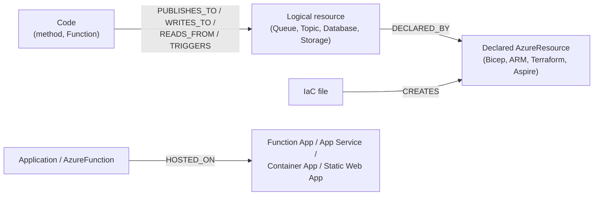

# Azure

Vogoban reads Azure Functions, Azure SDK calls, Bicep, ARM, Terraform, .NET Aspire and `azure.yaml` from your repository and links them into one graph: code → SDK client → data-plane resource → declared infrastructure → hosting. This is **static repository analysis**: no Azure subscription is contacted, nobody signs in to Azure, nothing is deployed, and no secret value is stored.

For a step-by-step walkthrough of a complete application (React → .NET API → Service Bus → Function → Cosmos DB → Bicep), see [Azure end to end](azure-end-to-end.md). How the analyzers and resolver work internally is in [Azure engine](../architecture/azure-engine.md).

## What Vogoban does and does not do

| Vogoban does | Vogoban does not |
|---|---|
| Parse Function attributes, `function.json`, Node.js v4 `app.*` registrations, `host.json`, `local.settings.json` | Run the Functions host, `func`, npm scripts or any repository code |
| Read Azure SDK calls through the Roslyn semantic model (C#) and the TypeScript compiler | Load types from `node_modules`, or call any Azure endpoint |
| Parse and symbolically evaluate Bicep, ARM JSON and Terraform, including Azure Verified Modules | Run `az`, `bicep`, `terraform`, `azd`, Aspire or a deployment |
| Link code to declared resources through explicit names, settings and connection references | Match resources by name similarity, or guess a resource that is not statically known |
| Report security-relevant declarations (public network access, anonymous HTTP, high-risk roles) | Prove what is deployed or how it behaves at runtime |
| Keep setting **names** and redacted values | Store connection strings, keys, SAS tokens or passwords |

Every Azure fact lives in the same RepositoryGraph as your C#, TypeScript and other infrastructure facts. Impact analysis, paths, governance, security findings, ownership, the MetaGraph, AI tools and MCP all work on Azure entities without special handling.

## The relationship model

Vogoban keeps four layers apart and connects them with stored, evidence-backed relationships:



- **Code** is a method, a Function or an application.
- A **logical resource** is the data-plane thing code talks to: a Service Bus topic, a Cosmos DB container, a blob container. It is stored with an existing entity kind (`Queue`, `Topic`, `Database`, `Storage`) and a `resolution` of `exact`, `statically-derived`, `partially-resolved` or `unresolved`.
- A **declared resource** (`AzureResource`) is what Bicep, ARM, Terraform or Aspire declares, with its ARM type, evaluated name and `nameState`.
- `DECLARED_BY` links a logical resource to its declaration only when the namespace or account and the leaf name are both statically known (for example `sb-contoso-orders/orders`). Two namespaces that both contain a topic called `orders` stay two different resources.

## Azure Functions

### Programming models

| Model | How it is recognised |
|---|---|
| .NET isolated worker | `[Function("Name")]` on a method |
| .NET in-process | `[FunctionName("Name")]`; binding direction from `out`, `IAsyncCollector`, `ICollector`, `FileAccess.Write` |
| Legacy `function.json` | Any language; the function name is the directory name, `scriptFile` is followed |
| Node.js v4 | `app.http(...)`, `app.timer(...)`, `app.serviceBusQueue/Topic(...)`, `app.eventHub(...)`, `app.storageQueue/Blob(...)`, `app.cosmosDB(...)`, `app.eventGrid(...)`, `output.*` extra outputs, in ESM and CommonJS |
| Durable Functions | `[OrchestrationTrigger]`, `[ActivityTrigger]`, `[EntityTrigger]`, `[DurableTask]` classes |

Python v2 decorators are not analyzed; Python, Java and PowerShell Functions are found only through `function.json`.

Functions projects become `Application` entities with `applicationKind: azure-functions`. If NuGet packages are not restored, Function attributes are still read from syntax (`unbound: true`), so Functions are found without `dotnet restore`; SDK analysis needs restored packages.

### Triggers

Each Function gets one `AzureFunction` entity (identity: repository + project + function name) and a relationship from its trigger source.

| Trigger | Attribute / Node v4 | Trigger source entity | Relationship |
|---|---|---|---|
| HTTP | `[HttpTrigger]`, `app.http` | `Endpoint` (route includes `host.json` `routePrefix`); the API resolver also creates an `ApiOperation` | `TRIGGERS` |
| Timer | `[TimerTrigger]`, `app.timer` | `AzureResource` with `azureKind: timer-schedule` (schedule or `%Setting%`) | `TRIGGERS` |
| Service Bus queue | `[ServiceBusTrigger("queue")]`, `app.serviceBusQueue` | `Queue` (`service-bus-entity`) | `TRIGGERS` |
| Service Bus topic | `[ServiceBusTrigger("topic", "sub")]`, `app.serviceBusTopic` | `Queue` (`service-bus-subscription`); the topic gets `SUBSCRIBES_TO` the subscription | `TRIGGERS` |
| Event Hubs | `[EventHubTrigger]`, `app.eventHub` | `Topic` (`event-hub`) | `TRIGGERS` |
| Event Grid | `[EventGridTrigger]`, `app.eventGrid` | the declared Event Grid subscription that delivers to this Function App | `TRIGGERS` (`STRUCTURALLY_RESOLVED`) |
| Blob | `[BlobTrigger]`, `app.storageBlob` | `Storage` (`blob-container`) | `TRIGGERS` |
| Storage queue | `[QueueTrigger]`, `app.storageQueue` | `Queue` (`storage-queue`) | `TRIGGERS` |
| Cosmos DB | `[CosmosDBTrigger]`, `app.cosmosDB` | `Database` (`cosmos-container`) | `CHANGE_FEED` |
| SQL, SignalR, Kafka, RabbitMQ, Warmup | `[SqlTrigger]`, `[SignalRTrigger]`, `[KafkaTrigger]`, `[RabbitMQTrigger]`, `[WarmupTrigger]` | recorded as the Function's trigger type | `TRIGGERS` where a source is resolvable |
| Durable | `[OrchestrationTrigger]`, `[ActivityTrigger]`, `[EntityTrigger]` | none by design; see Durable below | — |

A Function with no recognised trigger produces an unresolved reference (`unknown-trigger`), never a guessed edge. An Event Grid Function whose subscription is not declared in IaC produces `event-source-unresolved`.

### Bindings

Input and output bindings are read from parameters, the method or `[return:]`, and from properties of a returned multi-output type.

| Binding attributes | Direction | Relationship |
|---|---|---|
| `[ServiceBusOutput]`, `[EventHubOutput]`, `[QueueOutput]`, `[KafkaOutput]`, `[RabbitMQOutput]` | output to a broker | `PUBLISHES_TO` |
| `[EventGridOutput]` | output to Event Grid | `PUBLISHES_EVENT` |
| `[BlobOutput]`, `[CosmosDBOutput]`, `[TableOutput]`, `[SqlOutput]` | output to a data store | `WRITES_TO` |
| `[BlobInput]`, `[CosmosDBInput]`, `[TableInput]`, `[SqlInput]` | input | `READS_FROM` |
| `[FixedDelayRetry]`, `[ExponentialBackoffRetry]` | — | metadata on the Function |

### Durable Functions

`CallActivity(WithRetry)Async`, `CallSubOrchestrator(WithRetry)Async`, `ScheduleNewOrchestrationInstanceAsync` / `StartNewAsync`, `CallEntityAsync` / `SignalEntityAsync` become `INVOKES_ACTIVITY`, `CALLS_SUB_ORCHESTRATION`, `STARTS_ORCHESTRATION` and `USES_DURABLE_ENTITY`. Names come from string constants or `nameof`; targets are resolved within the same Function App. Orchestration code is never run or simulated.

### Settings and binding expressions

- `%Setting%` is resolved from the app settings declared on the hosting resource in IaC, then from `local.settings.json`.
- `{name}` runtime binding data keeps the value partial.
- Connection settings follow the Functions conventions: `<name>`, `<name>__fullyQualifiedNamespace`, `__serviceUri`, `__blobServiceUri`, `__queueServiceUri`, `__tableServiceUri`, `__accountName`, `__accountEndpoint`, `__credential`, `__clientId`.
- `host.json` contributes version, extension bundle, `routePrefix` and the Durable hub name.

### Example

From the `contoso-orders` sample (`src/Contoso.Orders.Functions/OrderFunctions.cs`):

```csharp
[Function("ProcessOrder")]
[ExponentialBackoffRetry(5, "00:00:04", "00:15:00")]
public Task ProcessOrder([ServiceBusTrigger("orders", "billing", Connection = "ServiceBus")] OrderSubmitted order, CancellationToken cancellationToken)
    => processor.ProcessAsync(order, cancellationToken);

[Function("GetOrderStatus")]
public HttpResponseData GetOrderStatus(
    [HttpTrigger(AuthorizationLevel.Anonymous, "get", Route = "orders/{id}/status")] HttpRequestData request,
    [CosmosDBInput("ordersdb", "orders", Connection = "Cosmos", Id = "{id}", PartitionKey = "{id}")] OrderStatus? status)
```

`local.settings.json` names the namespace for the `ServiceBus` connection:

```json
{
  "Values": {
    "ServiceBus__fullyQualifiedNamespace": "sb-contoso-orders.servicebus.windows.net",
    "Cosmos__accountEndpoint": "https://cosmos-contoso-orders.documents.azure.com:443/"
  }
}
```

and a Node.js v4 Function in the same repository (`notifications/src/functions/notify.ts`):

```ts
app.serviceBusTopic("NotifyCustomer", { topicName: "orders", subscriptionName: "notifications", connection: "ServiceBus", handler: notifyCustomer });
app.http("Health", { methods: ["GET"], authLevel: "function", route: "health", handler: health });
```

Vogoban extracts:

- `AzureFunction Contoso.Orders.Functions:ProcessOrder` triggered by the subscription `sb-contoso-orders/orders/billing`, with the retry policy as metadata;
- `AzureFunction GetOrderStatus` triggered by `Endpoint GET /api/orders/{id}/status` (route prefix `api` from `host.json`), `READS_FROM` the Cosmos container `cosmos-contoso-orders/ordersdb/orders`, with `ALLOWS_ANONYMOUS`;
- `AzureFunction contoso-notifications:NotifyCustomer` triggered by `sb-contoso-orders/orders/notifications`.

```bash
vogoban azure functions
```

```text
function                                  trigger     trigger source                                                                    bindings / durable                                                                auth       hosted on            location
----------------------------------------  ----------  --------------------------------------------------------------------------------  --------------------------------------------------------------------------------  ---------  -------------------  -------------------------------------------------
contoso-notifications:Health              http        Endpoint contoso-notifications:GET /api/health (COMPILER_RESOLVED)                -                                                                                 function   -                    notifications/src/functions/notify.ts:18
contoso-notifications:NotifyCustomer      serviceBus  Queue azure-service-bus:service-bus-subscription:sb-contoso-orders/orders/notifi  -                                                                                 -          -                    notifications/src/functions/notify.ts:17
Contoso.Orders.Functions:GetOrderStatus   http        Endpoint Contoso.Orders.Functions:GET /api/orders/{id}/status (COMPILER_RESOLVED  READS_FROM Database azure:cosmos-container:cosmos-contoso-orders/ordersdb/orders  anonymous  func-contoso-orders  src/Contoso.Orders.Functions/OrderFunctions.cs:22
Contoso.Orders.Functions:NightlyCleanup   timer       AzureResource NightlyCleanup:timer (COMPILER_RESOLVED)                            -                                                                                 -          func-contoso-orders  src/Contoso.Orders.Functions/OrderFunctions.cs:40
Contoso.Orders.Functions:OnOrderAudit     eventGrid   AzureResource Microsoft.EventGrid/topics/eventSubscriptions:egt-contoso-orders-a  -                                                                                 -          func-contoso-orders  src/Contoso.Orders.Functions/OrderFunctions.cs:37
Contoso.Orders.Functions:OrderChangeFeed  cosmosDB    Database azure:cosmos-container:cosmos-contoso-orders/ordersdb/orders (COMPILER_  PUBLISHES_TO Topic azure-event-hubs:event-hub:evhns-contoso-orders/order-telemet  -          func-contoso-orders  src/Contoso.Orders.Functions/OrderFunctions.cs:33
Contoso.Orders.Functions:ProcessOrder     serviceBus  Queue azure-service-bus:service-bus-subscription:sb-contoso-orders/orders/billin  -                                                                                 -          func-contoso-orders  src/Contoso.Orders.Functions/OrderFunctions.cs:18
```

The Node.js Functions have no `hosted on` value because `azure.yaml` and the Bicep files declare no service for the `notifications` folder; Vogoban does not invent one.

## Azure SDK

### .NET clients

| Service | Clients | Relationships produced |
|---|---|---|
| Service Bus | `ServiceBusClient`, `ServiceBusSender`, `ServiceBusReceiver`, `ServiceBusSessionReceiver`, `ServiceBusProcessor` | `PUBLISHES_TO` (send/schedule), `RECEIVES_MESSAGE` (receive/peek/complete/dead-letter), `CONSUMES_FROM` (`CreateProcessor`, `CreateSessionProcessor`) |
| Event Hubs | `EventHubProducerClient`, `EventHubBufferedProducerClient`, `EventHubConsumerClient`, `EventProcessorClient`, `PartitionReceiver` | `PUBLISHES_TO` (send/enqueue), `CONSUMED_BY` (read events, start processing) |
| Event Grid | `EventGridPublisherClient` | `PUBLISHES_EVENT` |
| Blob Storage | `BlobServiceClient`, `BlobContainerClient`, `BlobClient` (and block/append/page) | `WRITES_TO` (upload, delete, set metadata, copy), `READS_FROM` (download, list, get properties) |
| Queue Storage | `QueueServiceClient`, `QueueClient` | `PUBLISHES_TO` (send), `RECEIVES_MESSAGE` (receive, peek, delete, update) |
| Table Storage | `TableServiceClient`, `TableClient` | `WRITES_TO`, `READS_FROM` |
| Cosmos DB | `CosmosClient`, `Database`, `Container` | `WRITES_TO` (create/upsert/replace/delete/patch/batch), `READS_FROM` (read item, query), `CHANGE_FEED` (change-feed processor or iterator) |
| Key Vault | `SecretClient`, `KeyClient`, `CertificateClient`, `AddAzureKeyVault(...)` configuration provider | `READS_SECRET_FROM`; `SetSecret` and similar are `WRITES_TO` |
| App Configuration | `ConfigurationClient`, `AddAzureAppConfiguration(...)` | `READS_FROM` |
| Azure SQL | `SqlConnection`, EF Core `UseSqlServer` / `UseAzureSql` | SQL connection facts |
| Azure Identity | `DefaultAzureCredential`, `ManagedIdentityCredential`, `WorkloadIdentityCredential`, `ClientSecretCredential`, `ClientCertificateCredential`, `ClientAssertionCredential`, `AzureCliCredential`, `EnvironmentCredential`, `ChainedTokenCredential`, ...; key/SAS credentials; Microsoft.Identity.Web `AddMicrosoftIdentityWeb*` | `AUTHENTICATES_WITH` Microsoft Entra ID, with `credentialType` and `secretBased` metadata |

Azure Resource Manager (`ArmClient`) management operations are not modeled. A credential constructed for it is still recorded as `AUTHENTICATES_WITH`, like any other credential construction.

The address of a client (namespace or account, entity path, connection, credential) comes only from code: constructor arguments, factory calls (`CreateSender("orders")`, `GetBlobContainerClient("c")`, `GetContainer("db", "c")`), local and field initializers, constructor assignments, Microsoft.Extensions.Azure client registrations, Aspire client integrations (`AddAzureServiceBusClient("messaging")`, keyed variants, `[FromKeyedServices]`) and DI factory registrations (`AddSingleton(sp => new CosmosClient(...))`). Argument values are string constants, `IConfiguration["k"]`, `GetValue`, `GetConnectionString`, `Environment.GetEnvironmentVariable`, templates and `new Uri(...)`.

A client injected through DI resolves only when exactly one registration (or construction site, evidence `INFERRED`) of its type exists in the application. Otherwise Vogoban records an unresolved reference that names the ambiguity.

### JavaScript and TypeScript clients

The same services through `@azure/service-bus`, `@azure/event-hubs`, `@azure/eventgrid`, `@azure/storage-blob`, `@azure/storage-queue`, `@azure/data-tables`, `@azure/cosmos`, `@azure/keyvault-secrets` and `@azure/app-configuration`, with `process.env.X` settings, `const` initializers and `this.x` assignments. Only packages that depend on `@azure/*` are analyzed, and only statically traceable clients are reported because types from `node_modules` are not loaded.

### Example

`src/Contoso.Orders.Api/Services/OrderService.cs`:

```csharp
public OrderService(ServiceBusClient client, EventGridPublisherClient audit)
{
    _sender = client.CreateSender("orders");
    _audit = audit;
}

public async Task<string> SubmitAsync(string customerId, IReadOnlyList<OrderLine> lines, CancellationToken cancellationToken)
{
    var submitted = new OrderSubmitted(id, customerId, lines);
    await _sender.SendMessageAsync(new ServiceBusMessage(BinaryData.FromObjectAsJson(submitted)), cancellationToken);
    await _audit.SendEventAsync(new CloudEvent("contoso/orders", "Contoso.Orders.Submitted", new OrderAudit(id, "submitted")), cancellationToken);
    return id;
}
```

`Program.cs` registers the clients:

```csharp
builder.AddAzureServiceBusClient("messaging");
builder.Services.AddSingleton(sp => new EventGridPublisherClient(new Uri(builder.Configuration["EventGrid:Endpoint"]!), new DefaultAzureCredential()));
```

Vogoban resolves the `ServiceBusClient` through the Aspire connection name `messaging`, finds the hosting App Service's app setting `ConnectionStrings__messaging` in Bicep, and so knows the namespace. `SubmitAsync` gets `PUBLISHES_TO` the topic `sb-contoso-orders/orders` and `PUBLISHES_EVENT` the Event Grid topic `egt-contoso-orders-audit`; the `DefaultAzureCredential` construction gives `AUTHENTICATES_WITH` Microsoft Entra ID.

```bash
vogoban azure messaging
```

```text
azure-event-grid egt-contoso-orders-audit  [exact]
  publishers:    PUBLISHES_EVENT Method Contoso.Orders.Api.Services.OrderService.SubmitAsync(string, System.Collections.Generic.IReadOnlyList<Contoso.Orders.Contracts.OrderLine>, System.Threading.CancellationToken)
  receivers:     -
  subscriptions: -
  consumers:     -
  messages:      -
  declared by:   DECLARED_BY AzureResource Microsoft.EventGrid/topics:egt-contoso-orders-audit
…
azure-service-bus sb-contoso-orders/orders  [exact]
  publishers:    PUBLISHES_TO Method Contoso.Orders.Api.Services.OrderService.SubmitAsync(string, System.Collections.Generic.IReadOnlyList<Contoso.Orders.Contracts.OrderLine>, System.Threading.CancellationToken)
  receivers:     -
  subscriptions: SUBSCRIBES_TO Queue azure-service-bus:service-bus-subscription:sb-contoso-orders/orders/billing; SUBSCRIBES_TO Queue azure-service-bus:service-bus-subscription:sb-contoso-orders/orders/notifications
  consumers:     -
  messages:      -
  declared by:   DECLARED_BY AzureResource aspire:orders; DECLARED_BY AzureResource Microsoft.ServiceBus/namespaces/topics:sb-contoso-orders/orders

azure-service-bus sb-contoso-orders/orders/billing  [exact]
  publishers:    -
  receivers:     -
  subscriptions: -
  consumers:     ROUTES_TO Method Contoso.Orders.Functions.OrderFunctions.ProcessOrder(Contoso.Orders.Contracts.OrderSubmitted, System.Threading.CancellationToken); TRIGGERS AzureFunction Contoso.Orders.Functions:ProcessOrder
  messages:      CARRIES Message Contoso.Orders.Contracts.OrderSubmitted
  declared by:   DECLARED_BY AzureResource Microsoft.ServiceBus/namespaces/topics/subscriptions:sb-contoso-orders/orders/billing
```

The value in brackets is the resource's `resolution`. `declared by: -` means no IaC in the analyzed repositories declares that resource (for example `sb-contoso-orders/orders/notifications`).

## Infrastructure as code

### Bicep

`.bicep` and `.bicepparam`: parameters with decorators (`@secure()` defaults are never read), variables, resources (nested children, `parent:`, `existing`, conditions, loops), modules (local, registry, template specs), outputs, and `loadJsonContent` / `loadTextContent` of files inside the repository.

From `infra/modules/messaging.bicep`:

```bicep
resource sb 'Microsoft.ServiceBus/namespaces@2022-10-01-preview' = {
  name: namespaceName
  location: location
  sku: { name: 'Standard' }
  properties: {
    disableLocalAuth: true
    publicNetworkAccess: 'Enabled'
    minimumTlsVersion: '1.2'
  }

  resource orders 'topics' = {
    name: 'orders'

    resource billing 'subscriptions' = {
      name: 'billing'
      properties: {
        maxDeliveryCount: 10
      }
    }
  }
}
```

`namespaceName` is a module parameter. `infra/main.bicep` passes `'sb-${prefix}'` with `var prefix = 'contoso-orders'`, so the symbolic evaluator computes the exact names `sb-contoso-orders`, `sb-contoso-orders/orders` and `sb-contoso-orders/orders/billing`.

### ARM templates

Deployment template and parameter JSON files: parameters (`securestring` defaults dropped), variables, resources including nested `resources` and inline `Microsoft.Resources/deployments` templates, outputs, and the template expression language (`parameters()`, `variables()`, `concat`, `format`, `resourceId`, `reference`, `listKeys`, ...). Bicep-generated ARM JSON next to its `.bicep` source is skipped.

### Terraform

`.tf`, `.tfvars` and `.tfvars.json`: `azurerm_*` and `azapi_resource` resources, data sources (stored as referenced resources, `declaredState: REFERENCED`), variables, locals, outputs, local modules, `count` / `for_each` and `depends_on`. Parents come from the documented `*_id` / `*_name` attributes of azurerm 3.x and 4.x. Provisioners are dropped and providers are never installed.

From the `contoso-platform-infra` sample (`terraform/main.tf`):

```hcl
resource "azurerm_servicebus_namespace" "platform" {
  name                = "sb-contoso-platform"
  location            = azurerm_resource_group.platform.location
  resource_group_name = azurerm_resource_group.platform.name
  sku                 = "Standard"
  local_auth_enabled  = false
}

resource "azurerm_servicebus_topic" "shipments" {
  name         = "shipments"
  namespace_id = azurerm_servicebus_namespace.platform.id
}
```

This declares `Microsoft.ServiceBus/namespaces/topics` `sb-contoso-platform/shipments`. A resource's identity is its ARM type plus its full canonical name, so the same literal resource declared in Bicep and in Terraform is one entity.

### Symbolic evaluation and Azure Verified Modules

Each deployment root (a template not used as a module) is evaluated: module parameters are bound to their call sites; variables, outputs and parameter files (`.bicepparam`, `main.parameters.json` with azd `${VAR=default}` defaults, `.tfvars`) are applied; `union`, `concat`, `format`, `toLower`, `empty` and conditionals are evaluated when their inputs are known. Deployment-time functions (`uniqueString`, `resourceGroup()`, `utcNow()`, random and naming providers) stay opaque, so such names are `partially-resolved` or `unresolved` and are never matched by name.

Azure Verified Modules (`br/public:avm/res/<service>/<type>`) are read from their call-site parameters without contacting the registry, including their child conventions (`queues[]`, `topics[].subscriptions[]`, `blobServices.containers[]`, `sqlDatabases[].containers[]`, `roleAssignments[]`). Supported modules cover Service Bus, Event Hubs, Event Grid topics and system topics, Storage, Cosmos DB, SQL, Key Vault, App Service sites/plans/static sites, Container Apps (apps, environments, jobs), AKS, Container Registry, API Management, Application Insights, Log Analytics, managed identities, virtual networks, private endpoints, private DNS zones, NSGs, public IPs, Application Gateway, Front Door/CDN profiles, App Configuration, SignalR, Redis, PostgreSQL flexible server and deployment scripts. Other registry modules are opaque.

### azure.yaml

`azure.yaml` (azd) maps a service name to a project directory and host kind. A service is linked `HOSTED_ON` the resource whose `azd-service-name` tag evaluates to that service name.

```yaml
services:
  api:
    project: ./src/Contoso.Orders.Api
    language: dotnet
    host: appservice
  functions:
    project: ./src/Contoso.Orders.Functions
    language: dotnet
    host: function
```

```bicep
resource functionApp 'Microsoft.Web/sites@2023-12-01' = {
  name: 'func-${prefix}'
  kind: 'functionapp,linux'
  tags: union(tags, { 'azd-service-name': 'functions' })
  properties: {
    serverFarmId: plan.id
    siteConfig: {
      appSettings: [
        { name: 'ServiceBus__fullyQualifiedNamespace', value: '${serviceBusNamespace}.servicebus.windows.net' }
        { name: 'Cosmos__accountEndpoint', value: cosmosEndpoint }
      ]
    }
  }
}
```

## .NET Aspire

AppHost projects (`Aspire.AppHost.Sdk` or `Aspire.Hosting.AppHost`) are compiled with the `Projects.*` metadata types the Aspire SDK would generate, so `AddProject<Projects.X>()` binds. Recognised resources include Azure Storage (blobs, queues, tables), Service Bus (queues, topics, subscriptions), Event Hubs, Cosmos DB (databases, containers), Azure SQL, Key Vault, App Configuration, Application Insights, Log Analytics, SignalR, Redis, PostgreSQL, Container Apps and App Service environments, Container Registry, user-assigned identities, Search and OpenAI.

```csharp
var messaging = builder.AddAzureServiceBus("messaging");
messaging.AddServiceBusTopic("orders").AddServiceBusSubscription("billing");

builder.AddProject<Projects.Contoso_Orders_Api>("api")
    .WithReference(messaging)
    .WithExternalHttpEndpoints();
```

`WithReference` gives the API project a connection-name → resource map used to resolve `AddAzureServiceBusClient("messaging")`. `WithRoleAssignments` becomes `HAS_ROLE_ON`, `WithExternalHttpEndpoints` marks external exposure, and with a compute environment every project is `DEPLOYED_TO` it. Aspire names are logical (`nameState: aspire-logical-name`): the provisioned name is generated at publish time, so Aspire resources reconcile with Bicep or Terraform only through the code-side logical resource (both are `DECLARED_BY` targets) and never take part in cross-repository matching.

## Platform resources

The resource catalog (`vogoban azure resources`) knows these ARM types by service; anything else is still stored as an `AzureResource` with service `other`.

| Area | ARM types |
|---|---|
| Compute and hosting | `Microsoft.Web/sites` (Function App, web app, Logic App by `kind`), `sites/slots`, `sites/config`, `sites/functions`, `serverfarms`, `staticSites`; `Microsoft.App/containerApps`, `jobs`, `managedEnvironments`; `Microsoft.ContainerService/managedClusters` (AKS); `Microsoft.ContainerRegistry/registries` |
| Messaging | Service Bus namespaces, queues, topics, subscriptions, rules; Event Hubs namespaces, event hubs, consumer groups; Event Grid topics, system topics, domains, domain topics, event subscriptions |
| Data | Storage accounts, blob/queue/table services, containers, queues, tables, file shares; Cosmos DB accounts, SQL databases and containers, Mongo databases and collections, SQL role assignments; Azure SQL servers, databases, firewall rules; PostgreSQL and MySQL flexible servers; Azure Cache for Redis |
| Secrets and configuration | Key Vault vaults, secrets, keys, access policies; App Configuration stores and key-values |
| API and edge | API Management service, APIs, operations, policies, backends, products, named values, subscriptions; Application Gateway; Front Door (classic) and Front Door/CDN profiles, endpoints, origin groups, origins, routes |
| Identity | user-assigned managed identities, system-assigned identities, role assignments, role definitions |
| Observability | Application Insights, Log Analytics workspaces, diagnostic settings |
| Networking | virtual networks, subnets, private endpoints, private DNS zones and links, NSGs, public IPs |
| Other | SignalR, Durable Task Scheduler and task hubs, resource groups, deployment scripts |

Relationships extracted from IaC and Aspire:

| Relationship | Meaning |
|---|---|
| `CREATES`, `REFERENCES_RESOURCE`, `USES_MODULE` | IaC file → declared resource, `existing` / `data` reference, module use |
| `CONTAINS_RESOURCE`, `DEPENDS_ON_RESOURCE` | parent → child; explicit or implicit dependency |
| `HOSTED_ON`, `DEPLOYED_TO` | application or Function → Function App, App Service, Container App, plan or environment |
| `USES_IDENTITY`, `HAS_ROLE_ON` | resource → managed identity; identity → resource with the role name (built-in role ids are mapped; Owner, Contributor and User Access Administrator are flagged) |
| `READS_SECRET_FROM` | Key Vault references in app settings and SDK secret reads |
| `OBSERVED_BY`, `LOGS_TO` | app → Application Insights → Log Analytics |
| `IN_SUBNET`, `PRIVATE_ENDPOINT_FOR`, `ROUTES_TRAFFIC_TO` | networking; Front Door, Application Gateway and APIM → backend; APIM operation → `ApiOperation` |
| `SUBSCRIBES_TO` | topic → subscription; Event Grid topic → event subscription |
| `SUPPLIES_CONFIG` | a declared app setting → the configuration reference that code reads |
| `DECLARED_BY` | logical resource → declaring IaC or Aspire resource |

```bash
vogoban azure infrastructure
```

```text
IaC files
file                            creates  references existing  modules
------------------------------  -------  -------------------  --------------------------------------------------------------------------------
infra/main.bicep                10       0                    infra/modules/messaging.bicep, infra/modules/data.bicep, infra/modules/monitorin
infra/modules/apps.bicep        5        0                    -
infra/modules/data.bicep        4        0                    -
infra/modules/messaging.bicep   5        0                    -
infra/modules/monitoring.bicep  2        0                    -

Hosting
application                                               relationship  resource                                                      evidence  rule
--------------------------------------------------------  ------------  ------------------------------------------------------------  --------  ------------------------------------------------
Application Contoso.Orders.Api (aspnetcore)               HOSTED_ON     AzureResource Microsoft.Web/sites:app-contoso-orders-api      DECLARED  azd service name = resource tag azd-service-name
Application Contoso.Orders.Functions (azure-functions)    HOSTED_ON     AzureResource Microsoft.Web/sites:func-contoso-orders         DECLARED  azd service name = resource tag azd-service-name
AzureFunction Contoso.Orders.Functions:ProcessOrder       HOSTED_ON     AzureResource Microsoft.Web/sites:func-contoso-orders         DECLARED  function app project hosted on resource
…

Resource relationships
resource                                                                          relationship       target                                                                            evidence               detail
--------------------------------------------------------------------------------  -----------------  --------------------------------------------------------------------------------  ---------------------  -------------------------------------
AzureResource Microsoft.ManagedIdentity/userAssignedIdentities:id-contoso-orders  HAS_ROLE_ON        AzureResource Microsoft.KeyVault/vaults:kv-contoso-orders                         DECLARED               Owner
AzureResource Microsoft.Insights/components:appi-contoso-orders                   LOGS_TO            AzureResource Microsoft.OperationalInsights/workspaces:log-contoso-orders         DECLARED
AzureResource Microsoft.Web/sites:func-contoso-orders                             OBSERVED_BY        AzureResource Microsoft.Insights/components:appi-contoso-orders                   DECLARED               APPLICATIONINSIGHTS_CONNECTION_STRING
AzureResource Microsoft.ApiManagement/service/apis/operations:apim-contoso-order  ROUTES_TRAFFIC_TO  ApiOperation Contoso.Orders.Api:POST /api/orders                                  STRUCTURALLY_RESOLVED
AzureResource Microsoft.Web/sites:func-contoso-orders                             USES_IDENTITY      AzureResource Microsoft.ManagedIdentity/userAssignedIdentities:id-contoso-orders  DECLARED               user-assigned
…
```

## How code is linked to infrastructure

For a binding or SDK call, the resolver determines in order:

1. the **hosting resource** of the project (azd tag, Aspire environment);
2. the **namespace or account** from the connection: Aspire `WithReference` names, then the hosting resource's app settings (`X`, `X__fullyQualifiedNamespace`, `ConnectionStrings__X`, ...), then literal endpoints in `appsettings*.json` or `local.settings.json` (`sb-contoso-orders.servicebus.windows.net` → namespace `sb-contoso-orders`);
3. the **leaf name**: a literal, the value of a `%Setting%` or configuration key, or the IaC expression of that setting;
4. the declared resource of the right ARM type under that account with that name.

When the account cannot be determined statically, the logical resource keeps only its leaf name, is `partially-resolved`, and is never linked to a declaration or to another repository, even if exactly one declaration has the same leaf name. Example from the identity fixtures, where `local.settings.json` has no `ServiceBusConnection` setting:

```json
{ "bindings": [ { "name": "message", "type": "serviceBusTrigger", "direction": "in", "queueName": "orders", "connection": "ServiceBusConnection" } ] }
```

```text
azure-service-bus orders  [partially-resolved]
  publishers:    -
  receivers:     -
  subscriptions: -
  consumers:     TRIGGERS AzureFunction :ProcessOrders
  messages:      -
  declared by:   -
```

The resolver rules, evidence levels and identity keys are documented in [Azure engine](../architecture/azure-engine.md).

## Queries

The `azure` commands are thin views over the same graph. Option details are in the [Azure command reference](../cli/azure.md).

| Command | Shows |
|---|---|
| `vogoban azure` | Function counts by trigger, declared resources by service and by declaring language, code-side resources, unresolved Azure references |
| `vogoban azure functions` | Functions with trigger source, bindings, authorization level, hosting |
| `vogoban azure triggers` | one row per trigger edge with evidence |
| `vogoban azure resources [--kind K]` | declared resources with name state, declaring language and code references |
| `vogoban azure messaging` | brokers with publishers, subscriptions, consumers, carried messages and declarations |
| `vogoban azure infrastructure` | IaC files, hosting, identity, roles, networking, observability |
| `vogoban azure flow <entity>` | stored relationships downstream (what happens next) or `--upstream` (what reaches it) |

```bash
vogoban azure
```

```text
                                    count
----------------------------------  -----
Azure Functions                     7
  cosmosDB                          1
  eventGrid                         1
  http                              2
  serviceBus                        2
  timer                             1
Declared Azure resources            34
  api-management                    3
  app-service                       3
  …
  service-bus                       6
  static-web-apps                   1
  storage                           1
  declared in bicep                 26
  declared in arm                   0
  declared in terraform             0
  declared in aspire                6
Code-side data/messaging resources  7
Unresolved Azure references         0
```

```bash
vogoban azure resources --kind cosmos-db
```

`--kind` accepts a service (`cosmos-db`, `service-bus`, ...) or an Azure kind. Every other command works on Azure entities too, for example `vogoban impact sb-contoso-orders/orders --kind AzureResource` or `vogoban paths <route-id> <function-id>`. See [Impact analysis](impact-analysis.md) and the [end-to-end tutorial](azure-end-to-end.md) for complete examples.

## Security notes

Security facts are **static declarations, not proof of runtime state**. Settings changed in the portal, policies applied by your platform team, network rules and Entra ID configuration outside the repository are invisible to Vogoban. Azure findings appear in `vogoban security-findings` and can be used in governance selectors:

| Category | Condition |
|---|---|
| `AZURE_FUNCTION_ANONYMOUS_HTTP` | HTTP Function with `AuthorizationLevel.Anonymous` |
| `PUBLIC_ENDPOINT_*` | APIs and Functions hosted on an App Service or Function App without `publicNetworkAccess: Disabled`, external Container App ingress, or Aspire external endpoints are `PUBLIC` |
| `AZURE_STORAGE_PUBLIC_BLOB_ACCESS` | `allowBlobPublicAccess: true` or container public access |
| `AZURE_DATA_SERVICE_PUBLIC_NETWORK` | Storage, Cosmos DB, SQL, Key Vault, Service Bus or Event Hubs with public network access enabled or network default action `Allow` |
| `AZURE_SHARED_KEY_ACCESS_ENABLED` | shared-key or local authentication explicitly enabled |
| `AZURE_WEAK_TLS`, `AZURE_HTTP_ALLOWED` | TLS below 1.2, `httpsOnly: false` |
| `AZURE_SQL_FIREWALL_OPEN_TO_INTERNET`, `AZURE_SQL_FIREWALL_ALLOWS_AZURE_SERVICES` | firewall rule 0.0.0.0–255.255.255.255, or 0.0.0.0–0.0.0.0 |
| `AZURE_CONTAINER_APP_EXTERNAL_INGRESS` | external ingress |
| `AZURE_HIGH_RISK_ROLE_ASSIGNMENT` | Owner, Contributor or User Access Administrator granted to an identity |
| `AZURE_SECRET_BASED_CREDENTIAL` | `ClientSecretCredential`, username/password, key or SAS credentials |
| `AZURE_KEY_BASED_CONNECTION_SETTING` | app setting built from `listKeys()`, a connection string or a secure value |

```text
[MEDIUM] AZURE_STORAGE_PUBLIC_BLOB_ACCESS  contoso-orders  (sf_f18de97f735c7dfdbac71e)
    storage account stcontosoorders allows anonymous public blob access
    owner: UNOWNED
    evidence: declared in infra/modules/apps.bicep:19 (bicep); a static declaration, not proof of runtime state
    context: Set allowBlobPublicAccess to false unless anonymous reads are intended.
```

**Secrets are never stored.** Every string an analyzer extracts (C# and TypeScript literals, IaC defaults, app settings, connection strings, URLs) passes through one redaction filter before it reaches the fact cache, the graph, diagnostics, exports, MCP or AI results: connection strings keep non-secret pairs such as `Endpoint` and `SharedAccessKeyName` and lose `SharedAccessKey`, `AccountKey`, `Password` and similar (`=[redacted]`); URLs lose `sig`, `token`, `key`, `code` and similar query parameters; JWTs, PEM blocks and key material are replaced entirely. `@secure()`, `securestring` and Terraform `sensitive` values, Key Vault secret bodies and `listKeys()`-derived settings are not read. A literal connection string in TypeScript is recorded as a connection without its value, and therefore without its host. One accepted edge case: a letters-only value of 32–63 characters with no credential-like name or parameter is kept, because it cannot be told apart from an identifier. See [Security](security.md).

**Untrusted repositories.** Only files inside the repository are read: symbolic links are not followed, `loadJsonContent` / `loadTextContent` and module paths outside the repository are refused, Bicep registry and Terraform remote modules are never fetched, `azure.yaml` hooks and Terraform provisioners are never run, and IaC files larger than 4 MB or nested deeper than 64 levels are bounded. See [Trust modes](../advanced/trust-modes.md).

## Incremental analysis

IaC files, `host.json`, `function.json`, `local.settings*.json`, `azure.yaml` and code changes in repositories with Azure facts select the Azure domain in `vogoban graph sync`. A changed Bicep or Terraform module widens the update to every file that uses it. See [Incremental analysis](incremental-analysis.md).

## Limitations

- Runtime values are unknown: names computed by code, `uniqueString`, random or naming providers and unset azd environment values stay partial or unresolved. Bicep parameter defaults, parameter files and azd `${VAR=default}` defaults are treated as the deployed values; a real deployment can override them.
- Exposure and security facts are declarations. App Service access restrictions, Front Door or WAF rules, NSG rule evaluation, Entra ID app registrations and RBAC inheritance are not modeled.
- Clients passed through method parameters, collections, `Lazy<T>`, reflection or service locators other than `GetRequiredService<T>()` are not traced. DI with several registrations of a client type is reported as ambiguous. Clients in fields and properties are traced through deterministic initializers and constructor assignments.
- A code-side resource whose namespace or account is not statically known stays partially resolved and is never linked to a declaration or another repository.
- A frontend in one repository calling an API hosted in Azure by another repository is linked only through the MetaGraph's OpenAPI and route contract matching; Azure hosting is not used to bridge them.
- JS/TS SDK types are not loaded from `node_modules`. Python v2, Java and PowerShell Functions are found only through `function.json`.
- ARM linked templates and Bicep registry modules other than the supported AVM modules are opaque; nested inline ARM templates share the outer parameter namespace. Terraform `count` / `for_each` instances are one resource with `loop: true`.
- Event Grid subscriptions created outside IaC (scripts, portal) cannot be linked to their Functions.
- `ORCHESTRATES` is not emitted; orchestrations are represented by the Durable relationships.
- Some settings are flagged by name: `ServiceBus__credential` with the value `managedidentity` is reported as a secret-like literal (`SECRET_REFERENCE_EXPOSED_IN_UNSAFE_SOURCE`) even though it is not a secret. Review such findings before acting.

## Related

- [Azure end to end](azure-end-to-end.md)
- [Azure command reference](../cli/azure.md)
- [Azure engine (internals)](../architecture/azure-engine.md)
- [Messaging](messaging.md), [Infrastructure](infrastructure.md), [Frontend](frontend.md)
- [MetaGraph](metagraph.md), [Impact analysis](impact-analysis.md), [Security](security.md)
