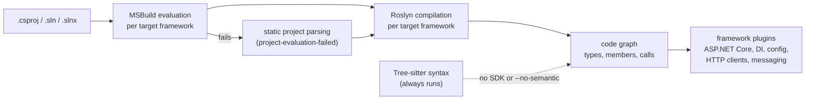

# .NET and ASP.NET Core

Vogoban reads C# projects with the Roslyn compiler and stores what it finds as a graph: projects, assemblies, types, members, calls, inheritance, and the ASP.NET Core application model on top (endpoints, dependency injection, middleware, hosted services, authorization and configuration). Every fact records how it was established (its evidence level) and where in the source it came from.

## Why it matters

Text search finds names. Compiler analysis finds the actual symbol a call binds to, the interface an implementation satisfies, and the handler behind an HTTP route. That is what impact analysis, the frontend→backend chains and the Azure flows are built on. When something cannot be resolved, Vogoban records an unresolved reference with a reason instead of guessing.

## How analysis works



1. **Project discovery.** `.csproj`, `.fsproj` and `.vbproj` files become `Project` entities; `.sln`/`.slnx` files become `Solution` entities. Only `.csproj` projects are compiled with Roslyn. A project reference that points outside the repository, or a solution entry that does not exist, becomes an unresolved reference with category `missing-project`.
2. **MSBuild evaluation.** For each project and each target framework, the .NET SDK's MSBuild evaluates the project to get the real compile items, global usings, preprocessor defines, package references and the NuGet assets file (`obj/project.assets.json`). If evaluation fails, Vogoban falls back to its own static parsing of the project XML and records a `project-evaluation-failed` diagnostic. `VOGOBAN_MSBUILD_EVALUATION=0` (or `--untrusted`) forces the fallback. MSBuild evaluation can run code from the repository's build files, so read [Trust modes](../advanced/trust-modes.md) before analyzing a repository you do not trust.
3. **Roslyn compilation.** Every target framework is compiled against its reference pack (SDK packs, NuGet-cached targeting packs, `Microsoft.NETFramework.ReferenceAssemblies`, `NETStandard.Library`), and the results are merged. An approximate reference pack is reported as a `reference-pack-approximate` diagnostic.
4. **Framework plugins** run over the Roslyn facts (never over raw text): applications, ASP.NET Core endpoints, dependency injection, configuration, HTTP clients and messaging (see [Messaging](messaging.md) and [API contracts](api-contracts.md)).

The Roslyn analyzer ships as source with Vogoban and is built automatically the first time semantic analysis runs (this needs network access to NuGet once). Vogoban finds the SDK through `dotnet` on `PATH`, `~/.dotnet/dotnet`, or `VOGOBAN_DOTNET`. Semantic analysis needs .NET SDK 8 or later.

## What Vogoban detects

### Code graph

| Fact | Entities / relationships | Evidence |
| --- | --- | --- |
| Projects, assemblies, packages | `Project`, `Assembly`, `Package`; `PROJECT_REFERENCES`, `PACKAGE_DEPENDS_ON`, `ASSEMBLY_REFERENCES`, `DEFINES_ASSEMBLY` | `DECLARED` / `STRUCTURALLY_RESOLVED` / `COMPILER_RESOLVED` |
| Declarations | `Namespace`, `Type` (class, record, struct, interface, enum, delegate), `Method`, `Property`, `Field`, `Event`, `Parameter`; `DECLARES`, `CONTAINS` | `COMPILER_RESOLVED` |
| Inheritance | `INHERITS`, `IMPLEMENTS` (type and member level), `OVERRIDES` | `COMPILER_RESOLVED` |
| Usage | `CALLS`, `CONSTRUCTS`, `USES_TYPE`, `USES_MEMBER`, `READS_FIELD`, `WRITES_FIELD`, `RETURNS_TYPE`, `ACCEPTS_PARAMETER`, `THROWS`, `ATTRIBUTED_WITH` | `COMPILER_RESOLVED` |

Symbols are identified by `<assembly>::<Roslyn documentation-comment id>`. Framework (reference-pack) symbols use `@framework::<id>`, so the same BCL type is one node across target frameworks and repositories. Framework and NuGet symbols are global entities without a repository.

### Target frameworks and `#if`

A multi-targeting project is compiled once per framework. A fact that exists in only some frameworks carries `targetFrameworks`; a symbol declared inside an `#if` region carries `conditions`. An unresolved reference that only fails in some frameworks gets the category `conditional-compilation`.

### Application graph

| What | How it is detected | Entities / relationships |
| --- | --- | --- |
| Applications | A builder call: `WebApplication.CreateBuilder` / `CreateSlimBuilder` / `CreateEmptyBuilder` / `Create`, `WebHost.CreateDefaultBuilder`, `ConfigureWebHostDefaults` / `ConfigureWebHost`, `WebAssemblyHostBuilder.CreateDefault` (Blazor WebAssembly), `Host.CreateApplicationBuilder` / `CreateDefaultBuilder` (generic host), Azure Functions worker builders. Test projects are never applications. | `Application` (kind `aspnetcore`, `generic-host`, `blazor-webassembly`, `azure-functions`); `DEFINES_APPLICATION`, `IMPLEMENTED_BY` → entry point |
| Controller endpoints | Types deriving from `ControllerBase`/`Controller`, or attributed with `[Controller]`/`[ApiController]`, or named `*Controller`. Attribute routes (`[Route]`, `[HttpGet]`…, `[controller]`/`[action]`/`[area]` tokens, inherited routes) and conventional routes (`MapControllerRoute`, `MapDefaultControllerRoute`, `MapAreaControllerRoute`). `[NonAction]`, static and abstract methods are skipped. | `Endpoint`; `IMPLEMENTED_BY` / `ROUTES_TO` → action method |
| Minimal API endpoints | `MapGet`, `MapPost`, `MapPut`, `MapDelete`, `MapPatch`, `MapMethods`, `Map` (any verb), nested `MapGroup` prefixes; lambda, method-group and local-function handlers; fluent `RequireAuthorization`, `AllowAnonymous`, `WithName`, `WithTags`, `WithDisplayName`, `Produces*`, `Accepts`, `HasApiVersion`, `MapToApiVersion` | `Endpoint`, `RouteGroup`; `IMPLEMENTED_BY` / `ROUTES_TO` → handler |
| Request / response | Parameter binding sources (route, query, body, services, …) and payload types | `ACCEPTS_REQUEST`, `PRODUCES_RESPONSE` |
| Authorization | `[Authorize]` (policy, roles, schemes), `[AllowAnonymous]`, `RequireAuthorization(...)`, `AllowAnonymous()`; policies defined with `AddPolicy` | `AuthorizationMetadata`; `REQUIRES_AUTHORIZATION`, `ALLOWS_ANONYMOUS` |
| Dependency injection | Generic, `typeof`, open generic, factory, instance, keyed, `TryAdd*`, `ServiceDescriptor`, typed `HttpClient`, `DbContext`, options and framework `Add*` calls, with lifetime, key and control-flow context | `ServiceRegistration`; `REGISTERS` → service type, `RESOLVES_TO` → implementation; `INJECTS` |
| Hosted services | `AddHostedService<T>()`, plus types deriving from `BackgroundService` or implementing `IHostedService` | `HostedService`; a hosted type with no static registration becomes an unresolved `HOSTS` reference |
| Middleware | `Use*` calls, `UseMiddleware<T>`, inline `Use`/`Run`, branches (`UseWhen`, `MapWhen`, `Map`) on `IApplicationBuilder`/`WebApplication`, in source order | `Middleware`; `USES_MIDDLEWARE` (with order), `PRECEDES` (only between unconditional registrations in the same method) |
| Configuration | `IConfiguration` indexers and `GetValue`/`GetSection`/`GetConnectionString`, `Configure<T>(GetSection(...))`, `BindConfiguration`, `Environment.GetEnvironmentVariable` | `ConfigurationReference` (keys and variable names, never values); `REFERENCES_CONFIG` |

Registrations, endpoints and middleware belong to an application when the registering method is reachable from that application's entry point through compiler-resolved calls. Otherwise Vogoban falls back to the same project, or to a referencing application, with `INFERRED` evidence. Several registrations of the same service are all kept and reported as conflicts; duplicate endpoint routes are conflicts too.

## Example

A minimal API in `src/Shop.Api/Program.cs` (an example repository; the ids in the output below will differ for your repository):

```csharp
var builder = WebApplication.CreateBuilder(args);

builder.Services.Configure<CatalogOptions>(builder.Configuration.GetSection("Catalog"));
builder.Services.AddScoped<IProductRepository, InMemoryProductRepository>();
builder.Services.AddMediatR(cfg => cfg.RegisterServicesFromAssemblyContaining<Program>());
builder.Services.AddMassTransit(x => x.UsingInMemory());
builder.Services.AddHostedService<PriceSyncWorker>();
builder.Services.AddHttpClient<InventoryClient>(c => c.BaseAddress = new Uri("http://inventory"));
builder.Services.AddAuthorization(o => o.AddPolicy("catalog.write", p => p.RequireRole("admin")));

var app = builder.Build();

app.UseHttpsRedirection();
app.UseAuthentication();
app.UseAuthorization();

var products = app.MapGroup("/api/v1/products");
products.MapGet("/", async (IMediator mediator) => await mediator.Send(new ListProducts()));
products.MapGet("/{id:int}", GetProduct).WithName("GetProduct").AllowAnonymous();
products.MapPut("/{id:int}/price", PriceEndpoints.ChangePrice).RequireAuthorization("catalog.write");

app.Run();
```

What Vogoban extracts from it:

- `Application Shop.Api` (kind `aspnetcore`, signal: WebApplication builder).
- Three `Endpoint` entities under the `RouteGroup` `/api/v1/products`. `PUT /api/v1/products/{id:int}/price` has `IMPLEMENTED_BY` → `PriceEndpoints.ChangePrice` (`COMPILER_RESOLVED`), a body parameter of type `PriceChange` (`ACCEPTS_REQUEST`, `STRUCTURALLY_RESOLVED`) and `REQUIRES_AUTHORIZATION` → `policy=catalog.write`.
- `ServiceRegistration` entities for `IProductRepository` → `InMemoryProductRepository` (scoped), the typed client and the hosted service, plus framework `Add*` calls.
- Three ordered `Middleware` entities.
- `ConfigurationReference` entities for `Catalog` (options binding) and for keys read elsewhere in code.

Analyze the repository after restoring it, then query the application graph:

```bash
dotnet restore
vogoban analyze .
vogoban endpoints
vogoban endpoint "PUT /api/v1/products/{id:int}/price"
```

```text
verb  route                            auth           handler                                                                           id
----  -------------------------------  -------------  --------------------------------------------------------------------------------  --------------------------
GET   /api/v1/products                 none-declared  lambda in <top-level-statements-entry-point>                                      e_10194ff3fddddf0f2ac34dc3
GET   /api/v1/products/{id:int}        anonymous      local function GetProduct in <top-level-statements-entry-point>                   e_7b3e0fa12b3bf419fb2fa543
PUT   /api/v1/products/{id:int}/price  required       Shop.Api.PriceEndpoints.ChangePrice(int, Shop.Api.PriceChange, MassTransit.IPubl  e_0daf07ace42a4113e7ec63ea

PUT /api/v1/products/{id:int}/price  (aspnetcore-minimal)
  id            e_0daf07ace42a4113e7ec63ea
  location      src/Shop.Api/Program.cs:24
  application   Shop.Api
  controller    -
  route groups  /api/v1/products
  handler       Method Shop.Api.PriceEndpoints.ChangePrice(int, Shop.Api.PriceChange, MassTransit.IPublishEndpoint)  [method]
  parameters    id:route?:int, change:body?:Shop.Api.PriceChange, bus:services?:MassTransit.IPublishEndpoint
  request       Type:Record Shop.Api.PriceChange (body, STRUCTURALLY_RESOLVED)
  response      -  declared: System.Threading.Tasks.Task<Microsoft.AspNetCore.Http.IResult>
  authorization required: policy=catalog.write (fluent:RequireAuthorization)
  metadata      routeName=- name=- tags=- produces=- consumes=-
  provenance    dotnet.aspnetcore/MINIMAL_API_MAPPING @ src/Shop.Api/Program.cs:24; contracts.api-resolver/OPENAPI_COVERAGE @ src/Shop.Api/Program.cs:24
```

The `auth` column is `required` when authorization metadata is declared, `anonymous` when `AllowAnonymous` is present, and `none-declared` when there is neither. It describes declarations, not runtime enforcement: an authorization policy configured globally (for example a fallback policy) is not applied to this column.

The other application views:

```bash
vogoban applications
vogoban registrations
vogoban middleware --app Shop.Api
vogoban hosted-services
vogoban authorization
vogoban config
```

```text
application      kind              endpoints  registrations  middleware  hosted  signals
---------------  ----------------  ---------  -------------  ----------  ------  --------------------------------------------------------------------------------
Shop.Api         aspnetcore        3          6              3           1       OutputType Exe; SDK Microsoft.NET.Sdk.Web; WebApplication builder (Microsoft.Asp
Shop.Worker      generic-host      0          1              0           0       Host builder (Microsoft.Extensions.Hosting.Host.CreateApplicationBuilder); Outpu
…

lifetime   service                                      implementation                      kind            flags  applications  location
---------  -------------------------------------------  ----------------------------------  --------------  -----  ------------  ----------------------------
n/a        AddAuthorization                             -                                   framework              Shop.Api      src/Shop.Api/Program.cs:13
n/a        AddMediatR                                   -                                   framework              Shop.Api      src/Shop.Api/Program.cs:9
singleton  Microsoft.Extensions.Hosting.IHostedService  Shop.Api.PriceSyncWorker            hosted-service         Shop.Api      src/Shop.Api/Program.cs:11
transient  Shop.Api.InventoryClient                     Shop.Api.InventoryClient            http-client            Shop.Api      src/Shop.Api/Program.cs:12
scoped     Shop.Api.IProductRepository                  Shop.Api.InMemoryProductRepository  service                Shop.Api      src/Shop.Api/Program.cs:8
…

Shop.Api
   1. UseHttpsRedirection  src/Shop.Api/Program.cs:17  (in <top-level-statements-entry-point>)
   2. UseAuthentication  src/Shop.Api/Program.cs:18  (in <top-level-statements-entry-point>)
   3. UseAuthorization  src/Shop.Api/Program.cs:19  (in <top-level-statements-entry-point>)

hosted service            registration  applications  location
------------------------  ------------  ------------  --------------------------
Shop.Api.PriceSyncWorker  registered    Shop.Api      src/Shop.Api/Catalog.cs:29

authorization         kind       policy definition  endpoints
--------------------  ---------  -----------------  ---------
AllowAnonymous        anonymous  -                  1
policy=catalog.write  authorize  defined            1

source         key                        kind                    note              references
-------------  -------------------------  ----------------------  ----------------  ----------
configuration  Catalog                    options-binding                           1
configuration  PriceSync:IntervalSeconds  value                                     1
environment    SHOP_REGION                environment-variable                      1
…
```

`registrations` lists every registration including framework `Add*` calls such as `AddMediatR`; `services` leaves the framework calls out. Option details for every command are in the [application graph CLI reference](../cli/application.md).

### Target frameworks example

```csharp
public sealed class SystemClock : IClock
{
    public DateTimeOffset Now => DateTimeOffset.UtcNow;

#if NET9_0_OR_GREATER
    public TimeProvider Provider => TimeProvider.System;
#endif
}
```

With `<TargetFrameworks>net8.0;net9.0</TargetFrameworks>`, both frameworks are compiled and `Provider` exists only in `net9.0`:

```bash
vogoban project Contoso.Clock --kind Project
vogoban show SystemClock.Provider --kind Property
```

```text
Contoso.Clock  (src/Contoso.Clock/Contoso.Clock.csproj)
  assembly          Contoso.Clock  [Library]
  target frameworks net8.0, net9.0
  semantic context  net8.0: nuget:Microsoft.NETCore.App.Ref/8.0.31/net8.0; net9.0: Microsoft.NETCore.App.Ref/9.0.20/net9.0
  compilation       errors=0 warnings=0
…
Property Contoso.Clock.SystemClock.Provider
  …
  metadata   {"symbolKind":"Property", … ,"conditions":["#if NET9_0_OR_GREATER"],"targetFrameworks":["net9.0"]}
```

## Unresolved references and `dotnet restore`

When the compiler cannot bind something, Vogoban keeps an unresolved reference with the caller, location, target text, reason, the compiler diagnostic at that location, and a category:

| Category | Meaning |
| --- | --- |
| `missing-package` | A type or member is missing and the project declares packages that are not restored (no `obj/project.assets.json`) |
| `missing-assembly` | A referenced assembly is missing and the project is restored or declares no packages |
| `missing-project` | A project or solution entry points to a file that is not in the repository |
| `conditional-compilation` | The reference fails only in some target frameworks |
| `generated-dependency-unavailable` | The target is generated at build time (for example a Razor component) and the generated code is not available |
| `dependent-on-unresolved-type` | The failure cascades from another unresolved type (for example a call on a variable of an unresolved type) |
| `overload-resolution` | The compiler could not pick an overload |
| `inaccessible` | The symbol exists but is not accessible from the call site |
| `unknown-symbol` | The name does not exist in the compilation |
| `compilation-failure` | Any other compiler error at that location |
| `analyzer-limitation` | No compiler diagnostic explains it; Vogoban could not bind the target |

Package types only resolve when the repository is restored, because Vogoban reads the compile references from `obj/project.assets.json`. **Run `dotnet restore` before `vogoban analyze`.** Vogoban does not restore for you (the platform worker does, see [Platform](../cli/platform.md)), and it prints no warning when a restore is missing; the symptom is a `missing-package` count in the analyze summary. For the example repository without `obj/` folders:

```text
unresolved: dependent-on-unresolved-type=13 missing-package=8 no-matching-operation=1 unimplemented-operation=1
```

In that state the MediatR and MassTransit types do not bind, so `vogoban messages` is empty. After `dotnet restore` and a new analysis, both message contracts and their handlers appear. Unrestored packages surface as unresolved references, never as guessed edges.

```bash
vogoban unresolved
vogoban stats
```

See [Diagnostics](../cli/diagnostics.md) for the `unresolved`, `conflicts` and diagnostics views.

## Syntax-only fallback (`--no-semantic`)

Without a usable .NET SDK, or with `vogoban analyze <path> --no-semantic`, Vogoban builds the graph from Tree-sitter syntax only and records a `semantic-unavailable` diagnostic (`semantic analysis disabled by option` when you asked for it). You still get projects, packages, files, namespaces, types and method declarations with `DECLARED` evidence. You do not get calls, type references, inheritance, endpoints, DI registrations, middleware, configuration references, HTTP clients or messaging, because all framework plugins run over Roslyn facts. On the example repository:

```text
Calls                          0
…
Endpoints                      0
```

`--no-semantic` also turns off TypeScript semantic analysis (see [TypeScript and JavaScript](typescript-javascript.md)).

## Limitations

- Only `.csproj` projects are compiled. F# and VB.NET projects appear as `Project` entities with their references, but no code graph.
- Package types resolve only after `dotnet restore`. Vogoban never restores repositories when run from the CLI.
- MSBuild evaluation runs repository build logic. With `--untrusted` or when evaluation fails, the static fallback parser does not run MSBuild targets, so generated compile items, conditional properties set by targets, and imports it cannot follow may be missing.
- Lambda and local-function handlers declared in top-level statements are represented by the entry-point method `<top-level-statements-entry-point>`. A chain or impact path that reaches such an endpoint continues through everything the entry point calls, which is broader than the real handler. Method-group handlers in a class (`PriceEndpoints.ChangePrice`) give precise chains.
- Routes built from non-constant strings and handlers that cannot be bound become unresolved references. Endpoints registered through reflection (for example `Activator.CreateInstance` endpoint groups) are not found.
- A type implementing `IHostedService` without a static `AddHostedService` registration is reported as unresolved, not as running.
- Middleware order is static source order inside one method. Middleware registered conditionally or from other methods is listed, but `PRECEDES` links only unconditional registrations in the same method.
- Authorization metadata shows what is declared on endpoints and groups. It is not proof of runtime enforcement. Configuration references record keys and variable names only, never values.
- Static analysis does not observe runtime behaviour: dynamic dispatch through reflection, DI decisions made at runtime and code generated at build time are not visible unless the compiler sees them.

## Related

- [API contracts](api-contracts.md): endpoints become API operations; HTTP clients
- [Messaging](messaging.md)
- [Frontend](frontend.md): linking frontends to these endpoints
- [Application graph CLI](../cli/application.md), [Repository graph CLI](../cli/graph.md), [analyze](../cli/analyze.md)
- [Analyzers (architecture)](../architecture/analyzers.md), [Evidence and provenance](../architecture/evidence-provenance.md)
