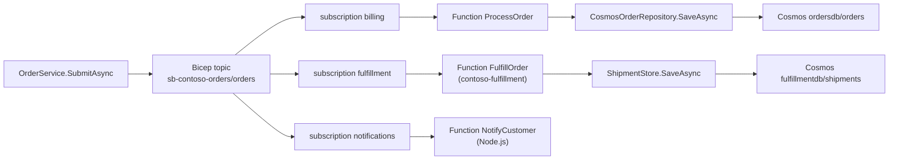

# Impact analysis

Impact analysis answers "if I change this, what may be affected?" Vogoban walks the stored relationships of the graph from the thing you change and lists every reachable entity with a level, a category and the path that explains why it is there. The result is based only on deterministic, stored relationships: it never guesses, and it does not predict failures.

## Why use it

- Before changing a Service Bus topic, an API operation, a message contract or a Bicep module, see which code, Functions, APIs, frontends, infrastructure and other repositories depend on it.
- In a review, attach the impact list and its paths as evidence.
- In CI, compare architecture snapshots (`vogoban diff`, `vogoban risk --diff`) instead of reading diffs line by line.

## A real question: "If I change this Service Bus topic, what may be affected?"

The example uses the three Contoso sample repositories from [Azure end to end](azure-end-to-end.md), registered in one MetaGraph store. The topic `sb-contoso-orders/orders` is declared in Bicep in `contoso-orders`, published to by the orders API and consumed by Functions in two repositories.



### 1. Find the entity

```bash
export VOGOBAN_DB=~/azure-demo/meta/graph.db
vogoban find sb-contoso-orders/orders --kind AzureResource
```

```text
id                          entity                                                                            location
--------------------------  --------------------------------------------------------------------------------  --------------------------------
e_a0d764ed415e9b225944c657  AzureResource Microsoft.ServiceBus/namespaces/topics/subscriptions:sb-contoso-or  infra/modules/messaging.bicep:18
e_9ece7fb1691e89ec57f1346e  AzureResource Microsoft.ServiceBus/namespaces/topics/subscriptions:sb-contoso-or  terraform/main.tf:35
e_00f95d1d7458b9880aa390b1  AzureResource Microsoft.ServiceBus/namespaces/topics:sb-contoso-orders/orders     terraform/main.tf:30
e_c27699a970fb60fc67831e43  AzureResource Microsoft.ServiceBus/namespaces/topics:sb-contoso-orders/orders     infra/modules/messaging.bicep:15
```

The topic appears twice: declared in Bicep (`contoso-orders`) and referenced as a Terraform `data` source (`contoso-platform-infra`). Use the Bicep one. Your ids will differ; they are derived from the repository identity.

### 2. Run impact across repositories

```bash
vogoban impact e_c27699a970fb60fc67831e43 --scope all
```

```text
impact of AzureResource Microsoft.ServiceBus/namespaces/topics:sb-contoso-orders/orders
  45 entities  levels: DIRECT=5 INDIRECT=4 POTENTIAL=18 TRANSITIVE=18  categories: API=1 CODE=14 CONTRACT=4 INFRASTRUCTURE=7 MESSAGE=9 REPOSITORY=2 SERVICE=8
  repositories: contoso-orders(28), contoso-fulfillment(10), contoso-platform-infra(3)  unresolved at boundary: 1  conflicts: 0
  graph: contoso-fulfillment@ff0892b6/64748c7e READY, contoso-orders@7e8f073b/f079ef41 READY, contoso-platform-infra@de6c5d18/7bfcbd44 READY  meta=snap_5e6bf2577d73ca88c317a096
level       category        entity                                                                            repository              because                              path (* crosses repository)
----------  --------------  --------------------------------------------------------------------------------  ----------------------  -----------------------------------  -------------------------------------------------------------------------
DIRECT      CONTRACT        SharedContract azure:service-bus-entity:sb-contoso-orders/orders                  meta                    member of shared contract            <-CONTAINS
DIRECT      INFRASTRUCTURE  AzureResource Microsoft.ServiceBus/namespaces:sb-contoso-orders                   contoso-orders          contains changed resource            <-CONTAINS_RESOURCE
DIRECT      INFRASTRUCTURE  AzureResource Microsoft.ServiceBus/namespaces/topics/subscriptions:sb-contoso-or  contoso-orders          delivers to subscriber               ->SUBSCRIBES_TO
DIRECT      MESSAGE         Queue azure-service-bus:service-bus-entity:sb-contoso-orders/orders               contoso-fulfillment     declared by infrastructure           <-DECLARED_BY*
DIRECT      MESSAGE         Queue azure-service-bus:service-bus-entity:sb-contoso-orders/orders               contoso-orders          declared by infrastructure           <-DECLARED_BY
INDIRECT    CODE            Method Contoso.Orders.Api.Services.OrderService.SubmitAsync(string, System.Colle  contoso-orders          publishes to                         <-DECLARED_BY <-PUBLISHES_TO
INDIRECT    MESSAGE         Queue azure-service-bus:service-bus-subscription:sb-contoso-orders/orders/billin  contoso-orders          declared by infrastructure           ->SUBSCRIBES_TO <-DECLARED_BY
INDIRECT    MESSAGE         Queue azure-service-bus:service-bus-subscription:sb-contoso-orders/orders/fulfil  contoso-fulfillment     delivers to subscriber               <-DECLARED_BY* ->SUBSCRIBES_TO
INDIRECT    MESSAGE         Queue azure-service-bus:service-bus-subscription:sb-contoso-orders/orders/notifi  contoso-orders          delivers to subscriber               <-DECLARED_BY ->SUBSCRIBES_TO
TRANSITIVE  CODE            Method Contoso.Fulfillment.Functions.FulfillmentFunctions.FulfillOrder(Contoso.O  contoso-fulfillment     delivers to consumer                 <-DECLARED_BY* ->SUBSCRIBES_TO ->ROUTES_TO
…
TRANSITIVE  SERVICE         AzureFunction contoso-notifications:NotifyCustomer                                contoso-orders          triggers                             <-DECLARED_BY ->SUBSCRIBES_TO ->TRIGGERS
TRANSITIVE  SERVICE         AzureFunction Contoso.Fulfillment.Functions:FulfillOrder                          contoso-fulfillment     triggers                             <-DECLARED_BY* ->SUBSCRIBES_TO ->TRIGGERS
TRANSITIVE  SERVICE         AzureFunction Contoso.Orders.Functions:ProcessOrder                               contoso-orders          triggers                             ->SUBSCRIBES_TO <-DECLARED_BY ->TRIGGERS
…
TRANSITIVE  INFRASTRUCTURE  AzureResource Microsoft.ServiceBus/namespaces/topics/subscriptions:sb-contoso-or  contoso-platform-infra  same contract in another repository  <-DECLARED_BY* ->SUBSCRIBES_TO <-CONTAINS ->CONTAINS*
POTENTIAL   MESSAGE         Queue azure-service-bus:service-bus-entity:sb-contoso-platform/shipments          contoso-fulfillment     publishes to (downstream)            <-DECLARED_BY* ->SUBSCRIBES_TO ->TRIGGERS ->PUBLISHES_TO
…
POTENTIAL   SERVICE         Endpoint Contoso.Orders.Api:POST /api/orders                                      contoso-orders          implemented by                       <-DECLARED_BY <-PUBLISHES_TO ->IMPLEMENTS <-CALLS <-IMPLEMENTED_BY
POTENTIAL   API             ApiOperation Contoso.Orders.Api:POST /api/orders                                  contoso-orders          implemented by                       <-DECLARED_BY <-PUBLISHES_TO ->IMPLEMENTS <-CALLS <-IMPLEMENTED_BY <-IMPLEMENTED
  (5 more; --limit N, --json or --out for all; 'paths <seed> <entity>' explains any row)
```

Reading the result:

- **Topic → subscription → Function.** The three subscriptions are reached through `SUBSCRIBES_TO`; the three Functions (two .NET, one Node.js, in two repositories) through `TRIGGERS`.
- **Publisher side.** `OrderService.SubmitAsync` publishes to the topic; the controller, endpoint and API operation that call it are `POTENTIAL` because they are reached through an interface dispatch (`IOrderService`).
- **Other repositories.** `*` marks steps that cross a repository boundary. The Terraform subscription in `contoso-platform-infra` and `FulfillOrder` in `contoso-fulfillment` are reached through MetaGraph relationships.
- **Downstream topic.** `sb-contoso-platform/shipments` is `POTENTIAL`: `FulfillOrder` publishes to it, so it is downstream of an affected consumer.

### 3. Follow the data path to the database

Impact follows *dependents*: things that would need to change, or could break, because the topic changed. A database written by a consumer does not depend on the topic, so it is not in the impact set. To see the full data path from topic to database, follow the flow downstream from the code-side topic:

```bash
vogoban find sb-contoso-orders/orders --kind Queue
vogoban azure flow e_e129c65c707476b0ea4a73b8 --to e_2b01116d867238f9b26e0aa5
```

```text
Queue azure-service-bus:service-bus-entity:sb-contoso-orders/orders  downstream: 33 reachable entities

    Queue azure-service-bus:service-bus-entity:sb-contoso-orders/orders
      -[SHARES_RESOURCE/STRUCTURALLY_RESOLVED/meta]-> Queue azure-service-bus:service-bus-entity:sb-contoso-orders/orders
      -[SUBSCRIBES_TO/COMPILER_RESOLVED]-> Queue azure-service-bus:service-bus-subscription:sb-contoso-orders/orders/fulfillment
      -[ROUTES_TO/COMPILER_RESOLVED]-> Method Contoso.Fulfillment.Functions.FulfillmentFunctions.FulfillOrder(Contoso.Orders.Contracts.OrderSubmitted, System.Threading.CancellationToken)
      -[CALLS/COMPILER_RESOLVED]-> Method Contoso.Fulfillment.Functions.ShipmentStore.SaveAsync(Contoso.Orders.Contracts.ShipmentCreated, System.Threading.CancellationToken)
      -[WRITES_TO/COMPILER_RESOLVED]-> Database azure:cosmos-container:cosmos-contoso-fulfillment/fulfillmentdb/shipments
```

That is the chain Topic → Subscription → Function → Service → Database, every hop a stored relationship with its evidence level. `find` lists the code-side topic twice, once per repository that uses it; `vogoban show <id>` tells you which repository each belongs to. Here `e_e129…` is the topic as seen by `contoso-orders`, and `e_2b01…` is the `Database` entity of the shipments container (from `vogoban find shipments`).

The reverse question, "what is affected if I change the Cosmos container?", is an impact question again, and the writers and readers show up:

```bash
vogoban impact e_347d574e1abfc4a67b7c9936 --limit 8
```

```text
impact of AzureResource Microsoft.DocumentDB/databaseAccounts/sqlDatabases/containers:cosmos-contoso-orders/ordersdb/orders
  33 entities  levels: DIRECT=2 INDIRECT=4 POTENTIAL=24 TRANSITIVE=3  categories: API=2 CODE=18 EXTERNAL_SYSTEM=1 INFRASTRUCTURE=3 MESSAGE=1 REPOSITORY=1 SERVICE=7
…
DIRECT      EXTERNAL_SYSTEM  Database azure:cosmos-container:cosmos-contoso-orders/ordersdb/orders             contoso-orders  declared by infrastructure    <-DECLARED_BY
DIRECT      INFRASTRUCTURE   AzureResource Microsoft.DocumentDB/databaseAccounts/sqlDatabases:cosmos-contoso-  contoso-orders  contains changed resource     <-CONTAINS_RESOURCE
INDIRECT    CODE             Method Contoso.Orders.Functions.Data.CosmosOrderRepository.PurgeCompletedAsync(S  contoso-orders  reads from                    <-DECLARED_BY <-READS_FROM
INDIRECT    CODE             Method Contoso.Orders.Functions.Data.CosmosOrderRepository.SaveAsync(Contoso.Ord  contoso-orders  writes to                     <-DECLARED_BY <-WRITES_TO
INDIRECT    SERVICE          AzureFunction Contoso.Orders.Functions:GetOrderStatus                             contoso-orders  reads from                    <-DECLARED_BY <-READS_FROM
INDIRECT    SERVICE          AzureFunction Contoso.Orders.Functions:OrderChangeFeed                            contoso-orders  change feed triggers          <-DECLARED_BY ->CHANGE_FEED
…
```

### 4. Explain any row

```bash
vogoban paths e_c27699a970fb60fc67831e43 <entity-id>
```

`paths` prints the relationship path between the changed entity and any row, with evidence on each hop. `--json` or `--out impact.json --format json` gives the complete list with paths, evidence, scope and provenance.

## How to read the output

### Levels

| Level | Meaning |
|---|---|
| `DIRECT` | one confirmed hop from the changed entity |
| `INDIRECT` | two confirmed hops |
| `TRANSITIVE` | three or more confirmed hops |
| `POTENTIAL` | reached only through an inferred edge, an interface or base-member dispatch, a contract-level edge or a downstream flow edge; it may be affected |

### Categories

The category comes from the entity kind: `CODE`, `PROJECT`, `SERVICE` (applications, endpoints, Functions, frontend routes, ...), `API`, `CONTRACT` (schemas, shared contracts), `MESSAGE` (messages, topics, queues), `REPOSITORY`, `INFRASTRUCTURE` (pipelines, images, Azure resources, ...), `DEPLOYMENT`, `EXTERNAL_SYSTEM` (external APIs, databases, storage) and `CONFIGURATION`.

### Propagation

Each relationship type has a rule that says in which direction impact flows and whether it continues. Some examples:

| Relationship | Impact flows to | Label |
|---|---|---|
| `CALLS` | the caller | calls |
| `IMPLEMENTS` | the implementing member; the interface caller as `POTENTIAL` | implements / dispatched through interface |
| `PUBLISHES_TO` | the publisher; the downstream topic as `POTENTIAL` | publishes to |
| `SUBSCRIBES_TO`, `TRIGGERS` | the subscriber or triggered Function | delivers to subscriber / triggers |
| `WRITES_TO`, `READS_FROM` | the code that writes or reads | writes to / reads from |
| `DECLARED_BY` | the code-side resource declared by changed IaC | declared by infrastructure |
| `HOSTED_ON` | the hosting resource, as `POTENTIAL`, without continuing | hosted on (hosting target) |

Every relationship type has such a rule; how they are applied is described in [Analysis pipeline](../architecture/analysis-pipeline.md).

### Header fields

- `repositories:` how many impacted entities are in each repository.
- `unresolved at boundary:` unresolved references attached to impacted entities. What lies behind them is unknown; `vogoban unresolved` lists them.
- `graph:` the repository commit and graph version used, with its state (`READY`, `STALE`, ...). A warning is printed when a graph is not `READY`.
- `meta=` the MetaGraph snapshot used when `--scope` includes the MetaGraph.

## Scores: structural exposure, not probability

`vogoban blast-radius <entity>` and `vogoban risk <entity>` add a score from 0 to 100 computed from the reach of the impact set.

```bash
vogoban blast-radius e_c27699a970fb60fc67831e43 --scope all
```

```text
Blast radius: 71.5 (CRITICAL) - structural change exposure derived from graph reach; not a probability of failure
factor                       value  points  explanation
---------------------------  -----  ------  ----------------------------------------------------------------------------
direct                       5      10/10   entities directly dependent on the change
indirect+transitive          22     10/10   entities reached through two or more confirmed hops
potential                    18     4.2/5   entities reached only through inferred, dispatch or contract-level edges
repositories                 2      15/15   other repositories reached
services                     4      9.3/10  applications affected
api-operations               1      3/10    API operations or APIs affected
external-consumers           0      0/10    consumers in other repositories reached through API or message relationships
deployments                  0      0/10    workloads, services, ingresses or releases affected
cross-repository-boundaries  4      10/10   distinct relationships crossing a repository boundary
contract-boundaries          10     5/5     API/message/contract entities propagating the impact
infrastructure-boundaries    7      5/5     infrastructure or deployment entities in the impact set
```

The score says how much of the architecture a change touches. It does not say how likely the change is to break something; a heavily used topic with a backward-compatible change scores just as high as a breaking one.

## API changes

`vogoban api-impact <operation> --change <kind>` describes the effect of a specific kind of API change on consumers:

| `--change` | Breaking for |
|---|---|
| `removed`, `route`, `method`, `version` | all consumers |
| `request-field`, `required-field`, `parameter`, `request-contract` | consumers that send the request |
| `response-field`, `response-contract` | consumers that read the response |
| `additive-field` | not breaking |

```bash
vogoban api-impact "POST /api/orders" --kind ApiOperation --change request-field --limit 6
```

```text
API operation Contoso.Orders.Api:POST /api/orders  [contoso-orders]
  api Contoso.Orders.Api (code-first)  provider Contoso.Orders.Api
  implemented by Contoso.Orders.Api:POST /api/orders  handler Contoso.Orders.Api.Controllers.OrdersController.Create(Contoso.Orders.Api.Controllers.CreateOrderRequest, System.Threading.CancellationToken)
  request Contoso.Orders.Api.Controllers.CreateOrderRequest  response -
  change request-field: potentially breaking for consumers using the request
Consumers (1) in contoso-orders
  contoso-orders: web/src/api/orders.ts:createOrder  apps=contoso-orders-web deployments=-  repository/INFERRED breaking=unknown
…
POTENTIAL  CODE            Method web/src/api/orders.ts:createOrder                                          contoso-orders  calls endpoint             <-CALLS_ENDPOINT
DIRECT     INFRASTRUCTURE  AzureResource Microsoft.ApiManagement/service/apis/operations:apim-contoso-order  contoso-orders  routes traffic to          <-ROUTES_TRAFFIC_TO
…
```

`POST /api/orders` matches both the `ApiOperation` and the `Endpoint`, so `--kind ApiOperation` picks one. The React client and the APIM operation that routes to it are both listed.

## Other impact commands

| Command | Use it for |
|---|---|
| `vogoban impact <entity...>` | general change impact |
| `vogoban message-impact <message>` | producers, consumers, transports and contract of a message |
| `vogoban service-impact <application>` | upstream and downstream of an application |
| `vogoban repository-impact <repo>` | everything other repositories consume from a repository |
| `vogoban dependencies <entity>`, `vogoban dependents <entity>` | plain dependency lists by level |
| `vogoban team-impact <entity...>` | impacted components grouped by owning team (see [Governance](governance.md)) |
| `vogoban risk --diff` | change risk between two stored snapshots |

Common options: `--scope repository|meta|all`, `--env E`, `--depth N`, `--max-nodes N`, `--limit N`, `--out F --format json|jsonl|csv`. Details are in the [impact command reference](../cli/impact.md).

## Limitations

- Impact uses only relationships stored in the graph. A dependency Vogoban did not extract (reflection, runtime configuration, a client passed through a collection) is not followed. Unresolved references at the boundary are reported, so you can see where knowledge stops.
- Impact does not run code, query Azure or read telemetry. It cannot tell whether a path is used in production, how often, or whether a particular change is backward compatible.
- `POTENTIAL` rows can be false positives (an interface with several implementations) and are labelled as such.
- Large graphs are bounded by `--depth` and `--max-nodes`; truncation is reported.

## Related

- [Azure end to end](azure-end-to-end.md)
- [MetaGraph](metagraph.md) for cross-repository impact
- [Impact command reference](../cli/impact.md), [Diff](../cli/diff.md)
- [Analysis pipeline](../architecture/analysis-pipeline.md), [Evidence and provenance](../architecture/evidence-provenance.md)
