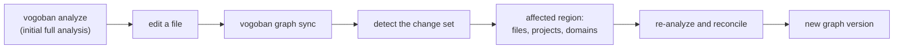

# Incremental analysis

After the first full analysis, `vogoban graph sync` keeps the graph current by re-analyzing only what a change affects and updating the stored graph in place. The result is the same graph a full analysis would produce; incremental analysis is only faster for narrow changes.

## Why use it

A full `vogoban analyze` re-reads the whole repository. When you edit one file, most of that work is wasted. `graph sync`:

- detects what changed (working tree, staged files, a commit or a commit range);
- re-analyzes only the affected files, projects and analyzer domains;
- reconciles the result with the stored graph and records a new graph version;
- falls back to a full rebuild, and says so, whenever reuse would be unsafe.

## The flow



1. **Initial analysis.** `vogoban analyze .` builds the graph and records the analyzed commit.
2. **Change.** You edit, add, delete or rename files.
3. **Detect.** `graph status` and `graph changes` compare the analyzed commit with the checkout.
4. **Affected region.** The planner works out which files, which projects (plus every project that references them) and which analyzer domains (code, API, messaging, Azure, frontend, ...) must be recomputed. A changed IaC module widens the region to every file that uses it.
5. **Update.** Only that region is re-analyzed; unchanged files and projects come from caches. The result is reconciled with the stored graph in one transaction.
6. **New version.** A new graph version and snapshot are recorded, so `vogoban diff` can show what changed.

How the planner, caches and reconciliation work is described in [Incremental engine](../architecture/incremental-engine.md).

## Example: change an Azure Function trigger

This uses the `contoso-orders` sample from [Azure end to end](azure-end-to-end.md), already analyzed and committed, with `bin/`, `obj/` and `.vogoban/` in `.gitignore`. (Without those entries, restore output and the store files themselves show up as changes.)

```bash
cd ~/azure-demo/contoso-orders
vogoban graph status
```

```text
contoso-orders: UP_TO_DATE
  analyzed commit  27e13936b706
  working commit   27e13936b706
  up to date       yes  ·  changed files 0
  last sync        2026-10-11T17:07:28.272Z (incremental, SUCCESS)
```

Change the subscription that `ProcessOrder` listens on, from `billing` to `invoicing`, in `src/Contoso.Orders.Functions/OrderFunctions.cs`:

```csharp
public Task ProcessOrder([ServiceBusTrigger("orders", "invoicing", Connection = "ServiceBus")] OrderSubmitted order, CancellationToken cancellationToken)
```

```bash
vogoban graph status
vogoban graph changes
```

```text
contoso-orders: CHANGES_DETECTED
  analyzed commit  27e13936b706
  working commit   27e13936b706 (dirty)
  up to date       no  ·  changed files 1
  last sync        2026-10-11T17:07:28.272Z (incremental, SUCCESS)
contoso-orders: 1 change(s) [working-tree] 27e13936b706 -> 27e13936b706 (dirty)
  +0 ~1 -0 renamed 0  ·  categories: source=1
  modified source         src/Contoso.Orders.Functions/OrderFunctions.cs
```

Synchronize:

```bash
vogoban graph sync
```

```text
contoso-orders: INCREMENTAL — 1 file change(s): +0 ~1 -0 renamed 0
  commit 27e13936b706 -> 27e13936b706  [working-tree]
  graph version 05a0fc6d647c -> ef9b03bdfad1
  changed files 1  ·  analyzed 35  ·  affected projects 1
  reconciled entities +1 ~2 -1  relationships +4 ~0 -5
  duration 2187 ms (baseline full 372 ms)
  domains: api, application, azure, code, messaging, metagraph
  diff: vogoban diff --from gs_595ff70964b04b56ea6b511c --to gs_c9493632e3fbdd87c7cccebb
```

What the lines mean:

- `INCREMENTAL` is the mode that actually ran. It would say `FULL` (with a reason) if a rebuild was needed.
- `affected projects 1`: only `Contoso.Orders.Functions` was recompiled.
- `reconciled entities +1 ~2 -1`: the `billing` subscription entity was removed, an `invoicing` one added, two entities updated.
- `domains:` the analyzer domains that were recomputed.
- `duration … (baseline full …)`: the time of this sync and of the last full analysis. In this small sample the full baseline was a warm run from cache, so the sync is not faster; the gain shows on larger repositories where most projects are untouched.

The graph now reflects the change:

```bash
vogoban azure triggers
```

```text
…
serviceBus  Queue azure-service-bus:service-bus-subscription:sb-contoso-orders/orders/invoic  TRIGGERS      Contoso.Orders.Functions:ProcessOrder     COMPILER_RESOLVED      src/Contoso.Orders.Functions/OrderFunctions.cs:18
```

and `vogoban diff` shows the architecture-level difference between the two snapshots:

```bash
vogoban diff --from gs_595ff70964b04b56ea6b511c --to gs_c9493632e3fbdd87c7cccebb
```

```text
repository diff gs_595ff70964b04b56ea6b511c (27e13936b706) -> gs_c9493632e3fbdd87c7cccebb (27e13936b706)  repository contoso-orders
entities: +1 -1 ~2   relationships: +4 -5 ~0
category    added  removed  changed
----------  -----  -------  -------
CODE        0      0        1
MESSAGE     1      1        0
REPOSITORY  0      0        1

Architecture changes (0)
```

The new subscription is not declared in Bicep, so `vogoban azure messaging` now shows `declared by: -` for `sb-contoso-orders/orders/invoicing`.

`graph history` keeps a record of every sync:

```bash
vogoban graph history
```

```text
timestamp                 mode         status   commit        files  ms    fallback
------------------------  -----------  -------  ------------  -----  ----  --------
2026-10-11T17:07:42.185Z  incremental  SUCCESS  27e13936b706  1      2187
2026-10-11T17:07:28.272Z  incremental  SUCCESS  27e13936b706  3      309
```

## Incremental equals full

The guarantee is that an incremental sync produces the same graph as a full analysis of the same files. You can check it yourself: analyze the same working tree into a fresh store and compare graph versions, which are content hashes of the graph.

```bash
vogoban analyze . --db /tmp/fresh/graph.db --log-level warn
vogoban repositories --db /tmp/fresh/graph.db
vogoban repositories
```

```text
repository      status  identity                                       commit        graph version  analyzed at               note
--------------  ------  ---------------------------------------------  ------------  -------------  ------------------------  ----
contoso-orders  READY   local:…/contoso-orders                         27e13936b706  ef9b03bdfad1   2026-10-11T17:08:00.675Z
repository      status  identity                                       commit        graph version  analyzed at               note
--------------  ------  ---------------------------------------------  ------------  -------------  ------------------------  ----
contoso-orders  READY   local:…/contoso-orders                         27e13936b706  ef9b03bdfad1   2026-10-11T17:07:44.540Z
```

Both stores have graph version `ef9b03bdfad1`. Reverting the edit and syncing again returns to the original version `05a0fc6d647c`:

```bash
git checkout src/Contoso.Orders.Functions/OrderFunctions.cs
vogoban graph sync
```

```text
contoso-orders: INCREMENTAL — graph was built from a dirty working tree; re-deriving against current state
  commit 27e13936b706 -> 27e13936b706  [working-tree]
  graph version ef9b03bdfad1 -> 05a0fc6d647c
…
```

The release tests verify the same property on real repositories: modifications, additions, deletions, renames, project references, configuration changes, commit ranges, and Azure and frontend changes, each compared with a clean full rebuild for identical entities, relationships, unresolved references, diagnostics and graph version.

## Ways to describe the change

| Command | Change set |
|---|---|
| `vogoban graph sync` | the working tree against the analyzed commit (default) |
| `vogoban graph sync --staged` | staged changes only |
| `vogoban graph sync --since <commit>` | changes since a commit |
| `vogoban graph sync --from <a> --to <b>` (or `--base` / `--head` in CI) | a commit range; the checkout must be at `<b>` |
| `vogoban graph sync --full` | force a full rebuild |
| `vogoban graph sync --meta` | also update the MetaGraph |

Synchronization always analyzes the checked-out files; a commit range only describes what changed. Options, JSON fields and exit codes are in the [sync command reference](../cli/sync.md). Optional Git hooks that run sync for you are described in [Hooks](../cli/hooks.md); CI usage in [CI](../advanced/ci.md).

## When it falls back to a full rebuild

A sync runs as a full rebuild, and reports `actualMode: full` with a `fallbackCode`, when incremental reuse is not safe:

- the analyzer, graph schema or plugin versions changed (for example after an upgrade);
- `vogoban.json` or other analysis configuration changed;
- the semantic mode (`--no-semantic`) or the trust mode (`--untrusted`, or a CI sync, which is untrusted by default) changed;
- there is no existing graph or no prior run for the repository;
- the base commit cannot be found (shallow clone, deleted branch) or the folder is not a Git repository.

A fallback still produces a correct graph and exits 0. Add `--strict-incremental` to make it exit 5 instead, for example in CI where you expect incremental runs.

If a sync fails, the previous graph stays intact and the failure is recorded in `graph history`. A graph built from a dirty working tree is always re-derived on the next sync, so reverting uncommitted changes never leaves stale facts.

## Limitations

- Speed-ups depend on how far a change reaches. A change to a project that most other projects reference recompiles almost everything; measured on dotnet/eShop, a 251-file range touching all projects took about as long as a full analysis.
- Git submodule contents are never analyzed, incrementally or otherwise; each submodule produces a `file-skipped` diagnostic. Register submodules as their own repositories and use the [MetaGraph](metagraph.md).
- The platform worker runs full `analyze` (with caches), not `graph sync`, so it records no sync history.
- Keep the store outside the repository or in `.gitignore`; otherwise the store files are reported as changes.

## Related

- [Sync command reference](../cli/sync.md), [Graph commands](../cli/graph.md), [Hooks](../cli/hooks.md)
- [Incremental engine (internals)](../architecture/incremental-engine.md)
- [CI](../advanced/ci.md), [Trust modes](../advanced/trust-modes.md)
