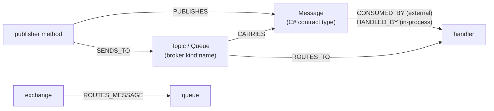

# Messaging

Vogoban finds message contracts, the code that publishes or sends them, the transports they travel on (topics, exchanges, queues, subscriptions) and the handlers that consume them. It covers MediatR, MassTransit, NServiceBus, Azure Service Bus, RabbitMQ.Client and Confluent.Kafka in .NET, Azure Event Hubs, Event Grid and Storage queues through the Azure plugins, and your own messaging abstractions declared in `vogoban.json`.

## Why it matters

Asynchronous links do not show up as calls. Without them, impact analysis stops at the publisher and a consumer in another service looks unused. With messages, transports and handlers in the graph, `message-impact`, `impact`, `azure flow` and the MetaGraph can follow a change from the code that publishes an event to every handler that receives it, in the same repository or another one.

## The model



- A `Message` entity keeps the C# semantic identity of its contract type (`USES_TYPE` → the type, role `message-schema`), its public fields (including inherited ones), its namespace, and a version when the namespace has a `v<N>` segment (`Contoso.Contracts.V1` → version `1`).
- Transports are separate `Topic` or `Queue` entities keyed by broker, kind and name (`masstransit:queue:price-changes`). Their name has its own evidence level.
- Relationships emitted by the .NET messaging plugins: `PUBLISHES` (publisher → message), `SENDS_TO` (publisher → transport), `CARRIES` (transport → message), `CONSUMED_BY` (message → handler, external brokers) or `HANDLED_BY` (message → handler, in-process dispatch), `ROUTES_TO` (transport → consumer) and `ROUTES_MESSAGE` (exchange → queue binding).
- Relationships emitted by the Azure plugins: `PUBLISHES_TO`, `PUBLISHES_EVENT` (Event Grid), `CONSUMES_FROM`, `RECEIVES_MESSAGE`, `SUBSCRIBES_TO` (topic → subscription, event subscriptions), `TRIGGERS` (subscription or queue → Azure Function), `CHANGE_FEED` (Cosmos DB → Function), `CONSUMED_BY` (Event Hubs consumers), plus `DECLARED_BY` to the Bicep/ARM/Terraform/Aspire resource.
- Across repositories, the MetaGraph adds `PUBLISHES_MESSAGE` / `CONSUMES_MESSAGE` (see [MetaGraph](metagraph.md)).

`CONSUMES`, `PRODUCES_MESSAGE`, `HANDLES_MESSAGE`, `RECEIVES_FROM` and `SENDS_MESSAGE` exist in the relationship vocabulary but are not produced by the 0.18.0 analyzers.

## What Vogoban detects

All .NET messaging plugins run over Roslyn facts, so the messaging packages must be restored (see [.NET](dotnet.md#unresolved-references-and-dotnet-restore)).

| Framework | Contracts and publishers | Transports | Handlers |
| --- | --- | --- | --- |
| MediatR (in-process) | Types implementing `IRequest`, `INotification`, `IStreamRequest`; `Send`, `Publish`, `CreateStream` on `ISender`/`IMediator`/`IPublisher`/`Mediator` | none (in-process) | `IRequestHandler`, `INotificationHandler`, `IStreamRequestHandler` implementations → `HANDLED_BY` |
| MassTransit | `Publish` on `IPublishEndpoint`/`IBus`/`ConsumeContext`; `Send` on `ISendEndpoint`/`ConsumeContext`/`IBus` | publish: exchange named after the message type (`STRUCTURALLY_RESOLVED`); send: `GetSendEndpoint("queue:...")` / `exchange:` / `topic:` addresses; `ReceiveEndpoint("name", ...)` queues | `IConsumer<T>` implementations; `ConfigureConsumer<T>` / `Consumer<T>` inside a receive endpoint → `ROUTES_TO` |
| NServiceBus | `Publish` (event), `Send` / `SendLocal` (command) on message sessions and handler contexts | `RouteToEndpoint(typeof(T), "destination")` queues | `IHandleMessages<T>` implementations |
| Azure Service Bus (`Azure.Messaging.ServiceBus`) | `ServiceBusSender.SendMessage(s)Async` / `ScheduleMessage(s)Async`; payload type from `BinaryData.FromObjectAsJson(x)` / `JsonSerializer.Serialize(x)` | entity name from the visible `CreateSender("...")` call | `CreateProcessor` / `CreateSessionProcessor` / `CreateReceiver` / `AcceptNextSessionAsync` (with subscription name) |
| RabbitMQ.Client | `BasicPublish` (payload from the body serializer call, routing key recorded) | `ExchangeDeclare`, `QueueDeclare`; `QueueBind` → `ROUTES_MESSAGE` (exchange → queue) | `BasicConsume` → `ROUTES_TO` |
| Confluent.Kafka | `IProducer<K,V>.Produce` / `ProduceAsync`; message type = the producer's value type | topic name argument | `IConsumer<K,V>.Subscribe(...)` topics |
| Azure SDK (.NET and TypeScript) | Service Bus sender, Event Hubs producer (`SendAsync`, `EnqueueEvent(s)Async`), Event Grid publisher (`SendEvent(s)Async`, `SendCloudEvent(s)Async`), Storage `QueueClient.SendMessage(Async)` | resolved to the logical Azure entity (namespace/entity) through names, settings and connection references | Service Bus receivers and processors, Event Hubs consumers and processors, Storage queue receivers, Azure Functions triggers |
| `vogoban.json` custom abstraction | configured publisher type + method names, message argument index | configured transport | implementations of configured handler interfaces; configured subscription methods |

Message contracts are concrete types. A publish whose argument is typed as an interface, an abstract type, `object`/`string`/`byte[]`/`BinaryData`/`ServiceBusMessage`, or a base type with derived contracts is an unresolved reference (category `dynamic-message-type`), not a guess. A transport name that is not a compile-time constant is an unresolved `SENDS_TO` (category `dynamic-transport-name`). Same-named contracts carried by one transport with different fields are a `conflicting-message-schema` conflict.

Azure Functions triggers, bindings and the resolution of Azure entity names are described in [Azure](azure.md).

## Example: MediatR and MassTransit

```csharp
// src/Shop.Contracts/Events.cs
namespace Shop.Contracts.V1;

public sealed record ProductPriceChanged(int ProductId, decimal NewPrice);
```

```csharp
// src/Shop.Api/PriceEndpoints.cs (publisher)
public static class PriceEndpoints
{
    public static async Task<IResult> ChangePrice(int id, PriceChange change, IPublishEndpoint bus)
    {
        await bus.Publish(new ProductPriceChanged(id, change.Price));
        return Results.NoContent();
    }
}
```

```csharp
// src/Shop.Worker/Program.cs and PriceChangedConsumer.cs (consumer)
builder.Services.AddMassTransit(x =>
{
    x.AddConsumer<PriceChangedConsumer>();
    x.UsingRabbitMq((context, cfg) =>
    {
        cfg.ReceiveEndpoint("price-changes", e => e.ConfigureConsumer<PriceChangedConsumer>(context));
    });
});

public sealed class PriceChangedConsumer : IConsumer<ProductPriceChanged>
{
    public Task Consume(ConsumeContext<ProductPriceChanged> context) { /* ... */ return Task.CompletedTask; }
}
```

```csharp
// src/Shop.Api/Catalog.cs (MediatR, in-process)
public sealed record ListProducts : IRequest<IReadOnlyList<Product>>;

public sealed class ListProductsHandler(IProductRepository repository) : IRequestHandler<ListProducts, IReadOnlyList<Product>>
{
    public Task<IReadOnlyList<Product>> Handle(ListProducts request, CancellationToken cancellationToken) => repository.ListAsync();
}
// Program.cs: products.MapGet("/", async (IMediator mediator) => await mediator.Send(new ListProducts()));
```

What Vogoban extracts:

- `Message ProductPriceChanged` (version `1` from the `V1` namespace segment, fields `NewPrice:decimal`, `ProductId:int`).
- `ChangePrice` -`PUBLISHES`-> the message (`COMPILER_RESOLVED`) and -`SENDS_TO`-> `masstransit:exchange:Shop.Contracts.V1:ProductPriceChanged` (`STRUCTURALLY_RESOLVED`, because the exchange name follows MassTransit's naming convention rather than a literal).
- `masstransit:queue:price-changes` -`ROUTES_TO`-> `PriceChangedConsumer`, and the message -`CONSUMED_BY`-> `PriceChangedConsumer`.
- `Message ListProducts` -`HANDLED_BY`-> `ListProductsHandler` (in-process).

```bash
vogoban messages
vogoban message ProductPriceChanged
vogoban publishers
vogoban consumers
vogoban transports
```

```text
message                                frameworks   dispatch    publishers  consumers             transports
-------------------------------------  -----------  ----------  ----------  --------------------  ----------------------------------------------------
Shop.Api.ListProducts                  mediatr      in-process  1           ListProductsHandler   -
Shop.Contracts.V1.ProductPriceChanged  masstransit  external    1           PriceChangedConsumer  price-changes, Shop.Contracts.V1:ProductPriceChanged

Shop.Contracts.V1.ProductPriceChanged  (masstransit; external)
  id          e_707804a72ca63cbe0f41e2e4
  declared    src/Shop.Contracts/Events.cs:3   version 1
  schema      Type:Record Shop.Contracts.V1.ProductPriceChanged
  fields      NewPrice:decimal, ProductId:int
  publishers  Shop.Api.PriceEndpoints.ChangePrice(int, Shop.Api.PriceChange, MassTransit.IPublishEndpoint) [Publish, COMPILER_RESOLVED]
  consumers   Shop.Worker.PriceChangedConsumer [CONSUMED_BY, COMPILER_RESOLVED]
  transports  masstransit:queue:price-changes [COMPILER_RESOLVED]; masstransit:exchange:Shop.Contracts.V1:ProductPriceChanged [STRUCTURALLY_RESOLVED]

publisher                                                                         message              framework    operation  evidence           location
--------------------------------------------------------------------------------  -------------------  -----------  ---------  -----------------  ---------------------------------
<top-level-statements-entry-point>                                                ListProducts         mediatr      Send       COMPILER_RESOLVED  src/Shop.Api/Program.cs:22
Shop.Api.PriceEndpoints.ChangePrice(int, Shop.Api.PriceChange, MassTransit.IPubl  ProductPriceChanged  masstransit  Publish    COMPILER_RESOLVED  src/Shop.Api/PriceEndpoints.cs:10

consumer                          message              framework    relationship  evidence           location
--------------------------------  -------------------  -----------  ------------  -----------------  -----------------------------------------
Shop.Api.ListProductsHandler      ListProducts         mediatr      HANDLED_BY    COMPILER_RESOLVED  src/Shop.Api/Catalog.cs:19
Shop.Worker.PriceChangedConsumer  ProductPriceChanged  masstransit  CONSUMED_BY   COMPILER_RESOLVED  src/Shop.Worker/PriceChangedConsumer.cs:6

transport                                                   senders      receivers                         carries              routes to
----------------------------------------------------------  -----------  --------------------------------  -------------------  ---------
masstransit:queue:price-changes                             -            Shop.Worker.PriceChangedConsumer  ProductPriceChanged  -
masstransit:exchange:Shop.Contracts.V1:ProductPriceChanged  ChangePrice  -                                 ProductPriceChanged  -
```

The MediatR `Send` is inside a lambda in top-level statements, so its publisher is the entry point `<top-level-statements-entry-point>`. Vogoban does not model MassTransit's binding of the message-type exchange to the `price-changes` queue, so the two transports are not connected to each other; the publisher and the consumer are connected through the `Message` entity. Option details are in the [contracts CLI reference](../cli/contracts.md).

## Example: Azure Service Bus to an Azure Function

In the Contoso Orders demo, the API sends `OrderSubmitted` to the Service Bus topic `orders`, and an isolated Azure Function consumes the `billing` subscription:

```csharp
// src/Contoso.Orders.Api/Services/OrderService.cs
_sender = client.CreateSender("orders");
…
var submitted = new OrderSubmitted(id, customerId, lines);
await _sender.SendMessageAsync(new ServiceBusMessage(BinaryData.FromObjectAsJson(submitted)), cancellationToken);
```

```csharp
// src/Contoso.Orders.Functions/OrderFunctions.cs
[Function("ProcessOrder")]
public Task ProcessOrder([ServiceBusTrigger("orders", "billing", Connection = "ServiceBus")] OrderSubmitted order, CancellationToken cancellationToken)
    => processor.ProcessAsync(order, cancellationToken);
```

The topic and its subscription are declared in Bicep (`infra/modules/messaging.bicep`) and in the Aspire AppHost. What Vogoban extracts, as one chain **Publisher → Topic → Subscription → Function → Handler**:

- `OrderService.SubmitAsync` -`PUBLISHES_TO`-> `sb-contoso-orders/orders` and -`PUBLISHES`-> `Message OrderSubmitted` (payload type from `BinaryData.FromObjectAsJson`);
- `sb-contoso-orders/orders` -`SUBSCRIBES_TO`-> subscription `sb-contoso-orders/orders/billing` -`TRIGGERS`-> `AzureFunction Contoso.Orders.Functions:ProcessOrder` -`IMPLEMENTED_BY`-> `OrderFunctions.ProcessOrder`;
- `OrderSubmitted` -`CONSUMED_BY`-> `OrderFunctions.ProcessOrder`, and the subscription -`CARRIES`-> `OrderSubmitted`;
- each logical entity -`DECLARED_BY`-> its Bicep resource (and `aspire:orders`).

```bash
cd contoso-orders
vogoban azure messaging
vogoban message OrderSubmitted --kind Message
vogoban find SubmitAsync --kind Method
vogoban find "Contoso.Orders.Functions:ProcessOrder" --kind AzureFunction
vogoban azure flow <SubmitAsync-id> --to <ProcessOrder-function-id>
vogoban show "Contoso.Orders.Functions:ProcessOrder" --kind AzureFunction
```

```text
azure-service-bus sb-contoso-orders/orders  [exact]
  publishers:    PUBLISHES_TO Method Contoso.Orders.Api.Services.OrderService.SubmitAsync(string, System.Collections.Generic.IReadOnlyList<Contoso.Orders.Contracts.OrderLine>, System.Threading.CancellationToken)
  receivers:     -
  subscriptions: SUBSCRIBES_TO Queue azure-service-bus:service-bus-subscription:sb-contoso-orders/orders/notifications; SUBSCRIBES_TO Queue azure-service-bus:service-bus-subscription:sb-contoso-orders/orders/billing
  consumers:     -
  messages:      -
  declared by:   DECLARED_BY AzureResource aspire:orders; DECLARED_BY AzureResource Microsoft.ServiceBus/namespaces/topics:sb-contoso-orders/orders

azure-service-bus sb-contoso-orders/orders/billing  [exact]
  publishers:    -
  receivers:     -
  subscriptions: -
  consumers:     ROUTES_TO Method Contoso.Orders.Functions.OrderFunctions.ProcessOrder(Contoso.Orders.Contracts.OrderSubmitted, System.Threading.CancellationToken); TRIGGERS AzureFunction Contoso.Orders.Functions:ProcessOrder
  messages:      CARRIES Message Contoso.Orders.Contracts.OrderSubmitted
  declared by:   DECLARED_BY AzureResource Microsoft.ServiceBus/namespaces/topics/subscriptions:sb-contoso-orders/orders/billing
…

Contoso.Orders.Contracts.OrderSubmitted  (azure-service-bus, azure-functions; external)
  id          e_9e60cabf35f663841b9ad86c
  declared    src/Contoso.Orders.Contracts/OrderSubmitted.cs:5   version -
  schema      Type:Record Contoso.Orders.Contracts.OrderSubmitted
  fields      CustomerId:string, Lines:System.Collections.Generic.IReadOnlyList<Contoso.Orders.Contracts.OrderLine>, OrderId:string
  publishers  Contoso.Orders.Api.Services.OrderService.SubmitAsync(string, System.Collections.Generic.IReadOnlyList<Contoso.Orders.Contracts.OrderLine>, System.Threading.CancellationToken) [SendMessageAsync, COMPILER_RESOLVED]
  consumers   Contoso.Orders.Functions.OrderFunctions.ProcessOrder(Contoso.Orders.Contracts.OrderSubmitted, System.Threading.CancellationToken) [CONSUMED_BY, COMPILER_RESOLVED]
  transports  azure-service-bus:service-bus-subscription:sb-contoso-orders/orders/billing [COMPILER_RESOLVED]

Method Contoso.Orders.Api.Services.OrderService.SubmitAsync(string, System.Collections.Generic.IReadOnlyList<Contoso.Orders.Contracts.OrderLine>, System.Threading.CancellationToken)  downstream: 31 reachable entities

    Method Contoso.Orders.Api.Services.OrderService.SubmitAsync(string, System.Collections.Generic.IReadOnlyList<Contoso.Orders.Contracts.OrderLine>, System.Threading.CancellationToken)
      -[PUBLISHES_TO/COMPILER_RESOLVED]-> Queue azure-service-bus:service-bus-entity:sb-contoso-orders/orders
      -[SUBSCRIBES_TO/COMPILER_RESOLVED]-> Queue azure-service-bus:service-bus-subscription:sb-contoso-orders/orders/billing
      -[TRIGGERS/COMPILER_RESOLVED]-> AzureFunction Contoso.Orders.Functions:ProcessOrder

AzureFunction Contoso.Orders.Functions:ProcessOrder
  …
Outgoing (3)
  -[HOSTED_ON]-> AzureResource Microsoft.Web/sites:func-contoso-orders  (DECLARED @ src/Contoso.Orders.Functions/OrderFunctions.cs:18)
  -[IMPLEMENTED_BY]-> Method Contoso.Orders.Functions.OrderFunctions.ProcessOrder(Contoso.Orders.Contracts.OrderSubmitted, System.Threading.CancellationToken)  (COMPILER_RESOLVED @ src/Contoso.Orders.Functions/OrderFunctions.cs:16)
  -[REFERENCES_CONFIG]-> ConfigurationReference configuration:ServiceBus  (COMPILER_RESOLVED @ src/Contoso.Orders.Functions/OrderFunctions.cs:18)
```

`SubmitAsync` and `ProcessOrder` are ambiguous as bare names (a method and its parameters, or a function and its method), so look up the ids with `find --kind` first; your ids will differ. `azure flow --to` prints paths that end at an Azure-level entity such as the function; the handler method is the function's `IMPLEMENTED_BY` target. The same message also reaches a second consumer in another repository through the MetaGraph (`vogoban message-consumers OrderSubmitted`, see [MetaGraph](metagraph.md)). The complete demo walkthrough is in [Azure end to end](azure-end-to-end.md).

## Custom messaging abstractions (`vogoban.json`)

When a codebase wraps its broker behind its own interfaces, declare the abstraction so Vogoban can treat it like a supported framework. Facts from configuration carry `DECLARED` evidence.

```csharp
public interface IEventBus { Task PublishAsync<T>(T message); }
public interface IEventHandler<T> { Task HandleAsync(T message); }

public sealed record InvoiceIssued(string InvoiceId, decimal Amount);

public sealed class InvoiceService(IEventBus bus)
{
    public Task IssueAsync(string id, decimal amount) => bus.PublishAsync(new InvoiceIssued(id, amount));
}

public sealed class SendInvoiceEmail : IEventHandler<InvoiceIssued>
{
    public Task HandleAsync(InvoiceIssued message) => Task.CompletedTask;
}
```

```json
{
  "messaging": [
    {
      "name": "contoso-bus",
      "dispatch": "external",
      "transport": { "broker": "rabbitmq", "kind": "exchange", "name": "billing-events" },
      "publishers": [{ "type": "Billing.IEventBus", "methods": ["PublishAsync"] }],
      "handlers": [{ "interface": "Billing.IEventHandler" }]
    }
  ]
}
```

| Key | Meaning |
| --- | --- |
| `name` (required) | Framework name shown in `messages` |
| `dispatch` | `in-process` (handlers get `HANDLED_BY`) or `external` (default, `CONSUMED_BY`) |
| `transport` | Optional `{ broker, kind: topic|queue|exchange|stream, name }` that every publish and handler is attached to |
| `publishers` | `{ type, methods, messageArgument? }`: calls to these methods on this type (or a receiver of this type) publish the argument at index `messageArgument` (default 0) or the generic type argument |
| `handlers` | `{ interface }`: non-abstract implementations of this generic interface consume its first type argument |
| `subscriptions` | `{ methods, messageTypeArgument, handlerTypeArgument }`: generic registration calls such as `Subscribe<TMessage, THandler>()` |

```bash
vogoban message InvoiceIssued --kind Message
```

```text
Billing.InvoiceIssued  (contoso-bus; external)
  id          e_4c65f89f9132ddf08e1d67cc
  declared    src/Billing/Bus.cs:6   version -
  schema      Type:Record Billing.InvoiceIssued
  fields      Amount:decimal, InvoiceId:string
  publishers  Billing.InvoiceService.IssueAsync(string, decimal) [PublishAsync, DECLARED]
  consumers   Billing.SendInvoiceEmail [CONSUMED_BY, DECLARED]
  transports  rabbitmq:exchange:billing-events [DECLARED]
```

A `messaging` entry without `name` is skipped and recorded as a `config-invalid` diagnostic ("messaging entries require a name"); an unparsable `vogoban.json` is reported the same way.

## Limitations

- All .NET messaging detection needs Roslyn semantic analysis and restored packages. With `--no-semantic` or unrestored packages there are no messages.
- Publishes typed as a base type, an interface, an abstract type or a raw payload (`object`, `string`, `byte[]`, `BinaryData`, `ServiceBusMessage`) are unresolved (`dynamic-message-type`). Transport names that are not compile-time constants are unresolved (`dynamic-transport-name`).
- MassTransit publish topology is approximated by the message-type exchange name (`STRUCTURALLY_RESOLVED`); bindings from that exchange to receive-endpoint queues, retry/redelivery and sagas are not modelled. NServiceBus `Send` gets a transport only when a `RouteToEndpoint` for the message type is visible.
- Azure Service Bus sends are attributed to an entity only when the sender comes from a visible `CreateSender("...")` call. Kafka consumers get a message type only from the consumer's generic value type.
- Messages sent in one place and handled through dynamic dispatch, reflection, or a broker configuration file that is not code are not linked.
- Static analysis shows declared publishers and consumers. It does not prove that messages flow at runtime (subscription filters, disabled consumers and deployment topology are not evaluated, except the Azure declarations described in [Azure](azure.md)).

## Related

- [Azure](azure.md), [Azure end to end](azure-end-to-end.md)
- [API contracts](api-contracts.md), [.NET](dotnet.md)
- [Contracts CLI](../cli/contracts.md), [Azure CLI](../cli/azure.md)
- [MetaGraph](metagraph.md), [Impact analysis](impact-analysis.md)
