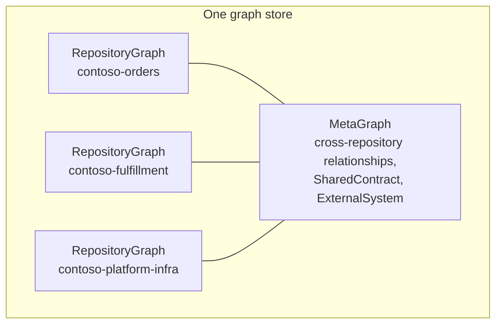

# MetaGraph: architecture across repositories

The MetaGraph connects independently analyzed repositories. Each repository keeps its own RepositoryGraph with its own facts; the MetaGraph adds only the relationships between them (shared topics, APIs one repository provides and another calls, message contracts, packages, infrastructure declared elsewhere), each with deterministic evidence. Matches that rest on a name alone are kept as unresolved, never linked.

## Why use it

Real systems are split across repositories: an API here, the Functions that consume its messages there, the Terraform that declares the shared Service Bus somewhere else. With the MetaGraph you can:

- see which repositories depend on which, and why (`vogoban connections`, `vogoban metagraph-topology`);
- trace a request or message across repository boundaries (`vogoban azure flow`, `vogoban paths`);
- run impact analysis that crosses repositories (`vogoban impact --scope all`, `vogoban repository-impact`);
- find every consumer of a message or API in the organization (`vogoban message-consumers`, `vogoban api-consumers`).

## How it fits together



- **Repository facts stay authoritative.** A repository's entities and relationships are written only by analyzing that repository. The MetaGraph never edits them.
- **Cross-repository facts live in separate tables**, with source and target repository, commit, graph version, evidence kinds, environment and the provenance of both sides.
- **Resolvers** group candidate facts by deterministic keys: packages, messages, deployments and images, APIs and service URLs, external systems, and Azure resources. A resolver recomputes only when its version changes or when one repository's relevant facts change.
- **Snapshots.** Every `metagraph build` records which graph version of each repository it used, so results are reproducible and `vogoban diff --meta` can compare builds.

Internals are in [MetaGraph architecture](../architecture/metagraph.md).

## Practical example: three Contoso repositories

The three sample repositories ship in the source distribution under `test/azure/fixtures/` (see [Azure end to end](azure-end-to-end.md) for how to prepare them):

| Repository | Contents |
|---|---|
| `contoso-orders` | React frontend, ASP.NET Core API publishing to the Service Bus topic `orders` in namespace `sb-contoso-orders`, Functions, Bicep |
| `contoso-fulfillment` | a .NET Function consuming `orders` through subscription `fulfillment` and publishing to `shipments` in namespace `sb-contoso-platform`, writing to Cosmos DB |
| `contoso-platform-infra` | Terraform declaring `sb-contoso-platform/shipments`, the `fulfillment` subscription on the orders topic, and the fulfillment Cosmos DB account |

The namespace each Function uses comes from its configuration:

```json
{
  "Values": {
    "OrdersBus__fullyQualifiedNamespace": "sb-contoso-orders.servicebus.windows.net",
    "PlatformBus__fullyQualifiedNamespace": "sb-contoso-platform.servicebus.windows.net"
  }
}
```

### Register, analyze, build

Use one store for the catalog. Here it is `meta/graph.db` next to the repositories:

```bash
cd ~/azure-demo
export VOGOBAN_DB=$PWD/meta/graph.db
vogoban register ./contoso-orders
vogoban register ./contoso-fulfillment
vogoban register ./contoso-platform-infra
vogoban analyze-all --log-level warn
vogoban metagraph build
```

```text
repository              status  commit        detail
----------------------  ------  ------------  --------------------------------------
contoso-fulfillment     READY   ff0892b62934  entities=177 relationships=277 1609ms
contoso-orders          READY   7e8f073b94c6  entities=553 relationships=1151 2614ms
contoso-platform-infra  READY   de6c5d18f1b3  entities=18 relationships=28 119ms
MetaGraph snapshot snap_5e6bf2577d73ca88c317a096
  contoso-fulfillment @ ff0892b62934 graph 64748c7ea129 [READY]
  contoso-orders @ 7e8f073b94c6 graph f079ef41fddb [READY]
  contoso-platform-infra @ de6c5d18f1b3 graph 7bfcbd44ac58 [READY]
category    state       relationships  unresolved  conflicts
----------  ----------  -------------  ----------  ---------
package     recomputed  12             0           0
message     recomputed  9              0           0
deployment  recomputed  0              0           0
api         recomputed  3              0           0
external    recomputed  4              0           0
azure       recomputed  17             0           0
```

`register` adds a repository to the catalog without analyzing it; `analyze-all` analyzes every registered repository from its path (a failure in one does not stop the others); `metagraph build` runs the cross-repository resolvers. `analyze-repo <repo>` re-analyzes a single one.

### Catalog status

```bash
vogoban repositories
```

```text
repository              status  identity                                                 commit        graph version  analyzed at               note
----------------------  ------  -------------------------------------------------------  ------------  -------------  ------------------------  ----
contoso-fulfillment     READY   local:…/contoso-fulfillment                              ff0892b62934  64748c7ea129   2026-10-11T17:04:42.916Z
contoso-orders          READY   local:…/contoso-orders                                   7e8f073b94c6  f079ef41fddb   2026-10-11T17:04:45.544Z
contoso-platform-infra  READY   local:…/contoso-platform-infra                           de6c5d18f1b3  7bfcbd44ac58   2026-10-11T17:04:45.732Z
```

| Status | Meaning |
|---|---|
| `REGISTERED` | in the catalog, never analyzed |
| `READY` | the analyzed commit matches the checkout |
| `STALE` | the checkout has moved on since the last analysis; run `analyze-repo` or `graph sync` |
| `UNAVAILABLE` | the local checkout is gone; the stored graph is still usable |
| `FAILED` | the last analysis failed; the previous graph is preserved |

### Cross-repository relationships

```bash
vogoban connections
```

```text
from                 relationship                  to                                              evidence               confidence  environment  evidence kinds
-------------------  ----------------------------  ----------------------------------------------  ---------------------  ----------  -----------  --------------------------------------
contoso-fulfillment  CONSUMES_REPOSITORY_CONTRACT  contoso-orders                                  STRUCTURALLY_RESOLVED  0.8         -            exact-resource-name, producer-consumer
contoso-fulfillment  DEPENDS_ON_REPOSITORY         contoso-orders                                  STRUCTURALLY_RESOLVED  0.8         -            infrastructure-declaration
contoso-fulfillment  DEPENDS_ON_REPOSITORY         contoso-platform-infra                          STRUCTURALLY_RESOLVED  0.8         -            infrastructure-declaration
contoso-fulfillment  USES_EXTERNAL_SYSTEM          cosmos-contoso-fulfillment.documents.azure.com  DECLARED               0.9         local        configuration-url
contoso-orders       USES_EXTERNAL_SYSTEM          cosmos-contoso-orders.documents.azure.com       DECLARED               0.9         local        configuration-url
contoso-fulfillment  CONSUMES_REPOSITORY_CONTRACT  contoso-orders                                  STRUCTURALLY_RESOLVED  0.6         -            namespace-name-version
contoso-fulfillment  SHARES_CONTRACT_WITH          contoso-orders                                  STRUCTURALLY_RESOLVED  0.6         -            namespace-name-version
```

Read each row as "from depends on to, because of these evidence kinds":

- `exact-resource-name, producer-consumer`: `contoso-orders` publishes to `sb-contoso-orders/orders` and `contoso-fulfillment` consumes from the same account-qualified name.
- `infrastructure-declaration`: a resource `contoso-fulfillment` uses is declared in another repository's IaC (the orders topic in Bicep, the shipments topic and Cosmos container in Terraform).
- `configuration-url`: a host named in configuration (`COSMOS_ENDPOINT`, `Cosmos__accountEndpoint`) identifies an external system; `environment` is `local` because it came from `local.settings.json`.
- `namespace-name-version`: both repositories define the message type `Contoso.Orders.Contracts.OrderSubmitted`.

```bash
vogoban metagraph stats
```

```text
repositories=3 snapshot=snap_5e6bf2577d73ca88c317a096 unresolved=0 conflicts=0
relationship                  count
----------------------------  -----
CONSUMED_BY                   2
CONSUMES_MESSAGE              2
CONSUMES_REPOSITORY_CONTRACT  2
CONTAINS                      11
DECLARED_BY                   4
DEPENDS_ON_REPOSITORY         2
PROVIDES_API                  3
PUBLISHES_MESSAGE             1
SHARES_CONTRACT_WITH          1
SHARES_RESOURCE               1
USES_EXTERNAL_SYSTEM          4
USES_SHARED_PACKAGE           12
evidence               count
---------------------  -----
DECLARED               16
EXACT                  3
STRUCTURALLY_RESOLVED  26
meta entity     count
--------------  -----
SharedContract  5
ExternalSystem  2
Database        0
unresolved category  count
-------------------  -----
```

A `SharedContract` groups the same contract seen from several repositories, for example the message `OrderSubmitted` or the Azure resource `sb-contoso-orders/orders`:

```bash
vogoban message-consumers OrderSubmitted
```

```text
Shared contract Contoso.Orders.Contracts.OrderSubmitted (namespace+name+version)  members: contoso-fulfillment:Contoso.Orders.Contracts.OrderSubmitted, contoso-orders:Contoso.Orders.Contracts.OrderSubmitted
  consumed by contoso-orders  STRUCTURALLY_RESOLVED 0.6 [consumer, namespace-name-version]
  consumed by contoso-fulfillment  STRUCTURALLY_RESOLVED 0.6 [consumer, namespace-name-version]
    handler contoso-fulfillment:Contoso.Fulfillment.Functions.FulfillmentFunctions.FulfillOrder(Contoso.Orders.Contracts.OrderSubmitted, System.Threading.CancellationToken)
    handler contoso-orders:Contoso.Orders.Functions.OrderFunctions.ProcessOrder(Contoso.Orders.Contracts.OrderSubmitted, System.Threading.CancellationToken)
```

```bash
vogoban metagraph-topology contoso-fulfillment
```

```text
contoso-fulfillment (downstream)
  contoso-orders  via DEPENDS_ON_REPOSITORY from contoso-fulfillment  STRUCTURALLY_RESOLVED 0.8 [infrastructure-declaration]
  contoso-platform-infra  via DEPENDS_ON_REPOSITORY from contoso-fulfillment  STRUCTURALLY_RESOLVED 0.8 [infrastructure-declaration]
  external cosmos-contoso-fulfillment.documents.azure.com (USES_EXTERNAL_SYSTEM)  DECLARED 0.9 env=local [configuration-url]
```

## Deterministic matching

Each resolver links two repositories only on an exact, deterministic key, and records the kind of evidence it used:

| Resolver | Matches on | Typical evidence kinds |
|---|---|---|
| Azure resources | account-qualified resource name and Azure kind (`service-bus-entity|sb-contoso-orders/orders`); a declaration must have an exact name and a known parent | `exact-resource-name`, `producer-consumer`, `infrastructure-declaration` |
| Messages | message namespace + name + version, or a shared contract package | `namespace-name-version`, `shared-contract-type`, `shared-contract-package` |
| APIs | OpenAPI operations and code-first operations by method and normalized route, plus HTTP-call hosts and service-URL configuration | `api-provider`, `http-call-host`, `service-url-configuration` |
| Packages | NuGet/npm package identity produced by one repository and referenced by another | `package-identity`, `package-reference` |
| Deployments | container image identity between a producing pipeline/Dockerfile and a deployment | `image-identity`, `producer-dockerfile` |
| External systems | hosts from configuration and connection strings | `configuration-url`, `connection-string-host` |

Rules that keep matches honest:

- **No bare names.** Two namespaces that both contain a topic called `orders` are two contracts. A consumer whose namespace is unknown links to neither.
- **No partial names.** Names that are settings, templates, partially resolved or empty never participate.
- **Route-only or name-only matches stay unresolved.** If an HTTP call matches a route in several repositories, or a name matches without a host, the candidate is recorded as unresolved with a reason, not linked.
- **Conflicts are recorded.** The same identity declared differently in two places is reported (for example `ambiguous-azure-declaration`), not overwritten.

### Example: what does not link

The identity fixtures in `test/azure/fixtures/identity/` contain a publisher writing to queue `orders` in namespace `sb-alpha`, a consumer of `orders` in `sb-alpha`, a consumer of `orders` in `sb-beta`, and a consumer of `orders` whose `local.settings.json` names no namespace. After registering all four and building the MetaGraph:

```bash
vogoban connections
```

```text
from            relationship                  to               evidence               confidence  environment  evidence kinds
--------------  ----------------------------  ---------------  ---------------------  ----------  -----------  --------------------------------------
consumer-alpha  CONSUMES_REPOSITORY_CONTRACT  publisher-alpha  STRUCTURALLY_RESOLVED  0.8         -            exact-resource-name, producer-consumer
```

Only `consumer-alpha` is linked. `consumer-beta` uses a different namespace, and the consumer with no namespace has a `partially-resolved` queue in its own graph (`vogoban azure messaging` shows it), so it never takes part in cross-repository matching.

### Unresolved and conflicting links

```bash
vogoban metagraph unresolved
vogoban metagraph conflicts
```

Unresolved MetaGraph candidates carry the resolver, category, source repository, target text and reason (for example `route-only-candidates`, `name-only-match`, `no-provider-in-catalog`, `operation-not-found-at-provider`). Treat them as "unknown", not "no dependency".

## Repository identity

Every entity id is derived from the repository identity, so identity decides whether two analyses describe the same repository.

| Source | Identity | Example |
|---|---|---|
| `vogoban.json` `repository.id` | `configured:<id>` | `configured:contoso-platform-infra` |
| Git remote `origin` | normalized URL (credentials stripped, lower case, no `.git`) | `github.com/contoso/contoso-platform-infra` |
| neither | `local:<absolute path>` | `local:/home/me/azure-demo/contoso-orders` |

The first one that applies wins. Pin identity and display name with `vogoban.json` at the repository root:

```json
{
  "repository": {
    "id": "contoso-platform-infra",
    "name": "platform-infra"
  }
}
```

```text
Registered contoso-platform-infra (e_b77f979ea37aab5587a16de3) identity=github.com/contoso/contoso-platform-infra status=REGISTERED
Registered platform-infra (e_1f5623b8175d9fe1a9151d81) identity=configured:contoso-platform-infra status=REGISTERED
```

The first line is a checkout with an `origin` remote; the second is a copy with the `vogoban.json` above.

### Rename behaviour

- **`local:` identity.** Moving or renaming the folder changes the identity. Analyzing the new path creates a new repository with new entity ids; the old catalog entry becomes `UNAVAILABLE` ("local checkout is not available; the stored graph is still usable"). Cross-repository links are rebuilt on the next `metagraph build`.
- **Remote or configured identity.** The folder can move freely; the identity and entity ids stay the same.

```text
repository              status       identity                          commit        graph version  analyzed at               note
----------------------  -----------  --------------------------------  ------------  -------------  ------------------------  -----------------------------------------------------------------
infra-c                 UNAVAILABLE  local:…/ident/infra-c             de6c5d18f1b3  9f3ed804b301   2026-10-11T17:19:52.059Z  local checkout is not available; the stored graph is still usable
infra-c2                READY        local:…/ident/infra-c2            de6c5d18f1b3  5d15d7079718   2026-10-11T17:19:52.659Z
platform-infra          READY        configured:contoso-platform-infra 50e557d34133  22fedb4a74f7   2026-10-11T17:11:19.400Z
```

Here `infra-c` was renamed to `infra-c2` (local identity, new repository), while `platform-infra` was also moved but kept its configured identity. For anything shared or long-lived, add a remote or pin `repository.id`.

Changing a configured `repository.id` or the remote URL is also a new identity. A Git checkout that Git can no longer read is refused rather than silently re-registered under a `local:` identity.

Details are in [Identity](../architecture/identity.md).

## Impact across repositories

Commands that accept `--scope` include MetaGraph relationships with `--scope meta` or `--scope all`. Steps that cross a repository boundary are marked `*`:

```bash
vogoban impact e_c27699a970fb60fc67831e43 --scope all
```

```text
impact of AzureResource Microsoft.ServiceBus/namespaces/topics:sb-contoso-orders/orders
  45 entities  levels: DIRECT=5 INDIRECT=4 POTENTIAL=18 TRANSITIVE=18  categories: API=1 CODE=14 CONTRACT=4 INFRASTRUCTURE=7 MESSAGE=9 REPOSITORY=2 SERVICE=8
  repositories: contoso-orders(28), contoso-fulfillment(10), contoso-platform-infra(3)  unresolved at boundary: 1  conflicts: 0
…
TRANSITIVE  SERVICE         AzureFunction Contoso.Fulfillment.Functions:FulfillOrder                          contoso-fulfillment     triggers                             <-DECLARED_BY* ->SUBSCRIBES_TO ->TRIGGERS
…
```

`vogoban repository-impact <repo>` summarizes what other repositories consume from one repository and runs impact on it:

```bash
vogoban repository-impact contoso-orders --limit 10
```

```text
Repository contoso-orders
  depends on (0)
  dependents (4): contoso-fulfillment, contoso-fulfillment, contoso-fulfillment, contoso-fulfillment
  provided APIs (3): Contoso.Orders.Api API, notifications API, Contoso.Orders.Functions API
  …
  shared contracts (1): contoso-fulfillment
  messages (2): OrderSubmitted, OrderSubmitted
  external systems (1): cosmos-contoso-orders.documents.azure.com
…
Blast radius: 74.1 (CRITICAL) - structural change exposure derived from graph reach; not a probability of failure
```

The `dependents` line lists one entry per cross-repository relationship, so the same repository can appear more than once. See [Impact analysis](impact-analysis.md) for how to read levels and scores.

## Keeping it current

- `vogoban graph sync --meta` updates one repository incrementally and then reconciles the MetaGraph.
- `vogoban metagraph build` recomputes only resolvers whose inputs changed; `--force` recomputes all.
- A MetaGraph failure after a successful repository sync leaves the previous MetaGraph snapshot unchanged.

## Limitations

- Repositories must be analyzed into the same store to be connected.
- A frontend in one repository calling an API hosted in Azure by another is linked only through API contract matching (method and route, OpenAPI, service URLs), not through Azure hosting.
- Aspire resource names are logical and never take part in cross-repository matching.
- Links reflect declarations in code, configuration and IaC. Values that exist only at deployment time (pipeline variables, portal settings) cannot be matched.
- Git submodules are not followed; register them as separate repositories.

## Related

- [Azure end to end](azure-end-to-end.md)
- [MetaGraph command reference](../cli/metagraph.md)
- [MetaGraph architecture](../architecture/metagraph.md), [Identity](../architecture/identity.md)
- [Impact analysis](impact-analysis.md)
