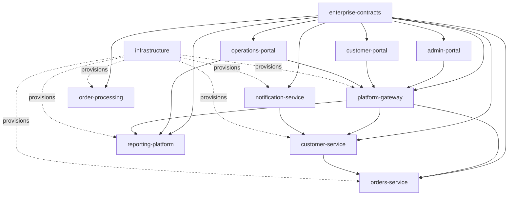
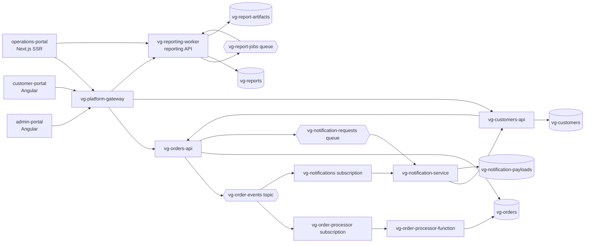
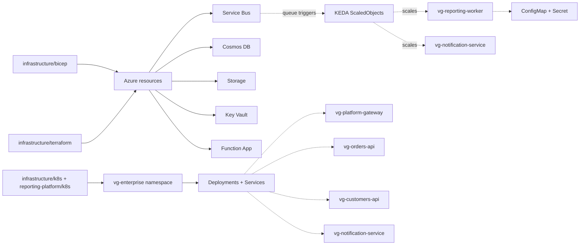
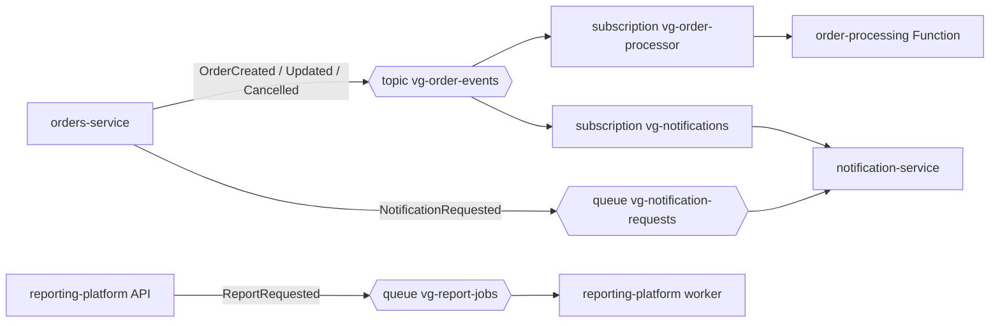

# vogoban-enterprise-landscape

A **multi-repository enterprise landscape** built as a MetaGraph testbed: eleven independently
analyzable repositories that share Azure resources, event contracts, an API gateway and an
infrastructure repository, connected by relationships that exist in source, configuration, contracts
and manifests.

It is not a sample application. Business logic is deliberately shallow everywhere; what is rich is
the connectivity between repositories.

## 1. What this landscape is

Eleven sibling repositories under one parent directory, each independently buildable, each with its
own README, build configuration and ownership metadata:

- **Two .NET microservice repositories** — `orders-service`, `customer-service`
- **One .NET API gateway repository** — `platform-gateway`
- **Two .NET worker repositories** — `notification-service`, `reporting-platform`
- **One Azure Functions repository** — `order-processing`
- **Three front-end repositories** — `admin-portal` and `customer-portal` (Angular),
  `operations-portal` (Next.js)
- **One infrastructure repository** — `infrastructure` (Bicep, Terraform, Kubernetes, environments)
- **One contract repository** — `enterprise-contracts` (C# library, npm package, JSON Schemas,
  AsyncAPI)

## 2. Why it contains multiple repositories

A single repository can show a RepositoryGraph. It cannot show a MetaGraph. The interesting
questions are all cross-repository — *what depends on this service across the organization*,
*which repositories share this Azure resource*, *what is the blast radius of changing this event
contract* — and answering them requires evidence that lives in more than one repository, in more
than one form, produced by more than one team.

So the landscape deliberately arranges for **one logical thing to be visible from several
independent repositories at once**. The `vg-order-events` Service Bus topic is not declared in a
single place: orders-service publishes to it, order-processing triggers on it,
notification-service subscribes to it, reporting-platform's queue sits beside it, the contracts
repository describes it in AsyncAPI, and the infrastructure repository provisions it. A resolver
that only reads one repository sees one fact; a resolver that reads all of them can federate the
identity.

### The evidence mechanisms

Names alone are weak evidence, so the landscape uses ten distinct mechanisms. Each is listed with
the file that carries it in section 6.

| # | Mechanism | What it proves |
|---|---|---|
| 1 | .NET `ProjectReference` | a repository compiles against the contract library |
| 2 | npm `file:` dependency | a portal imports the shared contract types |
| 3 | Runtime JSON Schema validation | a service actually loads and enforces a cross-repository schema |
| 4 | Typed `HttpClient` with a configured base URL | one backend calls another over HTTP |
| 5 | OpenAPI consumption by code generation | a portal's URLs are derived from the gateway's published contract |
| 6 | OpenAPI verification of downstream clients | the gateway's called paths must exist in the downstream specs |
| 7 | AsyncAPI over the messaging topology | the topic, subscriptions and queues are described once |
| 8 | Shared Azure resource identity | the same logical resource is referenced from several repositories |
| 9 | ARM resource ids and real attribute references | infrastructure links resources by identity, not by convention |
| 10 | Ownership metadata | every subject is attributed to a team and a domain |

## 3. Repository inventory

| Repository | Technology | Purpose | Key dependencies |
|---|---|---|---|
| `enterprise-contracts` | C# library, npm package, JSON Schema, AsyncAPI | The shared contract hub. DTOs, events, the topology constants, the schemas and the messaging document. | none |
| `platform-gateway` | ASP.NET Core | HTTP orchestration hub. Controllers and minimal APIs, three typed `HttpClient`s, OpenAPI, downstream contract verification. No Azure dependency. | enterprise-contracts, orders-service, customer-service, reporting-platform |
| `orders-service` | ASP.NET Core, Cosmos SDK, Service Bus SDK | Owns orders. Publishes `OrderCreated`, `OrderUpdated` and `OrderCancelled` to the topic. | enterprise-contracts, Service Bus, Cosmos |
| `customer-service` | ASP.NET Core, Cosmos SDK | Owns customers. `GET /customers/{id}/orders` calls the Orders API — the backend-to-backend edge. | enterprise-contracts, Cosmos, orders-service |
| `notification-service` | .NET hosted worker | Consumes the topic subscription and the notification queue; resolves preferences from customer-service. | enterprise-contracts, Service Bus, Storage, customer-service |
| `order-processing` | Azure Functions (isolated) | Service Bus trigger on the topic subscription, projecting order events into Cosmos. | enterprise-contracts, Service Bus, Cosmos |
| `reporting-platform` | .NET hosted worker + API, Kubernetes, KEDA | The KEDA-scaled report consumer, plus the reporting API the operations portal reads. | enterprise-contracts, Service Bus, Cosmos, Storage |
| `admin-portal` | Angular | Admin experience; calls the gateway and generates its API paths from the gateway's OpenAPI document. | platform-gateway, enterprise-contracts |
| `customer-portal` | Angular | Customer experience; a different gateway route family from the admin portal. | platform-gateway, enterprise-contracts |
| `operations-portal` | Next.js | Server-rendered operations experience; calls the gateway and the reporting platform on the server. | platform-gateway, reporting-platform, enterprise-contracts |
| `infrastructure` | Bicep, Terraform, Kubernetes | Names and provisions every logical resource the runtime repositories reference. | all runtime repositories |

## 4. Repository ownership

Ownership is recorded in two places: a Backstage-shaped `catalog-info.yaml` in every repository, and
a landscape-level catalog under `catalog/`.

| Repository | Team | Domain |
|---|---|---|
| `orders-service`, `order-processing` | `commerce-platform` | commerce |
| `customer-service` | `customer-platform` | customer |
| `notification-service` | `integration-platform` | notification |
| `reporting-platform` | `data-platform` | reporting |
| `platform-gateway`, `infrastructure` | `platform-engineering` | platform |
| `admin-portal`, `customer-portal`, `operations-portal` | `digital-experience` | experience |
| `enterprise-contracts` | `architecture-guild` | contracts |

`catalog/ownership.yaml` states the subject-to-owner edges explicitly, using the same
`component:` / `resource:` / `contract:` / `repository:` vocabulary as the `dependsOn` entries, so
the ownership graph and the dependency graph join on identical identifiers.

## 5. Architecture

### Repository topology



### Portals → gateway → services → messaging → workers



### Azure topology

```mermaid
flowchart TB
    subgraph RG[rg-vg-enterprise]
        SB[vg-enterprise-servicebus<br/>Service Bus namespace]
        Cosmos[vg-enterprise-cosmos<br/>Cosmos DB account]
        Storage[vgentstorage<br/>Storage account]
        KV[vg-enterprise-kv<br/>Key Vault]
        MI[vg-enterprise-identity<br/>managed identity]
        AI[vg-enterprise-appinsights]
        FA[vg-order-processor-function<br/>Function App]
        ACA[vg-enterprise-aca-env<br/>Container Apps]
    end

    SB --> Topic[vg-order-events topic]
    Topic --> SubProc[vg-order-processor subscription]
    Topic --> SubNotify[vg-notifications subscription]
    SB --> QNotify[vg-notification-requests queue]
    SB --> QReport[vg-report-jobs queue]

    Cosmos --> DB[vg-enterprise database]
    DB --> COrder[vg-orders]
    DB --> CCustomer[vg-customers]
    DB --> CReport[vg-reports]

    Storage --> BlobNotify[vg-notification-payloads]
    Storage --> BlobReport[vg-report-artifacts]

    KV --> SecretSB[vg-servicebus-connection]
    KV --> SecretCosmos[vg-cosmos-connection]
    KV --> SecretStorage[vg-storage-connection]

    FA --> SubProc
    FA --> COrder
    FA -. Key Vault reference .-> KV

    ACA --> CAGateway[vg-platform-gateway]
    ACA --> CAOrders[vg-orders-api]
    ACA --> CACustomers[vg-customers-api]
    ACA --> CANotify[vg-notification-service]

    MI -. role assignments .-> SB
    MI -. role assignments .-> Cosmos
    MI -. role assignments .-> Storage
    MI -. role assignments .-> KV
```



### MetaGraph topology — repositories federated by shared resources

```mermaid
flowchart TB
    subgraph Repos[Repositories]
        O[orders-service]
        P[order-processing]
        N[notification-service]
        R[reporting-platform]
        I[infrastructure]
        C[enterprise-contracts]
        G[platform-gateway]
        A[admin-portal]
        CP[customer-portal]
        OP[operations-portal]
        CU[customer-service]
    end

    subgraph Shared[Shared logical resources]
        Topic[vg-order-events]
        QReport[vg-report-jobs]
        QNotify[vg-notification-requests]
        CosmosOrders[vg-orders]
        CosmosCustomers[vg-customers]
        CosmosReports[vg-reports]
        Contracts[contracts/orders/order-created]
        GatewaySvc[vg-platform-gateway]
    end

    O --> Topic
    O --> CosmosOrders
    P --> Topic
    P --> CosmosOrders
    N --> Topic
    N --> QNotify
    R --> QReport
    R --> CosmosReports
    CU --> CosmosCustomers
    I --> Topic
    I --> QReport
    I --> QNotify
    I --> CosmosOrders
    I --> CosmosCustomers
    I --> CosmosReports

    O --> Contracts
    P --> Contracts
    N --> Contracts
    C --> Contracts

    A --> GatewaySvc
    CP --> GatewaySvc
    OP --> GatewaySvc
    G --> GatewaySvc
```



### Infrastructure topology



## 6. Cross-repository relationships

Every row is backed by a file. This is the fixture's answer key, not a claim about what an analyzer
will find.

### Contracts hub

| Consumer repository | Mechanism | Carrier |
|---|---|---|
| `orders-service` | C# `ProjectReference` + runtime schema validation | `src/Orders.Api/Orders.Api.csproj`, `Infrastructure/Contracts/ContractSchemaValidator.cs`, `appsettings.json` → `Contracts:SchemaRoot` |
| `customer-service` | C# `ProjectReference` | `src/Customers.Api/Customers.Api.csproj` |
| `platform-gateway` | C# `ProjectReference` | `src/PlatformGateway.Api/PlatformGateway.Api.csproj` |
| `notification-service` | C# `ProjectReference` + runtime schema validation | `Infrastructure/Contracts/ContractSchemaValidator.cs` |
| `order-processing` | C# `ProjectReference` + runtime schema validation | `Infrastructure/Contracts/ContractSchemaValidator.cs` |
| `reporting-platform` | C# `ProjectReference` + runtime schema validation | `Infrastructure/Contracts/ContractSchemaValidator.cs` |
| `admin-portal`, `customer-portal`, `operations-portal` | npm `file:` dependency + `import` | each `package.json` → `"@vg/enterprise-contracts": "file:../enterprise-contracts/typescript"` |

### Front ends → gateway

| Portal | Mechanism | Carrier |
|---|---|---|
| `admin-portal` | `HttpClient` through services whose path constants are generated from the gateway's OpenAPI document | `scripts/generate-api-client.mjs`, `src/environments/environment.ts` |
| `customer-portal` | same mechanism, different route family | `scripts/generate-api-client.mjs`, `src/environments/environment.ts` |
| `operations-portal` | server-side `fetch` in a `server-only` module | `src/lib/gateway-client.ts`, `GATEWAY_BASE_URL` |

### Gateway → services

| Gateway client | Downstream | Carrier |
|---|---|---|
| `IOrdersClient` | `orders-service` | `src/PlatformGateway.Api/Clients/OrdersClient.cs` + `appsettings.json` → `Services:Orders:BaseUrl` |
| `ICustomersClient` | `customer-service` | `Clients/CustomersClient.cs` + `Services:Customers:BaseUrl` |
| `IReportsClient` | `reporting-platform` | `Clients/ReportsClient.cs` + `Services:Reports:BaseUrl` |

### Backend → backend

| From | To | Carrier |
|---|---|---|
| `customer-service` | `orders-service` | `Clients/OrderSummaryClient.cs`, `Services:Orders:BaseUrl`, route `GET /api/customers/{id}/orders` |
| `notification-service` | `customer-service` | `Clients/CustomerPreferenceClient.cs`, `Services:Customers:BaseUrl`, route `GET /api/customers/{id}/preferences` |

### Messaging

| Publisher | Entity | Consumer |
|---|---|---|
| `orders-service` | topic `vg-order-events` | `order-processing` via subscription `vg-order-processor` |
| `orders-service` | topic `vg-order-events` | `notification-service` via subscription `vg-notifications` |
| `orders-service` | queue `vg-notification-requests` | `notification-service` |
| `reporting-platform` | queue `vg-report-jobs` | `reporting-platform` (worker), scaled by KEDA |

### Infrastructure → runtime

| Infrastructure artifact | Runtime identity it names |
|---|---|
| `infrastructure/bicep/modules/servicebus.bicep` | `vg-enterprise-servicebus`, `vg-order-events`, `vg-order-processor`, `vg-notifications`, `vg-notification-requests`, `vg-report-jobs` |
| `infrastructure/bicep/modules/cosmos.bicep` | `vg-enterprise-cosmos`, `vg-enterprise`, `vg-orders`, `vg-customers`, `vg-reports` |
| `infrastructure/bicep/modules/functionapp.bicep` | `vg-order-processor-function` with Key Vault-backed settings |
| `infrastructure/bicep/modules/containerapps.bicep` | `vg-platform-gateway`, `vg-orders-api`, `vg-customers-api`, `vg-notification-service` plus the `vg-notification-requests` scale rule |
| `infrastructure/k8s/` | namespace `vg-enterprise`, the platform ConfigMap and Secret, and Deployments for the four container-backed services |
| `reporting-platform/k8s/keda/reporting-scaledobject.yaml` | `vg-reporting-worker` scaled on queue `vg-report-jobs` |

## 7. Azure topology

Represented in Bicep and Terraform with real inter-resource references; nothing is deployed.

- **Service Bus** `vg-enterprise-servicebus` — topic `vg-order-events` with nested subscriptions
  `vg-order-processor` and `vg-notifications`, queues `vg-notification-requests` and `vg-report-jobs`.
- **Cosmos DB** `vg-enterprise-cosmos` — database `vg-enterprise` with containers `vg-orders`
  (`/customerId`), `vg-customers` (`/id`), `vg-reports` (`/reportType`).
- **Storage** `vgentstorage` — blob containers `vg-notification-payloads` and `vg-report-artifacts`.
- **Key Vault** `vg-enterprise-kv` — secrets `vg-servicebus-connection`, `vg-cosmos-connection`,
  `vg-storage-connection`, referenced with the real `@Microsoft.KeyVault(SecretUri=...)` syntax.
- **Managed identity** `vg-enterprise-identity` with Service Bus Data Sender, Service Bus Data
  Receiver, Cosmos DB Data Contributor, Storage Blob Data Contributor and Key Vault Secrets User.
- **Compute** — Function App `vg-order-processor-function`, and Container Apps for
  `vg-platform-gateway`, `vg-orders-api`, `vg-customers-api`, `vg-notification-service`.
- **Observability** — Log Analytics `vg-enterprise-logs` and Application Insights
  `vg-enterprise-appinsights`.

Terraform models the same estate with stable resource names (deliberately no random suffix, so the
names match what the runtime repositories reference) and real attribute references between
resources.

## 8. Messaging topology



`enterprise-contracts/asyncapi/vg-order-events.asyncapi.yaml` describes this topology as an AsyncAPI
2.6 document whose message schemas reference the JSON Schema files rather than restating them.

## 9. KEDA topology

| Trigger queue | ScaledObject | Workload | Carrier |
|---|---|---|---|
| `vg-report-jobs` | `vg-reporting-worker-scaledobject` | `vg-reporting-worker` Deployment | `reporting-platform/k8s/keda/reporting-scaledobject.yaml` |
| `vg-notification-requests` | `vg-notification-service-scaledobject` | `vg-notification-service` Deployment | `infrastructure/k8s/keda/` |

Both use the `azure-servicebus` trigger with a `TriggerAuthentication`
(`vg-enterprise-servicebus-auth`) using workload identity, and both `scaleTargetRef` the Deployment
of the same name. The reporting workload also appears in the Bicep Container Apps module as an
`azure-servicebus` scale rule, so the KEDA relationship exists in both the Kubernetes and the
infrastructure representations.

## 10. Contract topology

`enterprise-contracts` publishes one artifact per contract, and every consumer names it by the same
id, so the schema file is the single source of truth:

| Contract id | Schema | Consumed by |
|---|---|---|
| `orders/order-created` | `contracts/orders/order-created.schema.json` | orders-service (produces), order-processing, notification-service |
| `orders/order-updated` | `contracts/orders/order-updated.schema.json` | orders-service |
| `orders/order-cancelled` | `contracts/orders/order-cancelled.schema.json` | orders-service |
| `notifications/notification-requested` | `contracts/notifications/notification-requested.schema.json` | notification-service |
| `reporting/report-requested` | `contracts/reporting/report-requested.schema.json` | reporting-platform |

The contract repository validates its own consistency: its test project serializes a real instance of
every C# contract record and validates it against the published schema, and separately asserts that
every service, queue, container and account name appears in the TypeScript package, in the AsyncAPI
document and in the infrastructure repository. A rename cannot land in one representation without
failing the build.

## 11. MetaGraph test scenarios

The scenarios below are the ones the landscape was built to make answerable. **They have not been run —
see section 13.** Each row names the relationships a correct answer would traverse and the files that
carry them.

| Scenario | Expected traversal | Carried by |
|---|---|---|
| What depends on Orders Service? | platform-gateway, customer-service, admin-portal, customer-portal, operations-portal, order-processing, notification-service, infrastructure | typed HttpClients, `ProjectReference`, OpenAPI codegen, Bicep/Terraform |
| Which repositories publish or consume `OrderCreated`? | orders-service, order-processing, notification-service, enterprise-contracts | `ContractIds.OrderCreated`, `ServiceBusTrigger` attributes, `ServiceBusProcessor` registrations |
| Which repositories depend on Service Bus? | orders-service, notification-service, order-processing, reporting-platform, infrastructure | publisher, two processors, a trigger binding, Bicep and Terraform |
| Which repositories depend on Cosmos? | orders-service, customer-service, order-processing, reporting-platform, infrastructure | four container factories and both infrastructure representations |
| Which front ends eventually depend on Orders Service? | admin-portal, customer-portal, operations-portal → platform-gateway → orders-service | generated path constants, `Services:Orders:BaseUrl` |
| What infrastructure supports Orders Service? | orders-service → Service Bus topic + Cosmos container → infrastructure | module outputs, nested resources, attribute references |
| Who owns the components involved in `OrderCreated` processing? | orders-service and order-processing → commerce-platform; notification-service → integration-platform | `catalog-info.yaml`, `catalog/*.yaml` |
| What is the blast radius of changing the `vg-order-events` topic? | orders-service, order-processing, notification-service, reporting-platform (adjacent queue), enterprise-contracts, infrastructure | all six repositories name the topic |

## 12. How to analyze it with Vogoban

Analyze each repository independently, then federate:

```
platform-gateway/  orders-service/  customer-service/  notification-service/
order-processing/  reporting-platform/  admin-portal/  customer-portal/
operations-portal/  infrastructure/  enterprise-contracts/
```

Everything an analyzer needs is committed: project files, `appsettings.json`, `local.settings.json`,
`host.json`, `package.json`, `openapi/`, `contracts/`, AsyncAPI, Kubernetes manifests, Bicep modules
and Terraform resources. No repository needs a build artifact, a package restore or a deployed
resource to be analyzed, and no repository needs Azure to build.

> **No Vogoban CLI or Vogoban repository was reachable from the environment in which this landscape was
> built.** Nothing here is a guess about the CLI's interface, and no command is named. Run whatever
> entry point your Vogoban build exposes against each repository, federate them the way §28 of the
> brief describes, and compare the result against sections 6 and 11, which are written so they can be
> checked by inspection.

## 13. What is verified, and what is not

**Verified in this repository's build environment:**

- Every repository builds on its own (see each README and the landscape validation log).
- Bicep compiles, Terraform validates and formats clean, every Kubernetes manifest validates against
  published schemas including the `keda.sh` custom resources.
- The contract repository's tests prove the JSON Schemas and the C# records agree, and that the
  resource names in the C# constants, the npm package, the AsyncAPI document and the infrastructure
  repository agree.

**Not verified:**

- **The MetaGraph.** No Vogoban run was possible, so no cross-repository edge, no shared-resource
  correlation and no ownership query has been demonstrated. Sections 6 and 11 describe what the
  fixture provides, not what an analyzer found.
- **Nothing was deployed.** Bicep and Terraform were compiled and validated statically; no
  subscription, credential or resource group was used.
- **The portals were not driven in a browser** against a live gateway. Their evidence is a passing
  production build plus the generated API path constants.

**Known limitations, stated honestly:**

- The ownership catalog under `catalog/` uses a conventional shape. Whether it matches a schema
  Vogoban already recognizes is unverified — the per-repository `catalog-info.yaml` files use the
  Backstage software-catalog shape, which is the closest established standard available.
- Terraform uses fixed resource names instead of random suffixes. That is wrong for a real
  deployment and deliberate here, because name stability is what makes the cross-repository
  correlation testable.
- Service Bus and Cosmos connection strings are Key Vault references, so an application's link to a
  namespace or account is carried by a setting name rather than by an endpoint.
- Container and queue names are C# constants, configuration values and infrastructure literals that
  agree by convention; the contract repository's tests enforce that agreement, but the link itself is
  still a name, not a typed reference.
- **`Contracts:SchemaRoot` is a repository-relative path**, which is what makes the cross-repository
  schema reference visible to a static reader. It resolves only when the process working directory is
  the repository root: `dotnet run` uses the *project* directory, so `notification-service` pins
  `<RunWorkingDirectory>` and `reporting-platform` overrides the value in its launch profile. In a
  container or a Function App the schemas would have to be published alongside the application or the
  path overridden; `order-processing` has no working fix for this, because `func start` decides its own
  working directory and no Functions host is available here to verify a change.
- **`ConnectionStrings` entries are resolved by the hosting platform, not read by application code.**
  The `@Microsoft.KeyVault(SecretUri=...)` values are a real deployment setting that Azure Functions,
  App Service and Container Apps resolve, and the Key Vault → configuration relationship is what they
  carry, but no C# line in these repositories reads `ConnectionStrings:Cosmos` or its siblings.
- **Controller route templates are PascalCase** because every API uses `[Route("api/[controller]")]`,
  so the published OpenAPI documents spell `/api/Orders` and `/api/Customers` while the minimal APIs
  and the portals use lowercase. ASP.NET routing is case-insensitive, so both resolve to the same
  action — but an analyzer that compares route strings case-sensitively will see two route families
  where there is one. `platform-gateway/scripts/verify-downstream-contracts.mjs` reports this
  case-only difference explicitly rather than hiding it.
